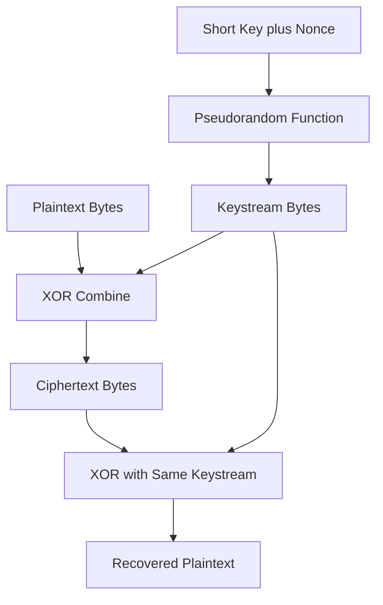

# Stream Ciphers and the Keystream: XOR as the Engine of Encryption

## English

A stream cipher does not chop plaintext into blocks. Instead it generates a long, pseudorandom sequence of bytes called a keystream, and combines it with the message one byte at a time using XOR (exclusive OR, a bitwise operation that outputs 1 when exactly one input bit is 1). The crucial property of XOR is reversibility: (P XOR K) XOR K = P. So the same operation both encrypts and decrypts, provided sender and receiver derive the identical keystream. This is why stream ciphers feel almost too simple: the whole security rests on the keystream being unpredictable and never reused.

Think of it like a one-time pad made practical. A true one-time pad uses a random key as long as the message, used exactly once, and is provably unbreakable. Stream ciphers imitate this by stretching a short key plus a nonce (a number used once) into a long keystream through a pseudorandom function. The result is not information-theoretically secure like a real pad, but it is computationally indistinguishable from random to anyone without the key. The keystream is deterministic given the key and nonce, so both sides can regenerate it independently without ever transmitting it.

The catastrophic failure mode is keystream reuse. If you encrypt two different messages with the same key and nonce, you produce C1 = P1 XOR K and C2 = P2 XOR K. XOR the two ciphertexts together and the keystream cancels: C1 XOR C2 = P1 XOR P2. An attacker now holds the XOR of two plaintexts, which leaks enormous structure, especially with natural language or known file headers. This exact mistake has broken real protocols, which is why nonce discipline is non-negotiable and why modern designs like ChaCha20 pair a counter with the nonce to guarantee each block of keystream is unique.

Modern stream ciphers are often built from block ciphers too. AES in counter mode (CTR) encrypts successive counter values to produce keystream, effectively turning a block cipher into a stream cipher. ChaCha20 is a dedicated stream cipher built from an ARX (add-rotate-XOR) design that is fast in software without hardware acceleration. Both are used inside AEAD constructions (authenticated encryption with associated data) that add a MAC (message authentication code) so tampering is detected, because raw XOR-based encryption is malleable: flipping a ciphertext bit flips the corresponding plaintext bit predictably.

The practical lesson is that XOR is the arithmetic of secrecy, but it is only as strong as the keystream discipline behind it. Treat the keystream like a one-time pad: never reuse it, never let it repeat, and always authenticate the ciphertext so an attacker cannot silently flip bits. In modern code you rarely touch XOR directly; you call an AEAD API like AES-GCM or ChaCha20-Poly1305, which handles keystream generation and integrity for you, precisely so these subtle failure modes stay out of reach.

## 中文

串流密碼（stream cipher）不會把明文切成區塊，而是產生一串又長又看似隨機的位元組，稱為金鑰串流（keystream），再用 XOR（互斥或，一種位元運算：當兩個輸入位元剛好一個是 1 時輸出 1）逐位元組與訊息結合。XOR 最關鍵的性質是可逆：(P XOR K) XOR K = P。所以同一個運算既能加密又能解密，前提是收發雙方推導出完全相同的金鑰串流。這正是串流密碼看似簡單得過分的原因：全部安全性都寄託在金鑰串流必須不可預測、且絕不重複使用。

可以把它想成「實用化的一次性密碼本」。真正的一次性密碼本（one-time pad）使用與訊息等長、只用一次的隨機金鑰，理論上可證明無法破解。串流密碼則用偽隨機函數，把短金鑰加上 nonce（只用一次的數值）拉長成金鑰串流來模仿它。結果雖然不像真正密碼本那樣具備資訊理論安全性，但對沒有金鑰的人而言，在計算上與隨機無法區分。金鑰串流在給定金鑰與 nonce 下是確定性的，所以雙方可以各自重新產生，完全不必傳輸它。

最災難性的失敗模式是金鑰串流重用。若你用同一把金鑰與同一個 nonce 加密兩則不同訊息，會得到 C1 = P1 XOR K 與 C2 = P2 XOR K。把兩段密文 XOR 起來，金鑰串流就抵消了：C1 XOR C2 = P1 XOR P2。攻擊者手上於是有兩段明文的 XOR，這會洩漏大量結構，對自然語言或已知的檔案標頭尤其致命。這個錯誤真實地破解過協議，所以 nonce 紀律不可妥協，而現代設計如 ChaCha20 會把計數器與 nonce 配對，確保每一段金鑰串流都獨一無二。

現代串流密碼也常由區塊密碼建構。AES 在計數器模式（CTR）下加密連續的計數值來產生金鑰串流，等於把區塊密碼變成串流密碼。ChaCha20 則是專門的串流密碼，採用 ARX（加、旋轉、XOR）設計，在沒有硬體加速的軟體環境中依然快速。兩者都常被包進 AEAD（帶關聯資料的認證加密）結構，額外加上 MAC（訊息認證碼）來偵測竄改，因為純 XOR 加密具有可延展性（malleability）：翻轉密文的某一位元，會可預測地翻轉對應的明文位元。

實務上的教訓是：XOR 是保密性的算術，但它的強度完全取決於背後的金鑰串流紀律。把金鑰串流當成一次性密碼本來對待：絕不重用、絕不讓它重複，並且一定要認證密文，讓攻擊者無法悄悄翻轉位元。在現代程式碼裡你很少直接碰 XOR，而是呼叫 AES-GCM 或 ChaCha20-Poly1305 這類 AEAD API，由它替你處理金鑰串流產生與完整性，正是為了讓這些微妙的失敗模式遠離你。

## Key Takeaway

Stream ciphers are XOR plus a never-reused pseudorandom keystream, and reusing that keystream instantly cancels it out and leaks plaintext structure.

## Related Concepts
- One-time pad
- XOR malleability

## Diagram

