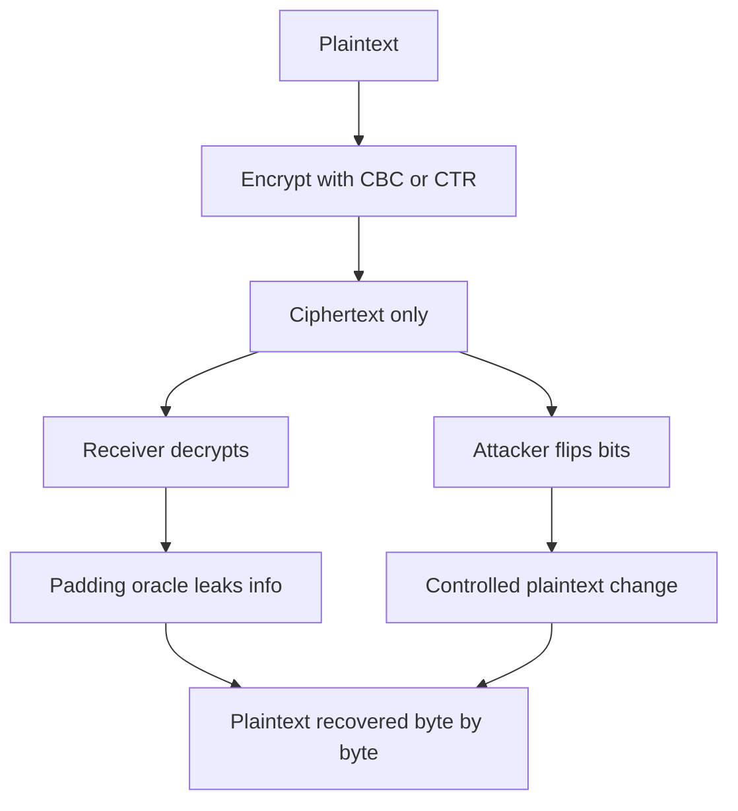

# Confidentiality Versus Integrity: Why Encryption Alone Is Not Enough

## English

People often assume that if data is encrypted, it is also safe from tampering. That is false. Encryption is designed to hide content, not to detect modification. Many classic modes, including AES in CBC or CTR mode without a MAC, are malleable: an attacker who cannot read the plaintext can still alter the ciphertext so that the decrypted plaintext changes in a controlled way. In CTR mode, flipping a bit in the ciphertext flips exactly the same bit in the plaintext, because XOR is linear. In CBC mode, flipping a bit in one ciphertext block corrupts that block but predictably flips a bit in the next block's plaintext. Confidentiality and integrity are separate guarantees, and you usually need both.

A vivid real-world example is the padding oracle attack against CBC mode. The receiver decrypts, strips padding, and if the padding is invalid it may respond differently (an error, a different timing, a different status code) than if the padding was valid. An attacker who can observe that difference can flip ciphertext bits, watch the oracle's reaction, and recover the plaintext one byte at a time, without ever breaking AES itself. The math was fine; the composition was wrong. This is why modern guidance says: never use raw CBC or CTR for new designs, use an AEAD (authenticated encryption with associated data) scheme.

AEAD schemes such as AES-GCM and ChaCha20-Poly1305 combine encryption with a MAC (message authentication code) over the ciphertext and any associated data (headers, routing info) that must stay in the clear but must not be altered. On decryption, the tag is verified first; if it fails, the ciphertext is rejected outright and no plaintext is ever returned. This ordering matters: releasing unverified plaintext, even briefly, reopens oracle-style attacks. The associated data feature is what lets you authenticate metadata like a packet header without encrypting it, which is essential in network protocols.

The deeper principle is that cryptographic primitives are building blocks, and security lives in how you compose them. Encrypt-then-MAC is the safe ordering: encrypt, then compute a MAC over the ciphertext, then transmit both. MAC-then-encrypt and encrypt-and-MAC have subtle weaknesses and have led to real breaks. The MAC must cover the ciphertext, not just the plaintext, so that any modification is caught before decryption is attempted. This is why the tag sits alongside the ciphertext and why nonce reuse or tag truncation is so dangerous.

For a practitioner, the takeaway is simple and strict: use a vetted AEAD library, never invent your own combination of cipher and MAC, and treat any decryption failure as a hard reject. If you find yourself writing code that decrypts first and checks something afterward, pause. That pattern is where integrity bugs breed. Confidentiality without integrity is like a sealed envelope with no tamper-evident seal: it hides the letter, but anyone can swap it out.

## 中文

很多人以為資料只要加密了就同時免於竄改，這是錯的。加密的目的是隱藏內容，不是偵測修改。許多經典模式（包括沒有 MAC 的 AES-CBC 或 AES-CTR）都具有可延展性（malleability）：攻擊者雖然讀不到明文，仍能改動密文，讓解密後的明文以可控方式改變。在 CTR 模式下，翻轉密文的某一位元，會剛好翻轉明文中同一位元，因為 XOR 是線性的。在 CBC 模式下，翻轉某個密文區塊的位元會弄壞該區塊，但會可預測地翻轉下一區塊明文中的某一位元。機密性與完整性是兩種不同的保證，通常兩者都需要。

一個鮮明的真實案例是針對 CBC 模式的填充預言攻擊（padding oracle attack）。接收方解密、去除填充，若填充無效，回應方式（錯誤、不同耗時、不同狀態碼）可能與填充有效時不同。能觀察到這個差異的攻擊者，就能翻轉密文位元、觀察預言的反應，逐位元組還原明文，完全不必破解 AES 本身。數學沒問題，是組合方式錯了。這就是為什麼現代指引說：新設計絕不要用裸的 CBC 或 CTR，要用 AEAD（帶關聯資料的認證加密）方案。

AES-GCM 與 ChaCha20-Poly1305 這類 AEAD 方案，會把加密與一個 MAC（訊息認證碼）結合起來，MAC 涵蓋密文以及任何必須保持明文、但絕不可被改動的關聯資料（標頭、路由資訊）。解密時會先驗證標籤；驗證失敗就整段拒絕，絕不吐出任何明文。這個順序很重要：即使只是短暫釋出未驗證的明文，都會重新打開預言式攻擊的大門。關聯資料這個功能，讓你能認證封包標頭這類中介資料而不必加密它，這在網路協議中不可或缺。

更深的原則是：密碼學原語只是積木，安全性存在於你如何組合它們。Encrypt-then-MAC 是安全的順序：先加密，再對密文計算 MAC，然後一起傳送。MAC-then-encrypt 與 encrypt-and-MAC 都有微妙弱點，並導致過真實的破解。MAC 必須涵蓋密文，而不只是明文，這樣任何改動都會在嘗試解密之前被攔下。這就是為什麼標籤要緊貼密文，也是為什麼 nonce 重用或標籤截斷如此危險。

對實作者而言，結論簡單而嚴格：使用經過審查的 AEAD 函式庫，絕不自己發明密碼與 MAC 的組合，並把任何解密失敗當成硬性拒絕。如果你發現自己在寫「先解密、再檢查某東西」的程式碼，先停下來。那個模式正是完整性漏洞滋生的地方。只有機密性而沒有完整性，就像一個沒有防拆封條的信封：它藏住了信，但任何人都能把它調包。

## Key Takeaway

Encryption hides content but does not detect tampering, so always pair it with authentication through a vetted AEAD scheme and reject any failed tag.

## Related Concepts
- Padding oracle attack
- Authenticated encryption

## Diagram

