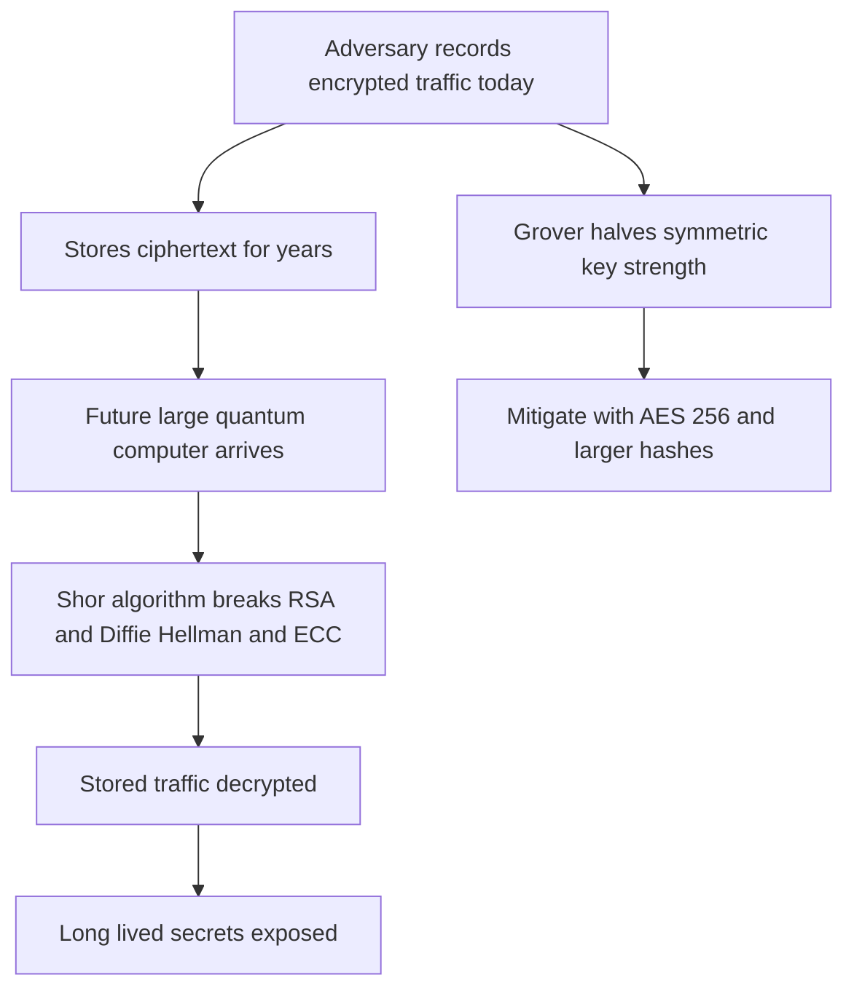

# Quantum Threats and Harvest-Now-Decrypt-Later: Preparing for the Post-Quantum Transition

## English

Most cryptography in use today rests on mathematical problems believed to be hard for classical computers: factoring large integers (RSA), computing discrete logarithms in finite fields or elliptic curves (Diffie-Hellman, ECDSA). In 1994 Peter Shor published an algorithm showing that a sufficiently large, fault-tolerant quantum computer could solve both problems efficiently. That would break RSA, Diffie-Hellman, and elliptic-curve schemes outright, not merely weaken them. The relevant caveat is scale: today's quantum machines are far too small and noisy to threaten real key sizes, but the trajectory is what drives planning.

The urgency comes from a threat model called harvest-now-decrypt-later. An adversary can record encrypted traffic today and store it, waiting for a future quantum computer to decrypt it. For data with a long confidentiality lifetime, such as medical records, state secrets, or long-lived backup archives, the effective deadline to migrate is not the day the quantum computer arrives but that day minus the data's required secrecy period. This is why standards bodies and governments have been pushing migration planning years before any practical attack exists.

Symmetric cryptography is in a much better position. Grover's algorithm gives a quadratic speedup for brute-force search, effectively halving the security level of a symmetric key: a 128-bit key behaves like 64 bits against a quantum brute-force attacker. The standard mitigation is simply to use larger keys, such as AES-256, which retains a comfortable margin. Hash functions similarly need larger outputs. The real crisis is in public-key cryptography, where the speedup is exponential rather than quadratic, and where the migration is genuinely hard because public keys are embedded everywhere: certificates, firmware, protocols, hardware tokens.

The response is post-quantum cryptography (PQC): new public-key schemes built on problems believed hard for both classical and quantum computers, such as lattice problems, code-based problems, and hash-based signatures. Standardization efforts have produced approved algorithms for key encapsulation and signatures — NIST's FIPS 203 (ML-KEM), FIPS 204 (ML-DSA) and FIPS 205 (SLH-DSA) were approved in 2024 — and hybrid modes that combine a classical algorithm with a post-quantum one are common during transition, so that security holds if either one survives. Hybrid key exchange in TLS is a concrete example: run both a classical and a post-quantum exchange and mix the results, so an attacker must break both.

The practical lesson for an undergraduate is that cryptographic agility is not academic. Systems must be designed so algorithms can be swapped without rewriting everything, keys and certificates must be inventoried, and long-lived data must be prioritized. The transition will take a decade or more because it touches hardware, standards, and deployed software simultaneously. Understanding why the threat is real even though the hardware is not yet here is the core insight: cryptography is a long game, and the planning horizon is measured in the lifetime of the secrets you are protecting.

## 中文

今日使用的密碼學大多建立在古典電腦難以解決的數學問題上：分解大整數（RSA）、在有限體或橢圓曲線上計算離散對數（Diffie-Hellman、ECDSA）。1994 年 Shor 發表了一個演算法，證明一臺足夠大且容錯的量子電腦可以有效率地解決這兩個問題。那會直接破解 RSA、Diffie-Hellman 與橢圓曲線方案，而不只是削弱它們。關鍵的但書是規模：今天的量子機器太小、太吵雜，還威脅不了真實的金鑰長度，但真正驅動規劃的是它的發展軌跡。

急迫感來自一種叫做「先收割、後解密」（harvest-now-decrypt-later）的威脅模型。對手可以今天就把加密流量錄下來儲存，等未來量子電腦出現再解密。對於機密壽命很長的資料，例如醫療紀錄、國家機密或長期備份檔案，實際的遷移期限不是量子電腦問世那天，而是那天再減去資料所需的保密年限。這就是為什麼標準機構與各國政府在實用攻擊出現前許多年，就一直在推動遷移規劃。

對稱密碼學的處境好得多。Grover 演算法對暴力搜尋只帶來平方級加速，等於把對稱金鑰的安全強度減半：128 位元金鑰在量子暴力攻擊者面前表現得像 64 位元。標準的緩解方式很簡單，就是使用更大的金鑰，例如 AES-256，仍保有舒適的餘裕。雜湊函式同樣需要更大的輸出。真正的危機在公鑰密碼學，那裡的加速是指數級而非平方級，而且遷移確實困難，因為公鑰無所不在：憑證、韌體、協議、硬體權杖。

回應之道是後量子密碼學（PQC）：建立在古典與量子電腦都難以解決之問題上的新公鑰方案，例如格問題、編碼問題與雜湊式簽章。標準化工作已為金鑰封裝（KEM）與簽章產生了正式的核准演算法——NIST 的 FIPS 203（ML-KEM）、FIPS 204（ML-DSA）與 FIPS 205（SLH-DSA）已於 2024 年核准——而過渡期間常見混合模式，把古典演算法與後量子演算法結合，只要其中一個存活，安全性就成立。TLS 中的混合金鑰交換就是具體例子：同時執行古典與後量子交換並混合結果，讓攻擊者必須同時破解兩者。

對大學生而言，實務上的教訓是：密碼學敏捷性不是學術空談。系統必須設計成演算法可以替換而不必全部重寫，金鑰與憑證必須被盤點，長期資料必須優先處理。這場遷移會花上十年以上，因為它同時牽動硬體、標準與已部署的軟體。理解「硬體尚未出現、威脅卻已真實」的道理是核心洞見：密碼學是一場長期賽局，規劃的時間尺度是以你所保護之秘密的壽命來衡量的。

## Key Takeaway

Quantum computers threaten public-key cryptography via Shor's algorithm, and harvest-now-decrypt-later means long-lived secrets need post-quantum migration planning today.

## Related Concepts
- Shor's algorithm
- Post-quantum cryptography

## Diagram

