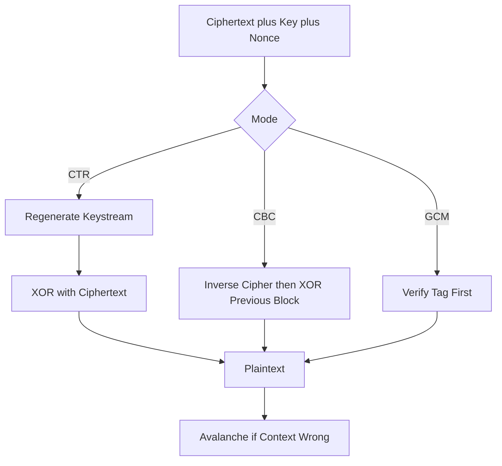

# The Decryption Side: How Ciphertext Becomes Plaintext Again

## English

Most explanations of cryptography focus on encryption — turning readable data into noise. It is worth walking the other direction, because decryption is where the real engineering constraints live. To decrypt, you must reconstruct the exact same key, the exact same algorithm state, and the exact same auxiliary values (an IV or nonce, a counter, a tag) that were used during encryption. If any single bit of that context is missing or wrong, the output is not 'slightly corrupted text' but total garbage — a property called avalanche, where a one-bit change in the key or input scrambles roughly half the output bits.

Consider a concrete example: a file encrypted with AES-256 in CTR mode. CTR turns a block cipher into a stream cipher by encrypting a sequence of counter values (nonce || counter) and XORing the result with the plaintext. To decrypt, you do not run the cipher backwards — AES itself is not invertible in the way people imagine; you simply regenerate the same keystream and XOR again, because XOR is its own inverse. This is why the nonce must never repeat under the same key: if it does, the same keystream gets reused, and XORing two ciphertexts together cancels the keystream entirely, leaking the XOR of the two plaintexts.

For block modes like CBC, decryption is genuinely a different operation: each ciphertext block is run through the inverse cipher, then XORed with the previous ciphertext block. That means decryption in CBC cannot be parallelised across blocks the way encryption can — a real performance consideration in disk encryption and streaming. Modern authenticated modes (GCM, ChaCha20-Poly1305) add another gate: the tag is verified before any plaintext is released, so a wrong key or tampered ciphertext produces an authentication failure rather than partial output. This is deliberate — releasing unverified plaintext invites padding-oracle attacks.

The practical lesson is that decryption is not a passive mirror of encryption. It is a separate code path with its own failure modes, its own performance profile, and its own security assumptions. Systems that treat 'decrypt' as an afterthought — for example, by ignoring tag-verification errors and using whatever plaintext came out — are the ones that end up in incident reports.

When you build or review a system, ask: where does the key come from at decryption time? Where does the nonce or IV come from, and is it stored alongside the ciphertext? Is the tag checked before or after the plaintext is used? These three questions catch a surprising share of real-world bugs.

## 中文

大部分密碼學的解釋都集中在加密——把可讀的資料變成雜訊。但其實值得反過來走一遍，因為解密才是真正工程限制所在。要解密，你必須重建出與加密時完全相同的金鑰、完全相同的演算法狀態，以及完全相同的輔助數值（IV 或 nonce、計數器、tag）。只要這份脈絡少了或錯了任何一個位元，輸出就不會是「稍微壞掉的字」，而是徹底的亂碼——這個性質叫做雪崩效應（avalanche），金鑰或輸入改一個位元，輸出大約一半的位元都會翻轉。

舉個具體例子：一個用 AES-256 的 CTR 模式加密的檔案。CTR 把區塊加密器變成串流加密器，做法是加密一連串計數器數值（nonce || counter），再把結果與明文做 XOR。要解密，你並不是把加密器反著跑——AES 本身不是大家想像中那樣可以「倒轉」；你只是重新產生同一條金鑰流（keystream），再 XOR 一次，因為 XOR 是自己的反運算。這就是為什麼同一把金鑰下 nonce 絕對不能重複：一旦重複，同一條金鑰流就被重用，把兩段密文 XOR 起來就會把金鑰流完全消掉，洩漏兩段明文的 XOR。

至於 CBC 這類區塊模式，解密真的是另一個操作：每個密文區塊先經過反加密器，再與前一個密文區塊 XOR。這代表 CBC 的解密不能像加密那樣跨區塊平行化——在磁碟加密與串流處理上是實實在在的效能考量。現代的認證模式（GCM、ChaCha20-Poly1305）還多一道閘門：tag 必須先驗證通過，才會釋出任何明文，所以錯金鑰或被篡改的密文會產生認證失敗，而不是部分輸出。這是刻意的設計——釋出未驗證的明文，等於邀請 padding-oracle 攻擊上門。

實務上的教訓是：解密不是加密的被動鏡像。它是一條獨立的程式路徑，有自己的失敗模式、效能特性與安全假設。把「解密」當成事後補上的系統——例如忽略 tag 驗證錯誤、照樣拿吐出來的明文去用——就是最後會出現在事故報告裡的那一批。

當你在建置或審查一個系統時，問三個問題：解密時金鑰從哪裡來？nonce 或 IV 從哪裡來，有沒有跟密文一起儲存？tag 是在明文被使用之前還是之後檢查？這三個問題能抓到相當比例的真實世界 bug。

## Key Takeaway

Decryption is a separate code path with its own failure modes: the key, nonce, and tag must be reconstructed exactly, and the tag must be verified before any plaintext is used.

## Related Concepts
- Block Ciphers and Modes of Operation
- Authenticated Encryption (AEAD)

## Diagram

