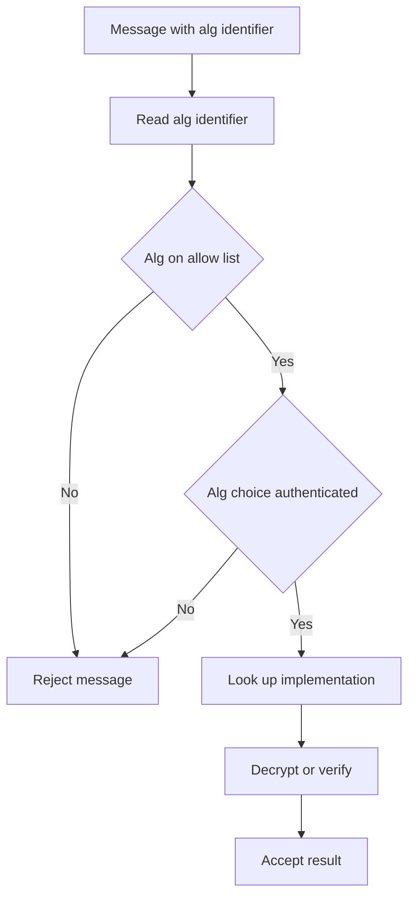

# Cryptographic Agility in Practice: Migrating Off a Broken Algorithm

## English

Cryptography is unusual among engineering disciplines in that 'working correctly today' is not evidence of safety tomorrow. Algorithms that were considered sound — MD5, SHA-1, RC4, DES, 3DES in many contexts — were later shown to be breakable, sometimes catastrophically. The lesson is not that cryptographers were careless; it is that security margins erode over decades as attack techniques improve and computing power grows. A system that hard-codes one algorithm is therefore a system with a built-in expiration date that nobody has written down.

Cryptographic agility means designing protocols and data formats so the algorithm can be swapped without redesigning everything above it. In practice this shows up as explicit algorithm identifiers in the protocol: TLS cipher-suite negotiation, JOSE headers with an 'alg' field, the 'cipher' field in an encrypted file header, or the algorithm OID in an X.509 certificate. The system reads the identifier, looks up the right implementation, and proceeds. When a new algorithm arrives, you add it to the registry and phase out the old one.

Agility is easy to claim and hard to get right, because the identifier itself becomes an attack surface. If an attacker can rewrite the 'alg' field, they can downgrade the system to 'none' or to a weak algorithm — this is exactly the class of vulnerability behind the famous JWT 'alg: none' issue and several TLS downgrade attacks. The fix is to authenticate the algorithm choice: it must be covered by the MAC or signature, and the receiver must reject any algorithm not on an explicit allow-list, never 'whatever the sender asked for'.

A second trap is that agility requires you to actually keep the old paths working during a transition, which means maintaining two implementations at once. That is a real cost, and it is why migrations often drag on for years — SHA-1 deprecation in certificate authorities took roughly a decade from first warnings to browsers refusing to accept the signatures. The organisations that handled it well had inventory of where each algorithm was used, the ability to roll out new configurations quickly, and monitoring to detect stragglers.

For a student building a project, the practical takeaway is simple: never write the algorithm name in more than one place. Put it in a small configuration layer, store it alongside the ciphertext or in the protocol header, and make the receiver validate it against an explicit list. Ten minutes of design now saves a painful migration later.

## 中文

密碼學在工程學科裡很特別：「今天運作正常」並不代表明天就安全。曾經被認為可靠的演算法——MD5、SHA-1、RC4、DES、以及許多情境下的 3DES——後來都被證明可被破解，有時還是災難級的破解。教訓不是密碼學家粗心，而是安全邊際會隨著攻擊技術進步與算力增長，在幾十年間逐步侵蝕。因此，把單一演算法寫死在程式裡的系統，就是一個沒有人寫下到期日的系統。

密碼學敏捷性（cryptographic agility）指的是把協定與資料格式設計成：演算法可以替換，而不必重新設計它上面的所有東西。實務上這會以協定裡明確的演算法識別碼出現：TLS 的 cipher-suite 協商、JOSE 標頭裡的 'alg' 欄位、加密檔案標頭裡的 'cipher' 欄位，或 X.509 憑證裡的演算法 OID。系統讀取識別碼，查出對應的實作，然後繼續。新演算法出現時，你把它加進註冊表，再把舊的淘汰。

敏捷性說起來容易，做對卻很難，因為識別碼本身會變成攻擊面。如果攻擊者能改寫 'alg' 欄位，就能把系統降級成 'none' 或某個弱演算法——這正是著名的 JWT「alg: none」問題與若干 TLS 降級攻擊的漏洞類型。解法是對演算法選擇本身做認證：它必須被 MAC 或簽章涵蓋，而且接收端必須拒絕任何不在明確允許清單上的演算法，絕不能「寄件者要什麼就給什麼」。

第二個陷阱是：敏捷性要求你在過渡期真的讓舊路徑繼續運作，也就是同時維護兩套實作。這是實實在在的成本，也是為什麼遷移常常拖上好幾年——憑證頒發機構的 SHA-1 淘汰，從最初警告到瀏覽器拒收簽章，大約花了十年。處理得好的組織，有清冊知道每個演算法用在哪裡、能快速推送新設定、也有監控找出落後的系統。

對正在做專案的學生，實務上的結論很簡單：永遠不要把演算法名稱寫在超過一個地方。把它放進一個小小的設定層，跟密文一起儲存或放在協定標頭裡，並讓接收端對照明確的清單驗證。現在花十分鐘設計，日後就省下一場痛苦的遷移。

## Key Takeaway

Design so the algorithm is a named, authenticated, allow-listed parameter rather than a hard-coded constant — and remember that the identifier itself must be protected against tampering.

## Related Concepts
- Public Key Infrastructure and the Chain of Trust
- Authenticated Encryption (AEAD)

## Diagram

