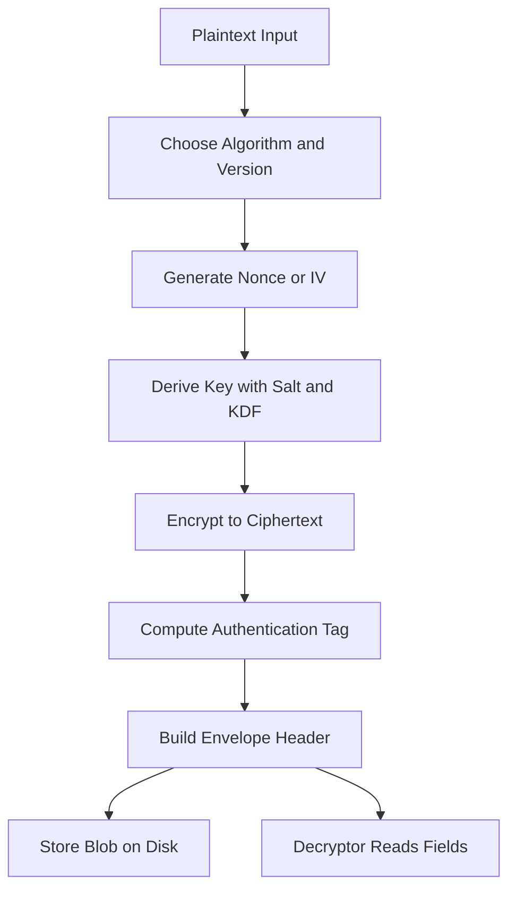

# Reading a Ciphertext Blob: What Is Actually Stored on Disk

## English

When you encrypt a file or a message, the output is rarely just the encrypted bytes. Real systems store a small structured envelope — sometimes called a container or header — alongside the ciphertext, containing everything the decryptor needs except the key itself. Learning to read that structure is one of the most useful practical skills in applied cryptography, because it tells you immediately whether a system was designed carefully or thrown together.

A well-designed envelope typically contains: a format version number, an algorithm identifier (for example, which cipher and which mode), the nonce or IV, the ciphertext, and the authentication tag. Some formats also include a salt if a key-derivation step is involved, and parameters for that KDF such as iteration count or memory cost. The header is usually authenticated — either by being fed into the AEAD as associated data, or by being covered by a separate MAC — so that an attacker cannot silently change the algorithm identifier or nonce without detection.

The critical rule is that the nonce and tag must travel with the ciphertext, because the decryptor cannot reconstruct them. This is why 'just encrypt the file and throw away the IV' is a bug: the data becomes permanently undecryptable. Equally, storing the nonce in a place the attacker can modify — without authenticating it — enables chosen-nonce attacks and, in some modes, keystream reuse.

A useful exercise is to open an encrypted archive (for example, an age-encrypted file, or the header of a LUKS volume, or a JWE in compact serialisation) and identify each field by name. You will see the pattern repeat: version, algorithm, parameters, nonce, ciphertext, tag. Once you can recognise that shape, unfamiliar formats become readable in minutes rather than hours, and you can spot the missing pieces — a format with no version number cannot be migrated; a format with no tag is not authenticated; a format that stores the nonce in a separate database is fragile.

For anyone building their own format, the practical advice is to be boring. Follow the structure of an existing, reviewed format rather than inventing one. Include a version byte from day one, even if you only have one version. Authenticate the header. And write down, in a comment or a spec, exactly which bytes are which — future you, six months from now, will not remember.

## 中文

當你加密一個檔案或訊息，輸出很少只是那些加密後的位元。真實的系統會在密文旁邊存一個小小的結構化信封——有時叫容器或標頭——裡面包含解密者需要的一切，只差金鑰本身。學會讀懂這個結構，是應用密碼學裡最實用的技能之一，因為它能立刻告訴你：這個系統是仔細設計過的，還是隨便拼湊出來的。

設計良好的信封通常包含：格式版本號、演算法識別碼（例如用哪個加密器、哪個模式）、nonce 或 IV、密文，以及認證 tag。有些格式還包含 salt（若涉及金鑰衍生步驟），以及該 KDF 的參數，例如迭代次數或記憶體成本。標頭通常會被認證——要麼當作關聯資料（associated data）餵進 AEAD，要麼由另一個 MAC 涵蓋——這樣攻擊者就不能悄悄改掉演算法識別碼或 nonce 而不被發現。

關鍵規則是：nonce 與 tag 必須跟密文一起傳遞，因為解密端無法自行重建它們。這就是為什麼「把檔案加密完就把 IV 丟掉」是個 bug：資料會變成永久無法解密。同樣地，把 nonce 存在攻擊者能改的地方、又沒有對它做認證，就會招來選定 nonce 攻擊，在某些模式下甚至造成金鑰流重用。

一個很有用的練習：打開一個加密壓縮檔（例如 age 加密的檔案、LUKS 磁碟區的標頭、或 compact 序列化的 JWE），逐一把每個欄位認出來。你會看到同樣的模式重複出現：版本、演算法、參數、nonce、密文、tag。一旦你能認出這個形狀，陌生的格式幾分鐘就能讀懂，而不是幾小時，而且你能一眼看出缺了什麼——沒有版本號的格式無法遷移；沒有 tag 的格式沒有認證；把 nonce 存在另一個資料庫的格式很脆弱。

對於要設計自己格式的人，實務建議是：無聊一點。照著一個已經被審查過的既有格式結構走，不要自己發明。從第一天就加一個版本位元組，即使你只有一個版本。對標頭做認證。並且在註解或規格裡寫清楚哪個位元組是什麼——半年後的你絕對不會記得。

## Key Takeaway

An encrypted blob is a structured envelope — version, algorithm, parameters, nonce, ciphertext, tag — and being able to read that structure tells you instantly whether the design is sound.

## Related Concepts
- Envelope Encryption, Key Rotation, and Key Management
- Initialization Vectors and Nonces

## Diagram

