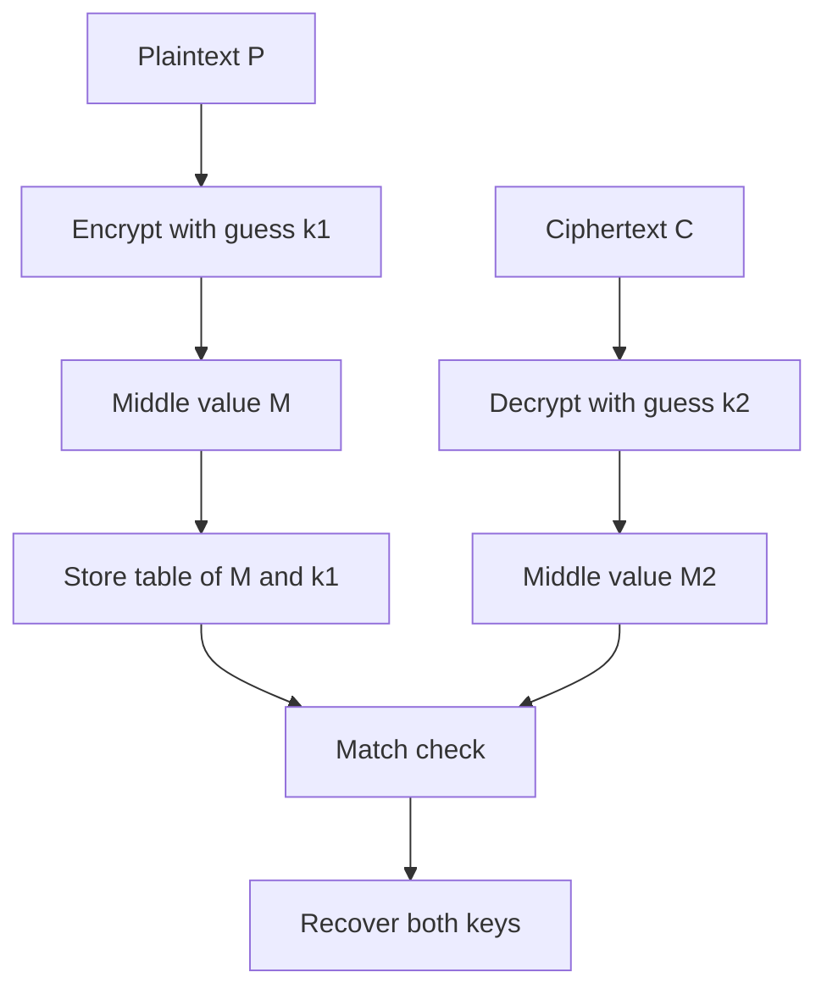

# Meet-in-the-Middle Attacks: Why Double Encryption Is Not Twice as Strong

## English

A natural intuition says that encrypting a message twice with two different keys must be at least twice as hard to break. That intuition is wrong, and the reason is one of the most elegant ideas in cryptanalysis: the meet-in-the-middle attack.

Consider double encryption: ciphertext C = E_k2(E_k1(P)), where P is the plaintext and E is a block cipher. A brute-force attacker who wants to recover both keys would naively try every pair (k1, k2), which costs 2^n × 2^n = 2^(2n) work for n-bit keys. But the attacker can split the problem. She guesses k1, encrypts the plaintext forward to get a middle value M = E_k1(P), and stores every (M, k1) pair in a giant table. Then she guesses k2, decrypts the ciphertext backward to get M' = D_k2(C), and checks whether M' appears in the table. A match reveals both keys at once.

The cost drops to roughly 2^n encryptions plus 2^n decryptions, plus a table of 2^n entries — about 2^(n+1) work and 2^n memory, instead of 2^(2n). For 128-bit keys that is the difference between an impossible 2^256 and a merely very expensive 2^129. The attack does not break the cipher; it exploits the structure of composing two independent keys. This is exactly why the classic 3DES construction uses three keys with an encrypt-decrypt-encrypt pattern (EDE) rather than simply stacking two AES calls, and why nobody recommends "AES-256 twice" as a way to get "AES-512 security."

The deeper lesson is that cryptographic strength does not compose additively. Every layer you add must be analysed as a whole system, not as independent walls. Meet-in-the-middle is a space-time tradeoff on the key search — it buys memory with time, halving the exponent of the work at the price of a table — and it is not the source of the 2^64 birthday bound on block ciphers. That bound comes from the birthday paradox applied to the 2^128 block space: finding two colliding inputs among 2^128 possible blocks takes about 2^64 attempts, so a 128-bit block cipher offers roughly 64 bits of collision resistance regardless of how long its key is. Because encryption under a fixed key is a permutation of the block space, distinct plaintext blocks never produce colliding ciphertexts; the birthday bound is about finding colliding inputs, and it derives from the block size rather than the key length. Reducing the search space by splitting the problem is a recurring theme in cryptanalysis, and recognising it stops you from building schemes that feel stronger than they are.

## 中文

直覺上，用兩條不同的金鑰將訊息加密兩次，破解難度理應至少翻倍。這個直覺是錯的，而原因正是密碼分析中最優雅的構想之一：中間相遇攻擊（meet-in-the-middle attack）。

設想雙重加密：密文 C = E_k2(E_k1(P))，其中 P 是明文，E 是分組密碼。想同時還原兩條金鑰的暴力攻擊者，天真地會嘗試每一對 (k1, k2)，對 n 位元金鑰而言需要 2^n × 2^n = 2^(2n) 次運算。但攻擊者可以把問題拆開。她先猜 k1，將明文向前加密得出中間值 M = E_k1(P)，並把每一對 (M, k1) 存入一張巨型表。然後她猜 k2，將密文向後解密得出 M' = D_k2(C)，再檢查 M' 是否出現在表中。一旦吻合，兩條金鑰便同時曝光。

成本因此降至大約 2^n 次加密加 2^n 次解密，再加一張 2^n 項的表——約 2^(n+1) 次運算與 2^n 記憶體，而非 2^(2n)。對 128 位元金鑰來說，這是「不可能的 2^256」與「只是非常昂貴的 2^129」之間的差別。這個攻擊並沒有破解密碼本身，而是利用了「組合兩條獨立金鑰」這個結構。這正是經典的 3DES 採用三條金鑰、以加密—解密—加密（EDE）模式運作，而非單純疊兩次 AES 的原因，也是為何沒有人建議用「AES-256 做兩次」來換取「AES-512 等級的安全性」。

更深的教訓是：密碼強度不會以加法方式疊加。你加的每一層都必須當成整體系統來分析，而不是各自獨立的牆。中間相遇攻擊是針對金鑰搜尋的時間—空間取捨——它用記憶體換時間，以儲存空間為代價把運算量的指數減半——而它並不是分組密碼 2^64 生日界限的來源。那個界限來自生日悖論應用在 2^128 的分組空間上：在 2^128 個可能分組之中找到兩個碰撞輸入，大約需要 2^64 次嘗試，所以一個 128 位元分組密碼無論金鑰多長，都只提供大約 64 位元的碰撞抗性。由於固定金鑰下的加密是分組空間上的一個置換（permutation），不同的明文區塊永遠不會產生碰撞的密文；生日界限講的是找到碰撞輸入，而它源自分組長度而非金鑰長度。透過拆解問題來縮小搜尋空間，是密碼分析中反覆出現的主題；認清這一點，可避免你建構出「感覺比實際更強」的方案。

## Key Takeaway

Double encryption with independent keys adds only about one extra bit of security against meet-in-the-middle attacks, because the search space can be split rather than multiplied.

## Related Concepts
- Birthday bound on block ciphers
- Triple DES and EDE construction

## Diagram

