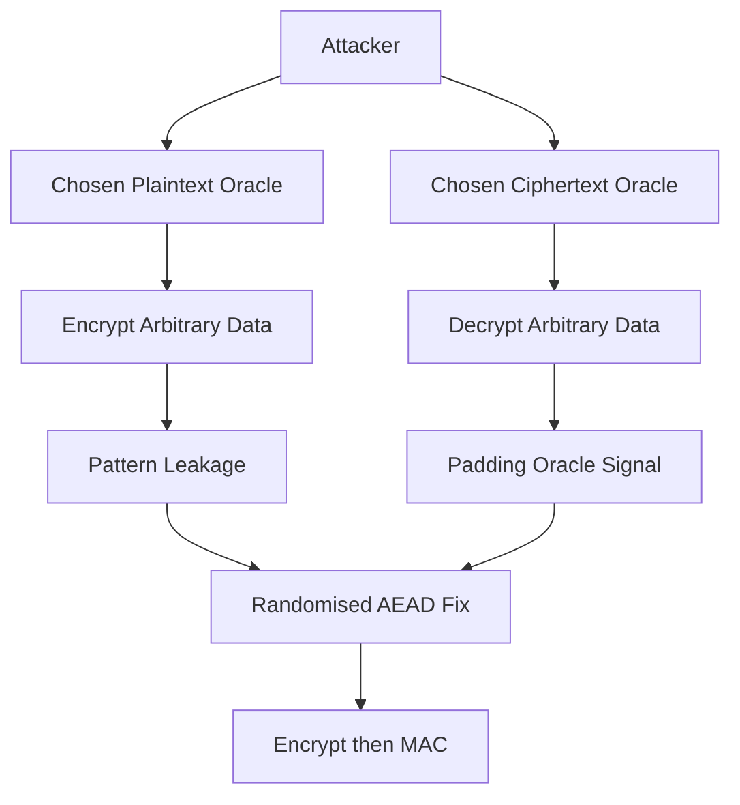

# Chosen-Plaintext and Chosen-Ciphertext Attacks: The Attacker Who Can Ask Questions

## English

Textbook descriptions of encryption often imagine an attacker who only sees a ciphertext and must guess the key. Real attackers are far more powerful: they can often get the defender's system to encrypt or decrypt messages of their choosing, and observe the results. These capabilities define the standard threat models of modern cryptography.

In a chosen-plaintext attack (CPA), the attacker can submit arbitrary plaintexts and receive their ciphertexts under the secret key. This is not exotic — any web service that encrypts user-supplied data hands the attacker this power for free. A cipher that is only secure against a passive eavesdropper but leaks patterns under CPA is called malleable or non-CPA-secure; deterministic encryption (same input, same output) fails here because the attacker can simply compare ciphertexts. The fix is randomised encryption with a fresh nonce or IV per message, so identical plaintexts look different. This is why AEAD schemes like AES-GCM are designed to be CPA-secure by construction.

A chosen-ciphertext attack (CCA) is stronger still: the attacker can also submit ciphertexts to a decryption oracle and learn whether they decrypt successfully, or what they decrypt to. Padding oracle attacks are the classic example — a server that reveals "bad padding" versus "bad MAC" gives the attacker a yes/no signal that can be exploited byte by byte. CCA security is the gold standard for modern encryption, and it is achieved by combining encryption with a message authentication code in the right order (encrypt-then-MAC) or by using an AEAD mode that ties the tag to the ciphertext. The tag ensures any tampered ciphertext is rejected before decryption is attempted, so the attacker never receives the oracle signal.

The practical takeaway is that "encryption" is not a single property. You must ask: secure against what? A scheme can be perfectly unbreakable against an eavesdropper yet trivially broken by someone who can submit one crafted ciphertext. When you read a cryptographic specification, look for the words IND-CPA or IND-CCA2 — these are formal security notions, and they tell you exactly which attacks the design has been proven to resist.

## 中文

教科書式的加密描述，往往設想攻擊者只看到密文，然後要猜出金鑰。真實的攻擊者強大得多：他們經常能令防禦方的系統加密或解密自己選定的訊息，並觀察結果。這些能力定義了現代密碼學的標準威脅模型。

在選擇明文攻擊（chosen-plaintext attack, CPA）中，攻擊者可提交任意明文，並取得以其秘密金鑰加密後的密文。這並不罕見——任何會加密使用者資料的網路服務，都等於免費把這項能力交給攻擊者。一個只對被動竊聽者安全、但在 CPA 下會洩漏模式的密碼，稱為可延展（malleable）或不具 CPA 安全性；確定性加密（相同輸入、相同輸出）在此必然失敗，因為攻擊者只要比對密文即可。解法是為每則訊息使用全新的 nonce 或 IV 來隨機化加密，令相同明文看起來不同。這正是 AES-GCM 等 AEAD 方案在設計上就具備 CPA 安全性的原因。

選擇密文攻擊（chosen-ciphertext attack, CCA）更強：攻擊者還能把密文送進解密預言機，得知它能否成功解密，或解密出什麼。填充預言機攻擊（padding oracle attack）是經典例子——伺服器若分別回報「填充錯誤」與「MAC 錯誤」，就等於給了攻擊者一個是／否訊號，可逐位元組加以利用。CCA 安全性是現代加密的黃金標準，做法是以正確次序把加密與訊息認證碼結合（先加密後認證，encrypt-then-MAC），或採用會把標籤綁定到密文的 AEAD 模式。標籤確保任何被篡改的密文在嘗試解密之前就被拒絕，攻擊者因此永遠收不到預言機訊號。

實務上的結論是：「加密」不是單一性質。你必須問：對抗什麼？一個方案可以對竊聽者完全牢不可破，卻被一個能提交單一精心構造密文的人輕易攻破。當你閱讀密碼規格時，留意 IND-CPA 或 IND-CCA2 這些字眼——它們是正式的安全概念，明確告訴你該設計已被證明能抵抗哪些攻擊。

## Key Takeaway

Modern encryption must be secure not just against eavesdroppers but against attackers who can request encryptions and decryptions, which is why randomised encryption and authenticated modes matter.

## Related Concepts
- Padding oracle attacks
- IND-CPA and IND-CCA security notions

## Diagram

