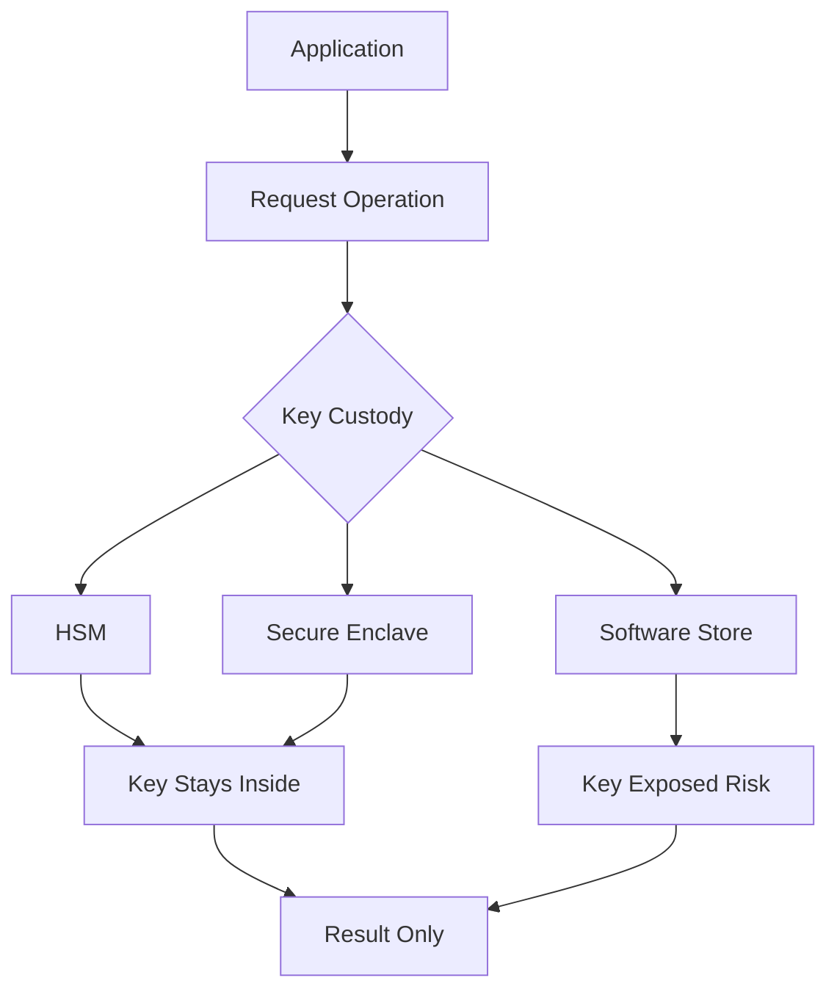

# Key Custody in Practice: Hardware Security Modules, Secure Enclaves, and the Limits of Software

## English

You can choose the strongest algorithm in the world and still lose everything if the key sits in a plaintext file on disk. Cryptography ultimately reduces to one question: who can read the key? Key custody — the discipline of storing, using, and retiring keys so that no unauthorised party ever sees them — is where most real-world breaches actually happen.

A hardware security module (HSM) is a tamper-resistant appliance designed to generate and hold keys internally. Keys are created inside the device and, by design, never leave it in plaintext; applications send data to the HSM for encryption or signature operations and receive only the results. If an attacker compromises the server, they get no key — just an API that will refuse to perform operations they are not authorised for. HSMs also enforce policies (which key can be used for what), log every operation, and often zeroise their memory if tampering is detected. Cloud providers offer HSM-backed key management services with similar guarantees, though the trust boundary shifts from your data centre to the provider's.

A trusted execution environment (TEE) or secure enclave takes a different approach: it carves out a protected region of the main CPU where code and data are isolated from the rest of the operating system, even from a compromised kernel. Keys can be unsealed only inside the enclave, and memory is encrypted as it leaves the CPU. This is cheaper and more flexible than an HSM, but the security model is subtly different — you are trusting the CPU vendor's implementation and its attestation chain, and side-channel attacks against enclaves have been demonstrated repeatedly. Neither approach is magic; both shift trust rather than eliminate it.

For most systems, the pragmatic answer is envelope encryption backed by a managed key service: a master key lives in the HSM or key service, and per-object data keys are wrapped by it. Key rotation then becomes a matter of re-wrapping data keys rather than re-encrypting petabytes. Whatever the mechanism, the design principle is the same: minimise the number of places a plaintext key can exist, make every use auditable, and assume that any key which touches general-purpose memory is at risk. The algorithm is rarely the weak link — the key's custody almost always is.

## 中文

你可以選用世上最強的演算法，但只要金鑰以明文檔案留在磁碟上，一切仍可能付諸流水。密碼學最終歸結為一個問題：誰能讀取金鑰？金鑰保管（key custody）——即儲存、使用與淘汰金鑰，使任何未獲授權者永遠看不到金鑰的紀律——正是現實世界大多數資料外洩真正發生的地方。

硬體安全模組（hardware security module, HSM）是一種防篡改的裝置，設計用來在內部產生並保存金鑰。金鑰在裝置內誕生，且按設計永遠不會以明文離開；應用程式把資料送進 HSM 進行加密或簽章運算，只取回結果。若攻擊者攻陷了伺服器，他們拿不到金鑰——只得到一個會拒絕執行未授權操作的 API。HSM 亦會強制執行政策（哪條金鑰可用於什麼用途）、記錄每一項操作，並常在偵測到篡改時把記憶體清零。雲端供應商提供具備類似保證、由 HSM 支援的金鑰管理服務，只是信任邊界由你的機房轉移到供應商。

可信執行環境（trusted execution environment, TEE）或安全隔離區（secure enclave）則走另一條路：它在主 CPU 中劃出一塊受保護的區域，令程式碼與資料與作業系統其餘部分隔離，甚至連被攻陷的核心也無法觸及。金鑰只能在隔離區內解封，記憶體離開 CPU 時會被加密。這比 HSM 便宜且更有彈性，但安全模型有微妙差異——你信任的是 CPU 廠商的實作及其認證鏈，而針對隔離區的側通道攻擊已被多次展示。兩種方法都不是魔法；它們只是轉移信任，而非消除信任。

對多數系統而言，務實的答案是：以受管理的金鑰服務為後盾，採用信封加密。主金鑰存於 HSM 或金鑰服務中，每個物件的資料金鑰則由它包裝。如此一來，金鑰輪換就變成重新包裝資料金鑰，而不必重新加密數以 PB 計的資料。無論採用哪種機制，設計原則都一樣：盡量減少明文金鑰可能存在的地方、令每次使用都可稽核，並假設任何接觸到一般用途記憶體的金鑰都有風險。演算法很少是弱點——金鑰的保管幾乎永遠才是。

## Key Takeaway

The security of an encryption scheme is ultimately bounded by how well its keys are protected, which is why HSMs, secure enclaves, and envelope encryption exist.

## Related Concepts
- Envelope encryption
- Hardware security modules

## Diagram

