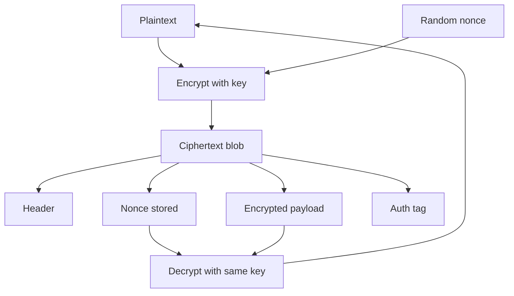

# The Anatomy of a Ciphertext: Why Encrypting the Same File Twice Looks Different

## English

When you encrypt the same message twice with the same key, you almost never get the same bytes back. That surprises people, because a deterministic function like AES, fed the same input and key, should produce the same output. The resolution is that a real encryption scheme never feeds just the plaintext and key into the cipher: it also feeds in a per-message random value called a nonce or initialisation vector (IV). The nonce is stored alongside the ciphertext, usually as a prefix, so the decryptor can read it back and re-run the cipher in the same starting state. Because the nonce changes every time, the keystream or the initial cipher block changes too, and the whole output diverges after the first block.

This is why a ciphertext blob on disk typically has a structure: a small header identifying the algorithm and its parameters, then the nonce (commonly 12 bytes for AES-GCM or ChaCha20-Poly1305), then the encrypted payload, and finally an authentication tag (16 bytes for GCM) that lets the decryptor detect tampering. None of those bytes are secret in themselves; the nonce and tag can be public. What matters is that the nonce is never reused with the same key. If you encrypt two messages under the same key with the same nonce in a stream cipher or in GCM, the attacker can XOR the two ciphertexts together and the keystream cancels out, leaving the XOR of the two plaintexts. That leaks the relationship between the messages, and in GCM it can leak the authentication key entirely.

So the nonce is not decoration; it is the thing that makes the ciphertext look random even when the plaintext is predictable. A file containing 'yes' or 'no' encrypted under a fixed key with a fixed nonce would produce identical ciphertexts every time, which immediately tells an eavesdropper the answer. With a fresh random nonce each time, the ciphertext is indistinguishable from random noise to anyone without the key. The trade-off is that random nonces must be large enough that collisions are astronomically unlikely; 96 random bits is the standard choice for GCM, giving you a birthday-bound safety margin of roughly 2^48 messages per key before collisions become a real concern.

A practical consequence: never hard-code a nonce, never derive it from a counter that can reset, and never reuse a nonce across processes that share a key. If you cannot guarantee uniqueness, switch to a construction that derives the nonce from a message counter or use a scheme designed for it. The rule of thumb is simple: the key is secret and long-lived, the nonce is public and unique per message, and the tag is public and proves nothing was tampered with. Get those three roles right and the ciphertext will look different every time even for identical inputs, which is exactly the property you want.

## 中文

當你用同一條金鑰加密同一段訊息兩次，幾乎永遠不會得到同一串位元組。這令人意外，因為像 AES 這類確定性函數，餵入相同的輸入和金鑰，理應產生相同的輸出。答案在於：真正的加密方案從來不會只把明文和金鑰餵進密碼器，它還會餵入一個每則訊息都不同的隨機值，稱為 nonce 或初始向量（initialisation vector，IV）。這個 nonce 會與密文一併儲存，通常放在前面，好讓解密方能讀回來，並以相同的起始狀態重跑密碼器。因為 nonce 每次都變，金鑰流或初始加密區塊也跟著變，整個輸出從第一個區塊之後就完全分歧。

這就是為什麼磁碟上的密文 blob 通常有固定結構：一個小標頭標明演算法及其參數，接著是 nonce（AES-GCM 或 ChaCha20-Poly1305 通常用 12 位元組），然後是加密負載，最後是認證標籤（GCM 為 16 位元組），讓解密方能偵測竄改。這些位元組本身都不是秘密；nonce 和標籤可以是公開的。真正重要的是：nonce 絕不能與同一條金鑰重複使用。若你在串流密碼或 GCM 中，用同一條金鑰、同一個 nonce 加密兩則訊息，攻擊者可以把兩段密文 XOR 起來，金鑰流互相抵消，剩下兩段明文的 XOR。這會洩漏訊息之間的關係，而在 GCM 中更可能直接洩漏認證金鑰。

所以 nonce 不是裝飾，它是讓密文即使面對可預測的明文也看起來隨機的關鍵。一個只含「是」或「否」的檔案，若用固定金鑰和固定 nonce 加密，每次都會產生相同的密文，等於直接告訴竊聽者答案。每次用新的隨機 nonce，密文在沒有金鑰的人眼中就與隨機雜訊無異。代價是隨機 nonce 必須夠大，讓碰撞機率低到天文數字；GCM 的標準選擇是 96 個隨機位元，提供大約每條金鑰 2^48 則訊息的生日界限安全邊際，之後碰撞才成為真正需要擔心的問題。

實務上的結論是：絕不要寫死 nonce，絕不要用可能重置的計數器推導 nonce，也絕不要讓共用同一條金鑰的多個程序重複使用 nonce。若你無法保證唯一性，改用能從訊息計數器推導 nonce 的構造，或使用專為此設計的方案。經驗法則是：金鑰是秘密且長壽的，nonce 是公開且每則訊息唯一的，標籤是公開且用來證明未被竄改的。把這三個角色分清楚，密文即使對相同輸入也會每次都長得不一樣，而這正是你想要的性質。

## Key Takeaway

A ciphertext is not just encrypted data: it is a structured blob of header, unique nonce, payload, and authentication tag, and the nonce is what makes identical plaintexts produce different ciphertexts.

## Related Concepts
- Nonce uniqueness and reuse attacks
- Ciphertext serialization formats

## Diagram

