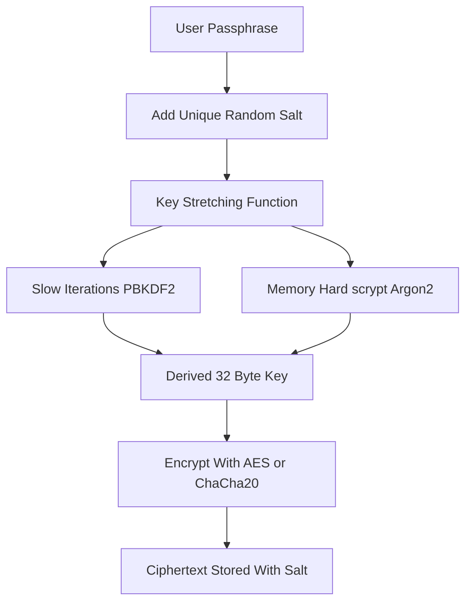

# Key Stretching and Why a Weak Passphrase Can Still Be Usable

## English

A passphrase like 'correct horse battery staple' is easy for a human to remember but has far less entropy than a 256-bit random key. If you fed that passphrase directly into AES as a key, an attacker who stole your ciphertext could try billions of guesses per second on a GPU, because AES itself is fast by design. The trick that makes passphrase-based encryption practical is key stretching: running the passphrase through a deliberately slow, memory-hard function to derive the actual encryption key. The slowness is the point. It multiplies the attacker's cost per guess without changing the legitimate user's one-time cost much.

The classic tool for this is PBKDF2, standardised in RFC 8018 (PKCS #5 v2.1), which iterates a pseudorandom function, usually HMAC-SHA-256, many thousands or millions of times. Newer functions like scrypt and Argon2 add memory hardness: they force the attacker to allocate large amounts of RAM per guess, which makes parallel GPU and ASIC attacks much more expensive because memory bandwidth, not raw compute, becomes the bottleneck. Argon2id, the winner of the Password Hashing Competition, combines data-dependent and data-independent memory access to resist both side-channel and time-memory trade-off attacks. The output of any of these is a fixed-length key, typically 32 bytes, suitable for AES-256 or ChaCha20.

The salt is the other half of the trick. A salt is a random value stored alongside the ciphertext, unique per encryption. It ensures that the same passphrase produces a different derived key each time, defeating precomputed rainbow tables and preventing an attacker from amortising work across many users. The salt does not need to be secret, but it must be unique and stored with the ciphertext. The iteration count or memory parameter must also be stored, because the decryptor needs to reproduce the exact same derivation to recover the key.

This is why a well-designed encrypted archive stores a small header containing the algorithm identifier, the salt, and the cost parameters, followed by the nonce and ciphertext. On decryption, the software reads the header, re-runs the KDF with the stored salt and parameters, derives the key, and then decrypts. If an attacker steals the file, they get the salt and parameters too, but that does not help them: they still have to pay the full cost per guess, and the salt prevents them from reusing work across files.

The practical lesson is that the security of passphrase-based encryption is bounded by two things: the entropy of the passphrase and the cost parameters of the KDF. A high-entropy passphrase with modest parameters can be stronger than a weak passphrase with aggressive parameters, because the attacker's search space is what matters. Choose parameters that take roughly a fraction of a second on your hardware, use a unique random salt per file, and remember that the KDF is not making the passphrase stronger; it is making each guess more expensive.

## 中文

像「correct horse battery staple」這樣的通關語，人類容易記住，但熵遠低於 256 位元的隨機金鑰。如果你把通關語直接當成 AES 金鑰，偷到密文的攻擊者可以在 GPU 上每秒嘗試數十億次猜測，因為 AES 本身設計上就很快。讓通關語加密變得可用的技巧是金鑰延展（key stretching）：把通關語送進一個刻意緩慢、耗記憶體的函數，推導出真正的加密金鑰。慢就是重點。它讓攻擊者每次猜測的成本倍增，而合法使用者一次性的成本幾乎不變。

經典工具是 PBKDF2，規範於 RFC 8018（PKCS #5 v2.1），它把一個偽隨機函數（通常是 HMAC-SHA-256）迭代數千甚至數百萬次。較新的 scrypt 和 Argon2 加入記憶體硬度：強迫攻擊者每次猜測都配置大量 RAM，使平行 GPU 和 ASIC 攻擊昂貴得多，因為瓶頸變成記憶體頻寬而非純算力。Password Hashing Competition 的優勝者 Argon2id 結合了資料相關與資料無關的記憶體存取，同時抵抗旁通道與時間記憶體取捨攻擊。這些函數的輸出都是固定長度的金鑰，通常 32 位元組，適合 AES-256 或 ChaCha20。

鹽（salt）是技巧的另一半。鹽是一個隨機值，與密文一併儲存，每次加密都不同。它確保同一句通關語每次都推導出不同的金鑰，擊敗預先計算的彩虹表，也防止攻擊者把工作量分攤到多個使用者身上。鹽不需要保密，但必須唯一，並與密文一起儲存。迭代次數或記憶體參數也必須儲存，因為解密方需要重現完全相同的推導過程才能還原金鑰。

這就是為什麼設計良好的加密壓縮檔會儲存一個小標頭，內含演算法識別碼、鹽和成本參數，後面才是 nonce 和密文。解密時，軟體讀取標頭，用儲存的鹽和參數重跑 KDF，推導出金鑰，然後解密。若攻擊者偷走檔案，他們也拿到鹽和參數，但這幫不上忙：他們仍須為每次猜測付出完整成本，而鹽防止他們跨檔案重複利用工作。

實務教訓是：通關語加密的安全性受兩件事限制：通關語的熵和 KDF 的成本參數。高熵通關語搭配適度參數，可能比弱通關語搭配激進參數更強，因為真正重要的是攻擊者的搜尋空間。選擇在你硬體上約需幾分之一秒的參數，每個檔案用唯一的隨機鹽，並記住：KDF 不是讓通關語變強，而是讓每次猜測變貴。

## Key Takeaway

Key stretching makes weak passphrases usable by making each attacker guess deliberately expensive, and the salt plus stored cost parameters are what let the decryptor reproduce the derivation.

## Related Concepts
- Salt uniqueness and rainbow tables
- Memory-hard functions versus iteration count

## Diagram

