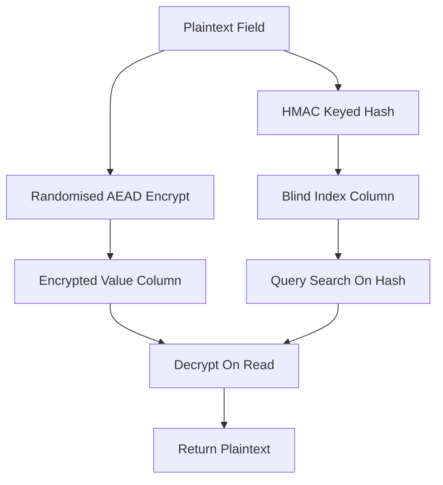

# Encrypting Structured Data: Field-Level Encryption and the Search Problem

## English

Encrypting a whole database file is easy; encrypting individual fields inside a database is where things get interesting. Suppose you have a users table with an email column and a country column. If you encrypt the email with a strong AEAD scheme and a fresh nonce per row, the ciphertext is different every time, which is exactly what you want for confidentiality. But now you cannot run `WHERE email = 'alice@example.com'` because the ciphertext is not deterministic. The database has no way to match the query against the stored bytes. This is the fundamental tension of field-level encryption: confidentiality and queryability pull in opposite directions.

One common compromise is deterministic encryption: use the same key and the same nonce (often derived from the plaintext via a keyed hash) for every value in a column, so equal plaintexts produce equal ciphertexts. This lets you index and search, but it leaks equality: an attacker who sees the ciphertexts learns which rows share the same email, even without decrypting. Note that the frequency-analysis risk runs the other way from what you might expect: it bites hardest on low-cardinality columns such as country codes, where the small set of repeated values exposes the plaintext distribution. High-cardinality columns like emails or national ID numbers still leak equality and can be re-identified, but each ciphertext appears only a few times, so frequency analysis gives an attacker much less to work with. A middle ground is order-preserving encryption, which additionally lets you do range queries, but it leaks the ordering of values and is generally considered risky for sensitive data.

A more robust pattern is to keep a blind index: store the encrypted value in one column and a keyed hash (HMAC) of the plaintext in another. Queries search the hash column, which is deterministic and indexable, while the actual value stays encrypted with a proper randomised AEAD. The HMAC key is held separately from the database, so an attacker with only database access cannot compute the hash for a guessed value without also stealing the HMAC key. This is the same idea behind searchable encryption schemes, which formalise how much leakage is acceptable.

Another angle is tokenisation: replace the sensitive value with a random token, store the mapping in a separate, heavily protected vault, and let the application resolve tokens on demand. The database never sees the plaintext, and the vault can be audited and rate-limited. This is common in payment systems, where card numbers are replaced by tokens and the real number lives in a PCI-compliant vault. The trade-off is operational complexity: every read now involves a round trip to the vault, and the vault becomes a high-value target.

The lesson is that encryption is not a single switch you flip on a column; it is a design decision about what you need to do with the data. If you only need to store and retrieve by primary key, randomised AEAD is fine. If you need equality search, a blind index with a separately held key is a reasonable compromise. If you need range queries, you are in dangerous territory and should consider whether the data really needs to be encrypted at the field level or whether the whole database should be protected at rest with access controls on top. Match the scheme to the query pattern, and document the leakage you are accepting.

## 中文

加密整個資料庫檔案很容易；加密資料庫裡的個別欄位才是真正有趣的地方。假設你有一個 users 表，包含 email 欄和 country 欄。若你用強力的 AEAD 方案和每列全新的 nonce 加密 email，每次密文都不同，這正是你對機密性想要的。但現在你無法執行 `WHERE email = 'alice@example.com'`，因為密文不是確定性的。資料庫無法把查詢與儲存的位元組比對。這就是欄位級加密的根本矛盾：機密性和可查詢性互相拉扯。

一種常見的折衷是確定性加密：對某一欄的每個值使用同一條金鑰和同一個 nonce（通常由明文經金鑰雜湊推導），讓相同明文產生相同密文。這讓你能建立索引和搜尋，但會洩漏相等性：看到密文的攻擊者即使不解密，也能得知哪些列共用同一個 email。要注意頻率分析的風險方向同你直覺相反：它最容易得手的是低基數欄位（例如國家代碼），因為重複的值會直接暴露明文的分佈。email 或身分證號這類高基數欄位仍然會洩漏相等性、可以被重新識別，但同一個密文只出現少數幾次，攻擊者能從頻率分析得到的線索少得多。中間路線是保序加密（order-preserving encryption），額外允許範圍查詢，但會洩漏值的順序，對敏感資料一般被視為有風險。

更穩健的模式是保留盲索引（blind index）：把加密值存在一欄，把明文的金鑰雜湊（HMAC）存在另一欄。查詢搜尋雜湊欄，它是確定性且可索引的，而真正的值則用適當的隨機化 AEAD 加密保存。HMAC 金鑰與資料庫分開保管，所以只有資料庫存取權的攻擊者，若沒有同時偷到 HMAC 金鑰，就無法為猜測的值計算雜湊。這與可搜尋加密（searchable encryption）方案背後的想法相同，那些方案正式化了可接受多少洩漏。

另一個角度是代碼化（tokenisation）：用隨機代碼取代敏感值，把對應關係存在另一個受嚴密保護的保險庫，讓應用程式按需解析代碼。資料庫永遠看不到明文，保險庫可以被稽核和限流。這在支付系統很常見，卡號被代碼取代，真正的號碼存在符合 PCI 規範的保險庫。代價是營運複雜度：每次讀取都要往返保險庫，而保險庫成為高價值目標。

教訓是：加密不是對欄位按下的一個開關，而是關於你需要對資料做什麼的設計決定。若你只需要按主鍵存取，隨機化 AEAD 就夠。若你需要相等搜尋，搭配分開保管金鑰的盲索引是合理折衷。若你需要範圍查詢，你已身處危險地帶，應考慮資料是否真的需要欄位級加密，或者整個資料庫應以靜態加密加上存取控制來保護。讓方案配合查詢模式，並記錄你接受了哪些洩漏。

## Key Takeaway

Field-level encryption forces a trade-off between confidentiality and queryability, and the right scheme depends on whether you need equality search, range queries, or only primary-key lookup.

## Related Concepts
- Deterministic encryption leakage
- Blind indexes and searchable encryption

## Diagram

