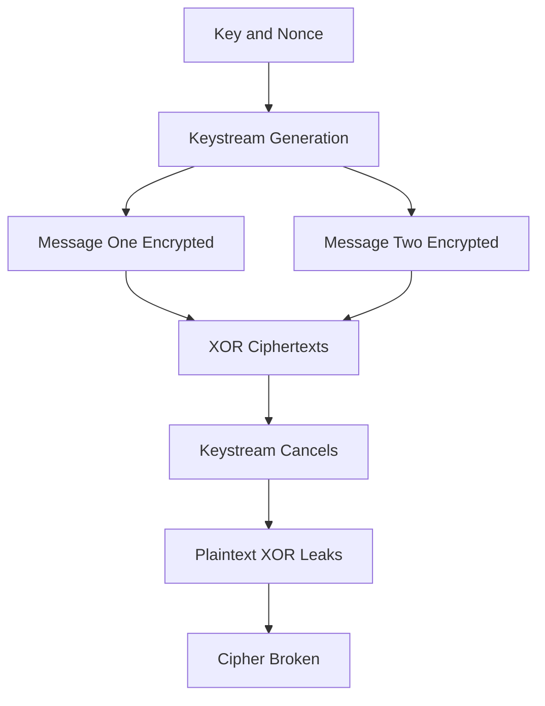

# Nonce Reuse: The Small Mistake That Breaks a Cipher Completely

## English

A nonce (short for 'number used once') is a value that must never repeat under the same key. In many encryption schemes the nonce does not need to be secret or random — it only needs to be unique — which makes it tempting to treat casually. The danger is that reuse does not degrade security gracefully. It fails catastrophically and often silently.

Consider stream ciphers and counter modes. Encryption works by generating a keystream from the key and nonce, then XORing it with the plaintext. If you encrypt two messages with the same key and the same nonce, you generate the same keystream twice. XOR the two ciphertexts together and the keystream cancels out, leaving the XOR of the two plaintexts. That is a classic 'two-time pad' problem: an attacker who can guess parts of one message (say, a known file header) can recover the corresponding bytes of the other, and statistical techniques can peel apart the rest. The cipher itself was never broken; the usage was.

Authenticated modes have their own failure mode. In AES-GCM, the authentication tag is computed over the ciphertext using a value derived from the key and nonce. Reusing a nonce with the same key allows an attacker to recover the authentication subkey, after which they can forge valid tags for arbitrary messages. With ChaCha20-Poly1305, nonce reuse similarly destroys confidentiality and integrity guarantees. Neither failure requires brute force; both are algebraic.

So how do real systems avoid this? Random nonces are safe only if they are long enough that collision probability stays negligible — roughly, the birthday bound means a 96-bit random nonce is fine for a limited number of messages under one key, but not unlimited. Counter-based nonces avoid randomness entirely: keep a persistent counter per key and increment it on every encryption, rebuilding it safely after crashes. Some designs derive a fresh key per message from a base key and a message counter, so even a repeated nonce meets a different key. XChaCha20 uses a 192-bit nonce precisely to make random generation comfortable.

The practical lesson: nonce management is a systems problem, not a math problem. If a device loses power between encrypting and persisting its counter, it may reuse a value on reboot. If two processes share a key without coordination, they may collide. Good libraries and protocols handle this for you; hand-rolling encryption around a raw block cipher usually does not. Treat any API that asks you to supply a nonce as a warning sign that you now own a correctness-critical invariant.

## 中文

Nonce（即「只用一次的數值」，number used once）是一個在同一把密鑰下絕不可重複的值。在許多加密方案中，nonce 不需要保密，也不需要隨機，只要唯一即可，因此很容易被輕視。危險在於：重複使用並不會令安全性「慢慢變差」，而是會災難性地、往往無聲地徹底失效。

以串流密碼及計數器模式為例。加密的原理是用密鑰與 nonce 產生金鑰流（keystream），再與明文做 XOR。若你用同一把密鑰、同一個 nonce 加密兩段訊息，就會產生兩次相同的金鑰流。把兩段密文互相 XOR，金鑰流便會互相抵消，只剩下兩段明文的 XOR。這就是經典的「兩次一次性密碼本」問題：攻擊者只要猜到其中一段訊息的部分內容（例如已知的檔案標頭），就能還原另一段對應的位元組，再用統計方法逐步拆解其餘部分。密碼演算法本身沒有被破解，問題出在使用方式。

認證加密模式另有其失效方式。在 AES-GCM 中，認證標籤（tag）是根據由密鑰與 nonce 衍生的數值，對密文計算出來的。若同一把密鑰重複使用同一 nonce，攻擊者便可還原認證子密鑰，之後就能為任意訊息偽造有效標籤。ChaCha20-Poly1305 在 nonce 重用下同樣會喪失機密性與完整性保證。兩種失效都不需要暴力破解，純粹是代數上的必然。

那麼真實系統如何避免？隨機 nonce 只有在長度足夠、碰撞機率可忽略時才安全——粗略地說，根據生日界限（birthday bound），96 位元隨機 nonce 在同一把密鑰下只適用於有限數量的訊息，並非無限。計數器式 nonce 則完全避開隨機性：為每把密鑰維持一個持久計數器，每次加密遞增，並在當機後安全地重建。有些設計會用基礎密鑰與訊息計數器為每則訊息衍生新密鑰，即使 nonce 重複也會遇上不同的密鑰。XChaCha20 採用 192 位元 nonce，正是為了讓隨機產生變得輕鬆安全。

實務教訓是：nonce 管理屬於系統問題，而非數學問題。若裝置在加密後、持久化計數器前斷電，重開機時可能重用舊值。若兩個程序共用密鑰卻沒有協調，也可能碰撞。優良的函式庫與協定會替你處理；圍繞原始區塊密碼自行拼湊加密，通常不會。任何要求你自己提供 nonce 的 API，都應視為警號——那代表你現在要負責維持一個關乎正確性的不變量。

## Key Takeaway

Nonce reuse does not weaken encryption gradually; it breaks it completely and often invisibly, so nonce generation and persistence must be treated as a systems-level invariant, not an afterthought.

## Related Concepts
- Birthday bound and collision probability
- Counter-based nonce management

## Diagram

