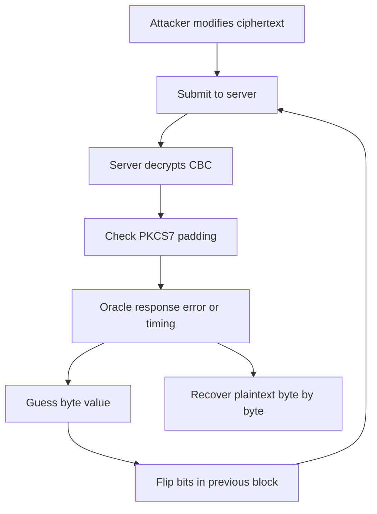

# Padding Oracle Attacks: When Error Messages Leak the Plaintext

## English

Block ciphers operate on fixed-size blocks, so messages whose length is not a multiple of the block size must be padded. PKCS#7 padding, for example, appends N bytes each of value N so the total fills the block. Padding is boring bookkeeping — until a system reveals, through timing, error codes, or behaviour, whether decryption produced valid padding. That single bit of feedback can be turned into a full plaintext recovery attack, byte by byte, without ever knowing the key.

The classic scenario is CBC mode (cipher block chaining). Each ciphertext block is decrypted and XORed with the previous block to yield plaintext. An attacker who can modify ciphertext and observe whether the result 'pads correctly' can flip bits in the previous block to steer the decrypted byte toward a guessed value. For each guess, they submit a modified ciphertext and watch for the oracle's yes/no. On average it takes about 128 queries per byte for a 16-byte block, so a few thousand requests recover a whole block — trivially feasible over a network.

The oracle does not have to be an explicit error message. It can be a different HTTP status code, a different response time, a connection that closes early, or a log entry that someone can read. Even a generic 'decryption failed' versus 'invalid request' distinction is enough. This is why security engineers say padding oracles are a property of the whole system, not just the crypto library.

The robust defence is to stop using unauthenticated encryption modes for anything an attacker can influence. Authenticated encryption (AEAD) such as AES-GCM or ChaCha20-Poly1305 verifies a tag before releasing any plaintext, so tampered ciphertext is rejected uniformly and no padding signal escapes. Where legacy CBC must remain, the standard mitigation is encrypt-then-MAC: compute a MAC over the ciphertext and verify it before attempting decryption, and make all failure paths indistinguishable to the outside observer. Constant-time comparison of tags matters too, since a naive byte-by-byte comparison leaks timing.

The deeper lesson generalises beyond padding: any observable difference in behaviour conditioned on secret data is a side channel. Error messages, response times, retry counts, and even which code path allocates memory can all act as oracles. Designing secure systems means making the failure path look identical to every other failure path, and preferring constructions where the library refuses to hand you unverified plaintext at all.

## 中文

區塊密碼（block cipher）以固定大小的區塊運作，因此長度不是區塊大小整數倍的訊息必須填充（padding）。例如 PKCS#7 填充會附加 N 個位元組、每個值都是 N，令總長度填滿區塊。填充本身只是無聊的記帳工作——直到系統透過時間差、錯誤碼或行為，洩露出解密結果的填充是否有效為止。這一個位元的回饋，就足以讓攻擊者在完全不知道密鑰的情況下，逐位元組還原整段明文。

經典情境是 CBC 模式（cipher block chaining，密碼區塊鏈結）。每個密文區塊解密後會與前一個區塊 XOR 才得出明文。若攻擊者能修改密文並觀察結果「填充是否正確」，便可翻轉前一區塊的位元，把解密後的位元組導向猜測值。每一次猜測，他們提交修改過的密文，觀察預言機（oracle）回答是或否。以 16 位元組區塊計算，平均每還原一個位元組約需 128 次查詢，幾千次請求就能還原整個區塊——在網絡上輕而易舉。

這個預言機不必是明確的錯誤訊息。它可以是不同的 HTTP 狀態碼、不同的回應時間、提早關閉的連線，或某個能被讀取的日誌記錄。即使只是「解密失敗」與「請求無效」之間的籠統差別，也已經足夠。這就是為何安全工程師說：填充預言機是整個系統的屬性，而非僅屬密碼函式庫。

穩健的防禦，是停止對任何攻擊者可影響的資料使用未認證的加密模式。認證加密（AEAD）如 AES-GCM 或 ChaCha20-Poly1305，會在釋出任何明文前先驗證標籤，因此被篡改的密文會一律被拒，沒有任何填充訊號外洩。若必須保留舊有 CBC，標準緩解方法是「先加密後 MAC」（encrypt-then-MAC）：對密文計算 MAC，並在嘗試解密前先驗證，同時讓所有失敗路徑對外部觀察者而言無法區分。標籤的比較也必須用常數時間（constant-time）方式，因為逐位元組的天真比較會洩漏時間差。

更深的教訓可推廣到填充以外：任何取決於秘密資料的可觀察行為差異，都是側通道（side channel）。錯誤訊息、回應時間、重試次數，甚至哪條程式路徑配置了記憶體，都可以充當預言機。設計安全系統，就是要讓失敗路徑與其他所有失敗路徑看起來一模一樣，並優先選用那些根本拒絕把未驗證明文交給你的函式庫建構方式。

## Key Takeaway

A padding oracle turns a single bit of observable feedback into full plaintext recovery, which is why authenticated encryption that verifies before decrypting is the correct default.

## Related Concepts
- Encrypt-then-MAC
- Constant-time comparison

## Diagram

