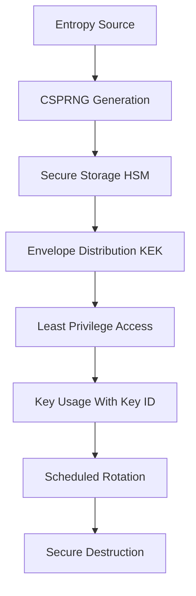

# Key Management Lifecycle: Generation, Distribution, Rotation, and Destruction

## English

Cryptography is often taught as an algorithm problem, but in production it is overwhelmingly a key management problem. A perfect cipher with a mishandled key is worthless. The lifecycle of a key — how it is generated, stored, distributed, used, rotated, and eventually destroyed — determines whether the encryption actually protects anything.

Generation starts with a cryptographically secure random number generator (CSPRNG) seeded by the operating system's entropy pool. Using a general-purpose pseudo-random generator, or a seed derived from a timestamp, produces keys that look random but are predictable. Generation also includes choosing the right key type and length for the algorithm, and, crucially, generating keys inside the environment where they will live rather than transporting them from elsewhere.

Storage and distribution are where most real breaches happen. Keys should ideally never leave a hardware security module (HSM) or secure enclave in plaintext; operations happen inside the boundary and only results come out. When keys must be moved, they are wrapped — encrypted under a key-encryption key (KEK) — which is the envelope encryption pattern. Access to keys should be governed by least privilege and audit logging, so that using a key is a visible, attributable event rather than an invisible one.

Rotation limits the blast radius of a compromise. If a key is used for years, a single leak exposes everything it ever protected. Rotating on a schedule, or on events such as staff departure, bounds the damage. Rotation must be designed in from the start: data must record which key version encrypted it (often in a key ID header), old keys must remain available for decryption while new data uses new keys, and re-encryption of old data may be needed to fully retire a key. Systems that hard-code a single key have no safe path to rotation.

Destruction is the final and most overlooked phase. Cryptographic erasure — destroying the key rather than every copy of the data — is a legitimate way to render data unrecoverable, and is often the only practical option for data spread across backups and replicas. But destruction must be real: zeroing memory that the compiler may optimise away, or deleting a key file that still exists in a snapshot, does not count. The full lifecycle view is what separates encryption that works from encryption that merely exists.

## 中文

密碼學常被當成演算法問題來教，但在生產環境中，它壓倒性地是密鑰管理問題。再完美的密碼，配上處理不當的密鑰也毫無價值。密鑰的生命週期——如何產生、儲存、分發、使用、輪換，以至最終銷毀——決定加密是否真的保護到任何東西。

產生階段始於由作業系統熵池（entropy pool）播種的密碼學安全隨機數產生器（CSPRNG）。使用一般用途的偽隨機產生器，或以時間戳衍生的種子，所產生的密鑰看似隨機，實則可預測。產生階段亦包括為演算法選擇正確的密鑰類型與長度，而關鍵是：密鑰應在它將要居住的環境內產生，而非從別處運送過來。

儲存與分發正是大多數真實外洩發生的地方。理想情況下，密鑰不應以明文離開硬體安全模組（HSM）或安全 enclave；操作在邊界內進行，只有結果流出。當密鑰必須移動時，會先被包裹（wrapped）——即以密鑰加密密鑰（KEK）加密——這就是信封加密（envelope encryption）模式。密鑰的存取應受最小權限與稽核日誌管治，令「使用密鑰」成為一個可見、可歸責的事件，而非隱形事件。

輪換（rotation）可限制外洩的爆炸半徑。若一把密鑰用上多年，一次洩漏就會暴露它曾保護過的一切。按計劃輪換，或在員工離職等事件時輪換，可把損害限制在範圍內。輪換必須從一開始就設計進去：資料須記錄是哪個密鑰版本加密的（通常放在 key ID 標頭），舊密鑰在解密時仍須可用，而新資料則用新密鑰；有時還需重新加密舊資料，才能完全退役一把密鑰。把單一密鑰硬編碼的系統，根本沒有安全的輪換路徑。

銷毀是最終、也最常被忽略的階段。密碼學抹除（cryptographic erasure）——銷毀密鑰而非銷毀每一份資料副本——是令資料無法還原的正當手段，對於散落在備份與複本中的資料，往往也是唯一實際可行的選項。但銷毀必須是真的：把編譯器可能優化掉的記憶體歸零，或刪除一個仍存在於快照中的密鑰檔案，都不算數。正是這種完整的生命週期視角，區分了「真正有效的加密」與「僅僅存在的加密」。

## Key Takeaway

Encryption is only as strong as its key lifecycle, so generation inside secure boundaries, least-privilege access, designed-in rotation, and genuine destruction matter as much as the algorithm itself.

## Related Concepts
- Hardware security modules
- Cryptographic erasure

## Diagram

