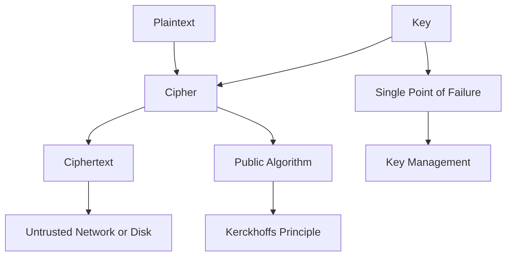

# Meet the Players: Plaintext, Cipher, Key, and Ciphertext

## English

Before any of the clever math makes sense, it helps to name the four objects that appear in every encryption story. Plaintext is the readable message you start with — a chat message, a database row, a whole file. The cipher is the algorithm, the fixed public recipe that transforms data (AES is a cipher; so is ChaCha20). The key is the secret input that the cipher mixes with the plaintext; the same cipher with a different key produces completely different output. Ciphertext is the scrambled result you can safely hand to an untrusted network or disk. The mental model is a locked box: the cipher is the design of the lock mechanism (public, studied by everyone), the key is the physical key in your pocket, plaintext is the letter, ciphertext is the sealed box.

A crucial consequence of this split is Kerckhoffs's principle, stated in the 1880s: a cipher must remain secure even if everything about it except the key is public knowledge. This is why AES is published in full detail, with test vectors and years of public cryptanalysis, and still trusted. Security lives entirely in the key, not in obscurity. Systems that rely on a secret algorithm (sometimes called 'security through obscurity') tend to fail badly once the algorithm leaks, which it almost always does.

A second consequence is that the key is the single point of failure. If an attacker obtains the key, the cipher offers no protection at all — the math is not a barrier, it is just a translator. This is why so much engineering effort (key management, hardware security modules, rotation policies) goes into protecting keys rather than algorithms. People sometimes ask 'how hard is AES to break?' — the honest answer is that nobody breaks AES; they steal, guess, or misuse the key.

It also explains why 'encrypting' something with a fixed hard-coded key is nearly worthless. If every copy of an app ships with the same embedded key, an attacker who downloads the app has the key. The ciphertext looks intimidating, but the box is unlocked. Real systems generate per-user, per-session, or per-device keys so that one compromise does not unlock everything.

Finally, keep the vocabulary precise: decryption is the inverse operation that recovers plaintext given ciphertext and the correct key. If you lack the key, you do not 'decrypt badly' — you simply cannot decrypt; modern ciphers are designed so that the only realistic route is guessing the key. That asymmetry between easy-with-key and infeasible-without is the entire point of cryptography.

## 中文

在理解任何巧妙數學之前，先為每個加密故事中都會出現的四個角色命名，會很有幫助。明文（plaintext）是你手上可讀的訊息——一則聊天訊息、一筆資料庫記錄、一整個檔案。密碼演演算法（cipher）是那個演演算法，是把資料轉換過去的固定公開配方（AES 是一種 cipher，ChaCha20 也是）。金鑰（key）是密碼演演算法與明文混合時所用的秘密輸入；同一個 cipher 配上不同金鑰，會產生完全不同的輸出。密文（ciphertext）則是攪亂後的結果，你可以安全地交給不受信任的網路或磁碟。心智模型就是一個上鎖的盒子：cipher 是鎖的機械設計（公開、人人可研究），key 是你口袋裡那把實體鑰匙，plaintext 是那封信，ciphertext 是封好的盒子。

這種拆分有一個關鍵推論，就是 1880 年代提出的柯克霍夫原則（Kerckhoffs's principle）：一個 cipher 即使除了金鑰以外的一切都公開，仍必須保持安全。這就是為什麼 AES 被完整公開、附上測試向量、歷經多年公開密碼分析，仍然值得信任。安全性完全存在於金鑰之中，而不在於隱蔽。依賴秘密演演算法的系統（有時稱為「以隱蔽求安全」）一旦演演算法外洩（而它幾乎總是會外洩），往往會慘烈地失敗。

第二個推論是：金鑰是唯一的失效點。如果攻擊者取得金鑰，cipher 就完全不提供任何保護——數學不是障礙，只是翻譯器。這就是為什麼大量工程心力（金鑰管理、硬體安全模組、輪替政策）都花在保護金鑰，而不是演演算法上。人們有時會問「AES 有多難破解？」——誠實的答案是：沒有人「破解」AES；他們是偷走、猜到或誤用金鑰。

這也解釋了為什麼用固定寫死的金鑰去「加密」某個東西，幾乎毫無價值。如果每一份應用程式都內建同一把金鑰，攻擊者只要下載那個應用程式就拿到金鑰了。密文看起來很嚇人，但盒子根本沒鎖。真正的系統會產生每位使用者、每個工作階段或每臺裝置專屬的金鑰，讓單一外洩不會解開所有東西。

最後，把用詞保持精確：解密（decryption）是在已知密文與正確金鑰的情況下，還原明文的逆運算。沒有金鑰，你不是「解密得很差」——你就是無法解密；現代 cipher 的設計就是要讓唯一現實可行的途徑是猜中金鑰。有鑰匙就輕鬆、沒鑰匙就不可行，這個不對稱性正是密碼學的全部重點。

## Key Takeaway

Encryption splits into four named parts — plaintext, cipher, key, ciphertext — and all real security lives in the secrecy of the key, never in the secrecy of the algorithm.

## Related Concepts
- Kerckhoffs's principle
- Key management lifecycle

## Diagram

