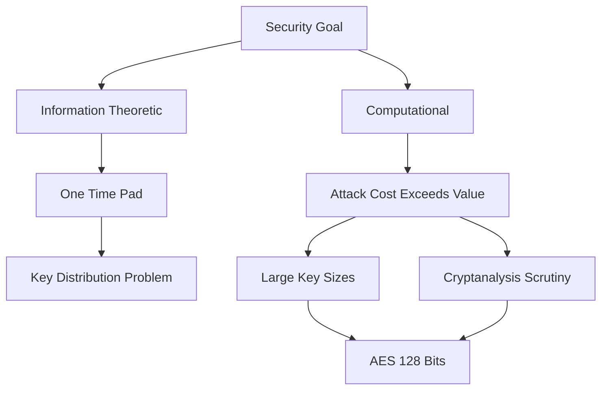

# Why 'Unbreakable' Is a Moving Target: Computational Security and Attack Cost

## English

Textbooks sometimes say a cipher is 'unbreakable', but working cryptographers almost never claim that. Instead they speak of computational security: a scheme is secure if every known attack costs more resources (time, money, energy) than the data is worth, or more than the attacker can plausibly muster. This is a pragmatic, economic definition, and it is why key sizes are chosen with huge safety margins. AES-128 has a key space of 2^128 possibilities — a number around 3.4 × 10^38. Even at billions of guesses per second, brute-forcing that space would take longer than the age of the universe, so 128 bits is considered plenty for the foreseeable future.

The comparison point is the one-time pad, the only scheme with information-theoretic security: if the key is truly random, as long as the message, used exactly once, and kept secret, then ciphertext gives an attacker literally zero information about plaintext, no matter how much computing power they have. The catch is key distribution — you need to physically share as many secret bits as you will ever send, which is wildly impractical for the internet. Practical ciphers trade that absolute guarantee for manageable key sizes, accepting 'computationally infeasible' instead of 'mathematically impossible'.

Attack cost is not just about brute force. Cryptanalysis finds shortcuts: differential and linear cryptanalysis, algebraic attacks, meet-in-the-middle techniques, and implementation bugs. A cipher is trusted only after decades of public attempts to break it. AES, standardized in 2001 after an open competition, has survived this scrutiny well; older ciphers like DES (56-bit key) did not, and were broken by exhaustive search once hardware got fast enough. The lesson is that 'broken' usually means 'the cost of attack dropped below what defenders assumed', not 'the math collapsed'.

This is why algorithm lifetimes matter. A system designed in 2000 with 80-bit security felt safe then; by 2020, 80-bit keys were within reach of well-funded attackers. NIST and other bodies periodically raise minimum recommendations — 112 bits today, moving toward higher thresholds for long-lived secrets. When you design a system, ask not 'is this secure now?' but 'will this still be secure in 20 years, when my data is still sensitive?' That is the harvest-now-decrypt-later mindset applied to symmetric ciphers too.

Finally, remember that real attacks rarely go after the cipher. They go after the key, the random number generator, the implementation, the protocol, or the human. A 'perfect' 256-bit cipher deployed with a reused nonce or a predictable key is far weaker than a 'merely good' 128-bit cipher deployed carefully. Computational security is a whole-system property, not a property of a single algorithm line in a spec sheet.

## 中文

教科書有時會說某個 cipher 是「牢不可破」，但真正在實務上工作的密碼學家幾乎不會這樣宣稱。他們講的是計算安全性（computational security）：如果每一個已知攻擊所需的資源（時間、金錢、能源）都超過資料本身的價值，或超過攻擊者合理能動用的量，那麼這個方案就算安全。這是務實的、經濟學式的定義，也是為什麼金鑰長度會預留極大的安全邊際。AES-128 的金鑰空間有 2^128 種可能——大約 3.4 × 10^38。即使每秒猜數十億次，暴力搜尋整個空間也比宇宙年齡還久，所以 128 位元在可預見的未來被視為足夠。

比較基準是一次性密碼本（one-time pad），這是唯一具有資訊理論安全性（information-theoretic security）的方案：如果金鑰真正隨機、長度與訊息相同、只用一次並保持秘密，那麼無論攻擊者有多少算力，密文對明文都不洩漏任何資訊。問題在於金鑰配送——你必須實體分享與你未來要傳送的總量一樣多的秘密位元，這對網際網路來說完全不切實際。實務上的 cipher 用可管理的金鑰長度換掉那個絕對保證，接受「計算上不可行」而不是「數學上不可能」。

攻擊成本不只是暴力破解。密碼分析會找到捷徑：差分與線性密碼分析、代數攻擊、中間相遇技術，以及實作錯誤。一個 cipher 要經過數十年公開嘗試破解才會被信任。AES 在 2001 年經過公開競賽標準化後，經得起這種檢驗；較舊的 DES（56 位元金鑰）則沒有，一旦硬體變快就被窮舉搜尋攻破。教訓是：「被破解」通常意思是「攻擊成本降到低於防禦者原本假設」，而不是「數學崩潰了」。

這就是演演算法壽命很重要的原因。一個 2000 年設計、具有 80 位元安全性的系統，當時感覺很安全；到了 2020 年，80 位元金鑰已在資金充裕的攻擊者能力範圍內。NIST 等機構會定期提高最低建議值——今天是 112 位元，並朝更高的門檻邁進，以保護長期秘密。設計系統時，不要只問「現在安全嗎？」，而要問「二十年後我的資料仍敏感時，它還安全嗎？」這就是把「先蒐集、後解密」的思維套用到對稱 cipher 上。

最後要記得，真實攻擊很少針對 cipher 本身。它們針對金鑰、亂數產生器、實作、協定或人。一個部署時重用 nonce 或金鑰可預測的「完美」256 位元 cipher，遠比小心部署的「僅算不錯」128 位元 cipher 更弱。計算安全性是整體系統的性質，不是規格表上某一行演演算法的性質。

## Key Takeaway

Modern ciphers are 'computationally secure' rather than 'unbreakable' — security is measured in attack cost, and that cost changes with hardware, cryptanalysis, and implementation mistakes.

## Related Concepts
- One-time pad
- Entropy and key strength

## Diagram

