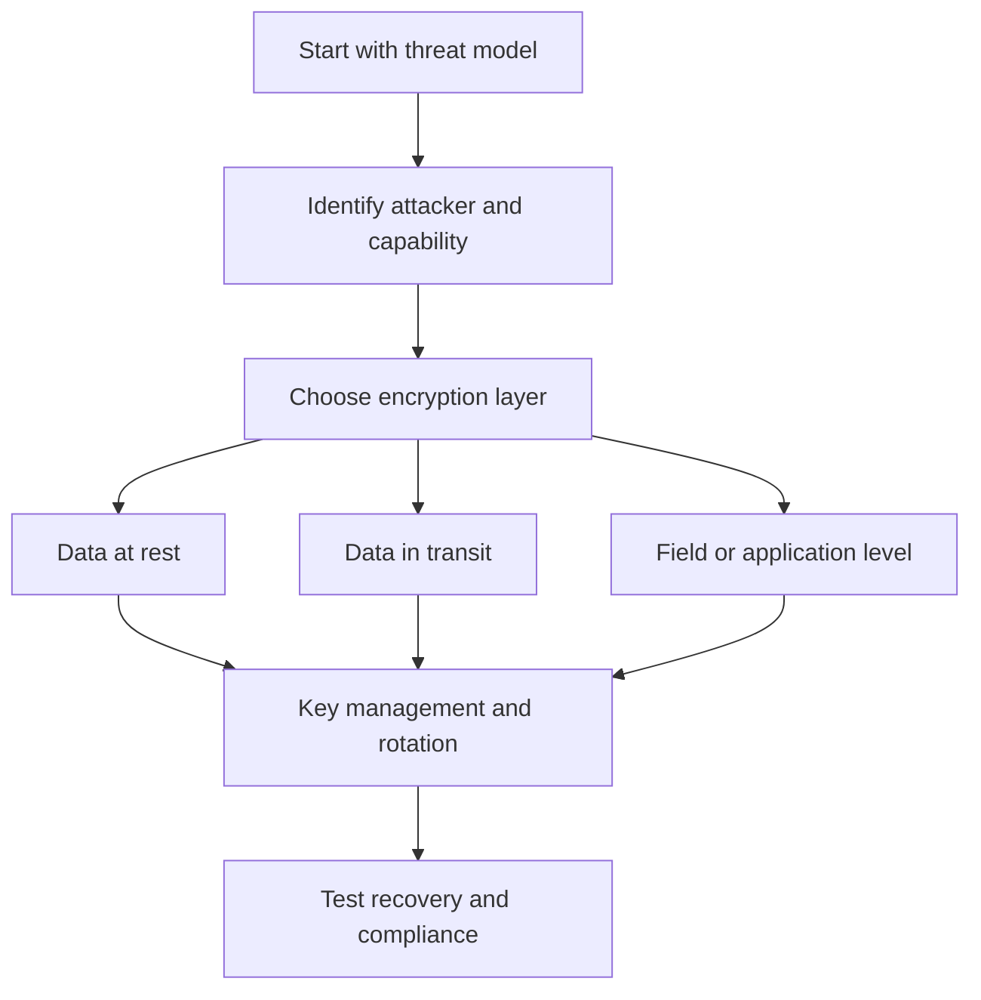

# Encryption in the Real World: Threat Models, Compliance, and the Cost of Getting It Wrong

## English

A cipher that is mathematically sound can still be a disaster in production if nobody asked what threat it is supposed to stop. That question is the threat model: who is the attacker, what can they do, and what are you protecting against? Encrypting a database at rest protects against a stolen disk or a misconfigured backup bucket, but does nothing against an attacker who already has valid application credentials and can query rows. Encrypting traffic in transit protects against network eavesdroppers, but not against a compromised endpoint. Every encryption decision should start with 'who am I defending against, and what do I accept losing if I fail?'

Regulatory frameworks add another layer. Standards like PCI DSS (for card data), HIPAA (for health data in the US), GDPR (for personal data in the EU), and various national data-protection laws often mandate encryption of sensitive data at rest and in transit, and may require specific key management practices. Compliance is not the same as security — a checkbox can be satisfied by weak encryption — but auditors and regulators increasingly reference concrete technical baselines. Knowing these constraints matters because they shape what you can and cannot deploy.

Operational realities bite hard. Encrypted data cannot be searched, sorted, or joined the way plaintext can; that is the whole point, but it is also a serious engineering cost. Teams often end up with field-level encryption for a handful of sensitive columns, application-level encryption for whole records, and disk-level encryption for everything else — a layered approach that matches each layer to a different threat. Each layer has its own key management, rotation, and recovery story, and each can fail independently.

Recovery is the part people forget. If you encrypt data and lose the key, the data is gone — permanently, cryptographically gone, not 'recoverable by a specialist'. Real systems therefore need key escrow, backup keys stored offline, or split-knowledge schemes, balanced against the risk that escrow itself becomes a target. Many organisations have destroyed their own data by rotating a key without re-encrypting, or by losing the HSM that held the master key. Designing for recovery is as important as designing for secrecy.

Finally, encryption is not a substitute for access control, logging, or input validation. It reduces the blast radius of a breach — stolen ciphertext is much less damaging than stolen plaintext — but it does not prevent unauthorised access, it does not stop an insider with legitimate keys, and it does not fix a SQL injection. The mature view is that encryption is one control among many, chosen deliberately, documented clearly, and tested regularly (including by trying to recover from a simulated key loss). That discipline is what separates real security from the illusion of it.

## 中文

一個數學上健全的 cipher，如果在生產環境中沒有人問清楚它要擋什麼威脅，仍然可能是一場災難。那個問題就是威脅模型（threat model）：攻擊者是誰、他們能做什麼、你要防的是什麼？靜態資料的資料庫加密可以防磁碟被偷或備份桶設定錯誤，但對已經持有有效應用程式憑證、能查詢資料列的攻擊者毫無作用。傳輸中加密可防網路竊聽，但防不了被入侵的端點。每個加密決策都該從「我在防誰，失敗時我接受失去什麼？」開始。

法規框架又加了一層。PCI DSS（信用卡資料）、HIPAA（美國健康資料）、GDPR（歐盟個人資料）以及各國資料保護法，常強制要求靜態與傳輸中加密敏感資料，並可能要求特定的金鑰管理做法。合規不等於安全——一個勾選框可以用弱加密滿足——但稽核人員與監管機構越來越引用具體的技術基準。了解這些限制很重要，因為它們會左右你能部署什麼、不能部署什麼。

營運現實會狠狠咬人。加密資料無法像明文那樣被搜尋、排序或 join；這正是重點，但也是嚴重的工程成本。團隊最後往往採用分層做法：少數敏感欄位做欄位級加密、整筆記錄做應用層加密、其餘全部做磁碟層加密——每一層對應不同的威脅。每一層都有自己的金鑰管理、輪替與復原故事，而且每一層都可能獨立失效。

復原是最容易被遺忘的部分。如果你加密了資料卻弄丟金鑰，資料就永遠消失——密碼學意義上的消失，不是「專家可以救回來」。所以真實系統需要金鑰託管、離線備份金鑰，或分割知識方案，同時要權衡託管本身成為攻擊目標的風險。許多組織曾因為輪替金鑰時沒有重新加密，或弄丟存放主金鑰的 HSM，而毀掉自己的資料。為復原而設計，和為保密而設計一樣重要。

最後，加密不能取代存取控制、日誌記錄或輸入驗證。它縮小外洩的爆炸半徑——被偷走的密文比被偷走的明文傷害小得多——但它不能防止未授權存取、擋不住持有合法金鑰的內部人員，也修不好 SQL injection。成熟的觀點是：加密是眾多控制措施之一，要有意識地選擇、清楚地記錄、定期測試（包括模擬金鑰遺失後的復原）。這份紀律，正是真實安全與安全幻覺之間的分界。

## Key Takeaway

Encryption only makes sense against a defined threat model; in production, recovery, compliance, and layered controls matter as much as the cipher itself.

## Related Concepts
- Threat modeling
- Key escrow and recovery

## Diagram

