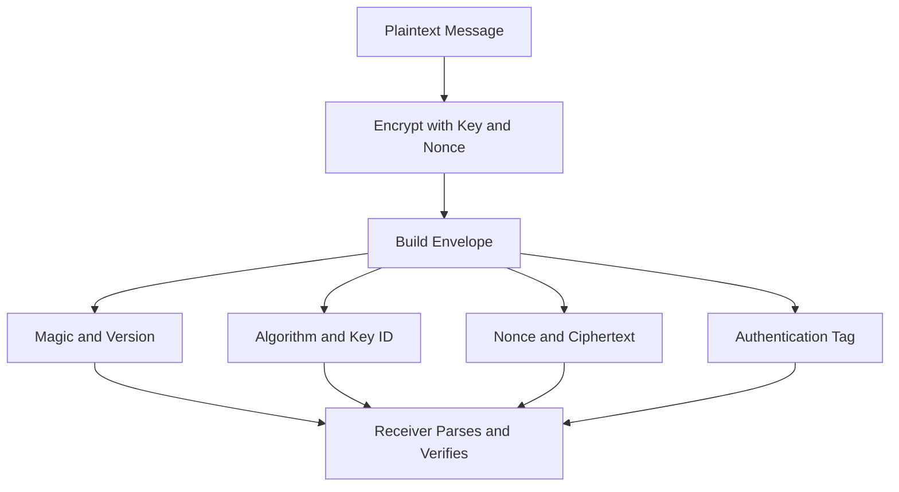

# How a Ciphertext Travels Through a Real System

## English

When you send an encrypted message in a real system, the ciphertext itself is only one ingredient in a larger package. That package usually contains a version byte so future software knows which algorithm was used, a key identifier so the recipient knows which key to load, the nonce or IV, the actual ciphertext, and an authentication tag. This whole structure is often called an envelope or a container. Think of it like a sealed parcel: the letter inside is the ciphertext, but the shipping label, the tracking number, and the tamper-evident seal all travel with it. If you strip any of those away, the receiver cannot safely open or trust the contents. Modern formats like JWE (JSON Web Encryption, defined in RFC 7516) and the CMS EnvelopedData structure (RFC 5652) formalise exactly this idea: a header describing the algorithm and key, followed by the encrypted payload and integrity tag.

The practical consequence is that you almost never see raw ciphertext alone in a production system. When you look at a database column or a file on disk, the bytes are usually a serialised structure. A typical layout might be: a magic number identifying the format, a version number, the algorithm identifier, the key ID, the nonce, the ciphertext, and finally the authentication tag. Each field has a fixed or length-prefixed size so the parser knows where one ends and the next begins. If the parser reads the wrong length, everything after that point becomes garbage, which is why format specifications are so precise about byte ordering and endianness.

A subtle but important property of this design is that the header must be authenticated, not just the payload. If an attacker can flip the algorithm identifier from AES-256-GCM to a weaker algorithm without detection, they can downgrade your security. The standard fix is to feed the entire header (algorithm ID, key ID, version) into the AEAD (Authenticated Encryption with Associated Data) computation as associated data, so any tampering with the header causes the tag check to fail. This is why AEAD schemes take two inputs: the plaintext to encrypt, and the associated data to authenticate but not encrypt. The header is public but protected; the payload is both hidden and protected.

Key identifiers deserve their own note. In a system with many keys, the recipient needs to know which one to use before it can decrypt anything. Embedding a key ID in the header is convenient, but it also leaks information: an observer can tell whether two ciphertexts were encrypted under the same key, or when a key rotation happened. Some systems accept this trade-off for operational simplicity; others avoid explicit key IDs and instead try each candidate key until one works, at the cost of extra computation. Neither approach is wrong, but the choice affects both security and performance, and it is worth thinking through before you commit to a format.

Finally, the envelope has to survive transport. Base64 encoding is common when ciphertext must travel through text-only channels like JSON or email, but encoding adds roughly 33% to the size and is not encryption. Compression is tempting to save space, but compressing before encrypting can leak information through length differences (the CRIME and BREACH attacks exploited exactly this). The safe rule is: encrypt first, then encode, and never compress secrets whose length correlates with sensitive data. Understanding the full journey from plaintext to a transmittable envelope is what separates a working prototype from a system you can actually deploy.

## 中文

在真實系統中傳送加密訊息時，密文字身只是整個包裹裡的其中一件材料。這個包裹通常還會包含：一個版本位元組，讓將來的軟體知道用了哪種演演算法；一個金鑰識別碼，讓收件者知道要載入哪條金鑰；nonce 或 IV；真正的密文；以及一個驗證標籤。整個結構常被稱為信封（envelope）或容器（container）。可以想像成一個密封包裹：裡面的信件是密文，但外面的寄件標籤、追蹤編號、防篡改封條都會一起運送。少了任何一樣，收件者就無法安全地開啟或信任內容。現代格式例如 JWE（JSON Web Encryption，RFC 7516 定義）和 CMS 的 EnvelopedData 結構（RFC 5652），正是把這個概念形式化：先有描述演演算法與金鑰的標頭，接著是加密載荷與完整性標籤。

實際後果是：在生產系統裡，你幾乎不會看到赤裸的密文單獨存在。當你檢視資料庫欄位或磁碟上的檔案，那些位元組通常是一個序列化結構。典型佈局可能是：識別格式的魔術數字、版本號、演演算法識別碼、金鑰 ID、nonce、密文，最後是驗證標籤。每個欄位都有固定或帶長度字首的大小，讓解析器知道何時結束、何時開始下一欄。若解析器讀錯長度，之後所有東西都會變成亂碼，這就是為何格式規範對位元組順序和位元組序（endianness）如此講究。

這個設計有一個微妙但重要的特性：標頭必須被驗證，不只是載荷。如果攻擊者能把演演算法識別碼從 AES-256-GCM 改成較弱的演演算法而不被發現，就能降級你的安全性。標準做法是把整個標頭（演演算法 ID、金鑰 ID、版本）當作關聯資料（associated data）餵進 AEAD（Authenticated Encryption with Associated Data，帶關聯資料的驗證加密）計算，如此一來任何對標頭的篡改都會令標籤檢查失敗。這就是為何 AEAD 方案接受兩個輸入：要加密的明文，以及要驗證但不加密的關聯資料。標頭是公開但受保護的；載荷則同時被隱藏和保護。

金鑰識別碼值得獨立討論。在有多條金鑰的系統中，收件者必須先知道用哪一條才能解密。把金鑰 ID 放進標頭很方便，但同時會洩漏資訊：觀察者能看出兩個密文是否用同一條金鑰加密，或何時進行了金鑰輪換。有些系統為了操作簡便而接受這個取捨；有些則避免明確的金鑰 ID，改為逐一嘗試候選金鑰直到成功，代價是額外運算。兩種做法都沒有錯，但選擇會同時影響安全與效能，值得在定下格式之前想清楚。

最後，信封必須能承受傳輸。當密文要經過 JSON 或電郵等純文字通道時，Base64 編碼很常見，但編碼會令大小增加約 33%，而且它不是加密。壓縮看似能節省空間，但在加密前壓縮可能透過長度差異洩漏資訊（CRIME 和 BREACH 攻擊正是利用這一點）。安全原則是：先加密，再編碼，並且絕不壓縮那些長度與敏感資料相關的秘密。理解從明文到可傳輸信封的完整旅程，正是區分「能跑的雛形」與「真正可部署系統」的關鍵。

## Key Takeaway

Real ciphertext always travels inside a structured envelope whose header must be authenticated, not just the payload.

## Related Concepts
- Authenticated Encryption (AEAD)
- Key Management Lifecycle

## Diagram

