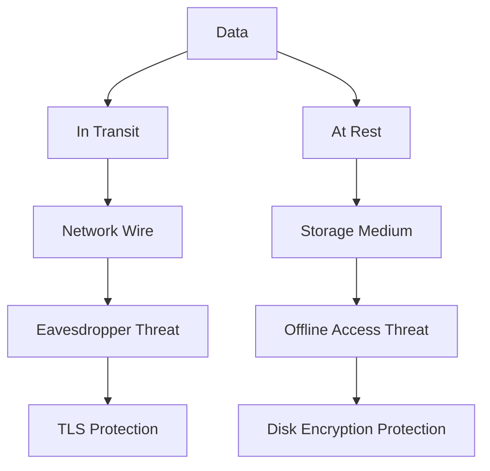

# Encryption at Rest Versus Encryption in Transit

## English

Encryption at rest and encryption in transit sound similar but protect against completely different threats, and confusing them is one of the most common mistakes in system design. Encryption in transit protects data while it moves across a network: your browser talking to a server over TLS, a service talking to a database, or two microservices exchanging messages. The threat is an eavesdropper on the wire, whether that is someone on the same Wi-Fi, a compromised router, or a tap on a backbone link. Encryption at rest protects data when it is sitting still: on a disk, in a database, in an object store, or on a backup tape. The threat is someone who gains physical or logical access to the storage medium, whether that is a stolen laptop, a decommissioned drive, or an attacker who has breached the storage layer but not the application.

Consider a laptop. Full-disk encryption (FDE) such as BitLocker, FileVault, or LUKS protects the drive when the machine is off or the disk is removed. But once the operating system has booted and unlocked the drive, the data is decrypted transparently for every process running on the machine. If malware runs as your user, FDE gives you nothing against it, because the malware sees the same plaintext you do. This is the crucial distinction: at-rest encryption defends against offline attackers who have the disk but not the running system, not against attackers who have code execution. Confusing the two leads to a false sense of security, where teams believe FDE makes them safe from application-layer compromise.

Databases illustrate the same split. Transparent Data Encryption (TDE) encrypts the database files on disk, so a stolen backup or a snapshot of the storage volume does not reveal the data. But queries still return plaintext to any client that authenticates successfully, so TDE does nothing against SQL injection or a compromised application account. For that, you need application-level or field-level encryption, where the application encrypts specific values before they ever reach the database, so even the database engine cannot read them. The trade-off is that encrypted fields cannot be indexed or searched normally, which is why field-level encryption is usually reserved for a small set of highly sensitive columns rather than the whole schema.

Backups deserve special mention because they often fall through the cracks. A backup is a copy of data at rest in a different location, often managed by a different team with different access controls. If production is encrypted but backups are not, an attacker who gains access to the backup store gets everything. The rule of thumb is that every copy of the data, wherever it lives and however long it lives, needs its own protection story. That includes replicas, read-only snapshots, analytics warehouses, and disaster-recovery copies, each of which may have weaker controls than the primary system.

In transit, the picture is more standardised but still full of traps. TLS protects the connection, but it terminates somewhere: at a load balancer, at a reverse proxy, or at the application itself. Everything after the termination point is plaintext unless you re-encrypt. This is why service meshes and mutual TLS (mTLS) exist: to make sure that even internal traffic between services is encrypted and authenticated, so a compromised pod cannot silently sniff its neighbours. The practical rule is to think of encryption as a property of a specific data flow at a specific moment, not a checkbox you tick once for the whole system. Each hop, each copy, and each idle moment needs its own answer to the question: who could read this, and what stops them?

## 中文

靜態加密（encryption at rest）與傳輸中加密（encryption in transit）聽起來相似，但防禦的威脅完全不同，混淆兩者是系統設計中最常見的錯誤之一。傳輸中加密保護資料在網絡上移動的時候：你的瀏覽器透過 TLS 與伺服器通訊、服務與資料庫通訊、或兩個微服務交換訊息。威脅是線路上的竊聽者，無論是同一 Wi-Fi 上的人、被入侵的路由器，還是骨幹鏈路上的竊聽裝置。靜態加密則保護資料靜止的時候：在磁碟上、資料庫裡、物件儲存中，或備份磁帶上。威脅是取得實體或邏輯儲存存取權的人，無論是被偷的筆記型電腦、退役的硬碟，還是已入侵儲存層但未入侵應用層的攻擊者。

想想一部筆記型電腦。全碟加密（FDE，Full-Disk Encryption）例如 BitLocker、FileVault 或 LUKS，在機器關機或硬碟被拆走時保護磁碟。但一旦作業系統開機並解鎖磁碟，資料就會對機器上每一個行程透明地解密。如果惡意軟件以你的使用者身分執行，FDE 對它毫無作用，因為惡意軟件看到的明文與你看到的完全相同。這正是關鍵區別：靜態加密防禦的是擁有磁碟但沒有執行中系統的離線攻擊者，而不是擁有程式碼執行權的攻擊者。混淆兩者會帶來虛假的安全感，令團隊誤以為 FDE 能保護他們免受應用層入侵。

資料庫展示了同樣的分野。透明資料加密（TDE，Transparent Data Encryption）加密磁碟上的資料庫檔案，所以被偷的備份或儲存磁碟區快照不會洩漏資料。但查詢仍然會向任何成功驗證的客戶端回傳明文，所以 TDE 對 SQL 注入或被入侵的應用帳戶毫無作用。要應對這些，你需要應用層或欄位層加密：應用程式在資料到達資料庫之前就加密特定值，連資料庫引擎都讀不到。取捨是加密欄位無法正常建立索引或搜尋，這就是為何欄位層加密通常只用於少數高度敏感的欄位，而非整個資料表結構。

備份值得特別一提，因為它經常被忽略。備份是資料在不同位置的靜態副本，通常由不同團隊以不同存取控制管理。如果生產環境已加密但備份沒有，取得備份儲存存取權的攻擊者就能得到一切。經驗法則是：資料的每一份副本，無論在哪裡、存在多久，都需要自己的保護方案。這包括副本、唯讀快照、分析倉庫和災難復原副本，每一份的控管都可能比主系統薄弱。

在傳輸方面，情況較為標準化但仍充滿陷阱。TLS 保護連線，但它在某處終止：在負載平衡器、反向代理，或應用程式本身。終止點之後的一切都是明文，除非你重新加密。這就是服務網格（service mesh）和雙向 TLS（mTLS，mutual TLS）存在的原因：確保連服務之間的內部流量都經過加密和驗證，令被入侵的容器無法悄悄嗅探鄰居。實用原則是：把加密視為特定資料流在特定時刻的屬性，而不是對整個系統勾選一次的選項。每一跳、每一份副本、每一個靜止時刻，都需要自己回答這個問題：誰能讀到這些資料，而什麼阻止了他們？

## Key Takeaway

At-rest encryption protects stored copies from offline attackers, in-transit encryption protects moving data from eavesdroppers, and neither substitutes for the other.

## Related Concepts
- Threat Models
- TLS Termination

## Diagram

