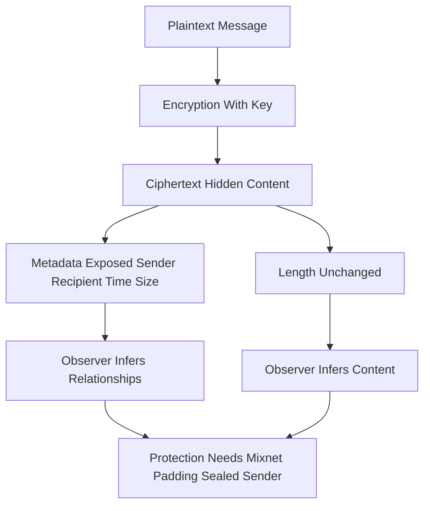

# What Encryption Cannot Do: The Boundaries of Confidentiality

## English

Encryption is a powerful tool, but it solves exactly one problem: keeping the contents of a message secret from anyone who does not hold the key. Everything else that people often expect from encryption, such as hiding who is talking to whom, hiding that a message was sent at all, hiding how large the message is, or hiding patterns of activity over time, is a separate problem that encryption alone does not address. Understanding these boundaries is the difference between designing a system that is actually private and one that merely looks private to the casual observer. The classic phrase is that encryption hides the content, not the context.

Metadata is the biggest example. When you send an encrypted message, the ciphertext may be unreadable, but the sender address, recipient address, timestamp, message size, and routing information are typically visible to every server along the path. Even in end-to-end encrypted systems, the servers that relay messages usually learn who is talking to whom and when. This metadata can be extraordinarily revealing: patterns of communication, frequency of contact, times of day, and message sizes can together paint a detailed picture of relationships and behaviour. Protecting metadata requires different techniques, such as mix networks that batch and shuffle messages, cover traffic that pads the channel with dummy data, or sealed-sender designs that hide the sender's identity from the relay. Each of these has real costs in latency, bandwidth, or complexity, which is why most systems do not deploy them by default.

Message length is a subtler leak. Encrypting a message does not change its length, so an observer can often infer what was said from how long the ciphertext is. A short message might be yes or no; a long one might be a document. Even with compression, length patterns can be distinctive enough to identify content. The standard mitigation is padding: adding random bytes to every message so that all messages fall into a small number of size buckets. Padding is not free, since it wastes bandwidth and complicates the protocol, but it is the only way to stop length from being a side channel. Traffic analysis, the study of who talks to whom and how often, is a well-developed field precisely because encryption leaves so much of this information intact.

Encryption also does not protect against a compromised endpoint. If malware is running on your device, or if the recipient's device is compromised, the plaintext is available to the attacker regardless of how strong the cipher is. This is why end-to-end encryption is often described as protecting the channel, not the endpoints. The same applies to screenshots, copy-paste, notification previews, and backups taken by the operating system: each is a place where plaintext can escape the encrypted channel. A common mistake is to treat E2EE as a complete security guarantee, when in reality it only covers the path between two trusted devices.

Finally, encryption does not stop an attacker from deleting, corrupting, or replaying data. Confidentiality is not integrity, and neither is availability. An attacker who cannot read your messages may still be able to drop them, delay them, or reorder them, and without integrity protection they may even be able to modify them undetected. This is why authenticated encryption, replay protection, and message sequence numbers are essential companions to encryption in any serious protocol. The healthy mental model is that encryption is one tool in a toolbox, and a system is only as private as its weakest link. Knowing exactly what encryption does not do is the first step to building something that actually protects the people who use it.

## 中文

加密是強大的工具，但它只解決一個問題：讓沒有金鑰的人無法得知訊息內容。人們常期望加密做到的其他事情，例如隱藏誰在跟誰通話、隱藏訊息曾被發送過、隱藏訊息有多大、或隱藏活動隨時間的模式，都是加密本身無法處理的獨立問題。理解這些邊界，正是設計真正私密系統與只是對隨意觀察者看起來私密的系統之間的差別。經典說法是：加密隱藏內容，而非脈絡。

中繼資料（metadata）是最大的例子。當你發送加密訊息，密文或許無法解讀，但寄件者地址、收件者地址、時間戳、訊息大小、路由資訊，通常對路徑上每一部伺服器都可見。即使在端對端加密系統中，轉送訊息的伺服器通常仍會得知誰在何時與誰通話。這些中繼資料可以極具揭示性：通訊模式、聯絡頻率、一天中的時段、訊息大小，合起來可以描繪出關係與行為的詳細圖像。保護中繼資料需要不同技術，例如混合網絡（mix network）會批次打亂訊息、掩護流量（cover traffic）以假資料填充通道、或密封寄件者（sealed sender）設計令轉送節點看不到寄件者身分。每種技術都有延遲、頻寬或複雜度的實際成本，這就是為何大多數系統預設不部署它們。

訊息長度是更微妙的洩漏。加密不會改變訊息長度，所以觀察者常能從密文有多長推斷說了什麼。短訊息可能是「是」或「否」；長訊息可能是一份文件。即使加上壓縮，長度模式仍可能足夠獨特以識別內容。標準緩解方法是填充（padding）：為每則訊息加上隨機位元組，令所有訊息落入少數幾個大小區間。填充並非免費，因為它浪費頻寬並使協議複雜化，但它是阻止長度成為旁通道的唯一方法。流量分析（traffic analysis），即研究誰與誰通話、多久一次，是一門成熟的領域，正因為加密留下了大量這類資訊。

加密也無法防禦被入侵的端點。如果惡意軟件在你的裝置上執行，或收件者的裝置被入侵，無論加密多強，攻擊者都能取得明文。這就是為何端對端加密常被形容為保護通道，而非端點。同樣道理適用於截圖、複製貼上、通知預覽，以及作業系統建立的備份：每一處都是明文可能逃離加密通道的地方。常見錯誤是把 E2EE 當成完整的安全保證，而實際上它只覆蓋兩部受信任裝置之間的路徑。

最後，加密無法阻止攻擊者刪除、破壞或重播資料。機密性不是完整性，兩者也不是可用性。無法讀取你訊息的攻擊者，仍可能丟棄、延遲或重排它們，而在沒有完整性保護的情況下，甚至可能不被察覺地修改它們。這就是為何驗證加密、重播保護和訊息序號，在任何認真的協議中都是加密的必要夥伴。健康的心智模型是：加密是工具箱裡的一件工具，而一個系統的私密程度取決於它最弱的一環。確切知道加密做不到什麼，是建立真正保護使用者系統的第一步。

## Key Takeaway

Encryption hides content but not context, so metadata, message length, endpoint compromise, and tampering all need separate defences.

## Related Concepts
- End-to-End Encryption
- Traffic Analysis

## Diagram

