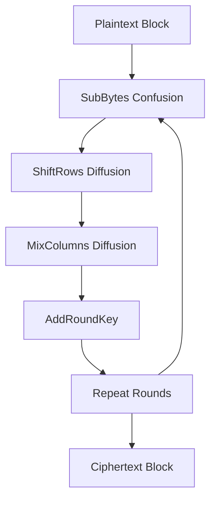

# Confusion and Diffusion: The Two Properties Every Good Cipher Needs

## English

In 1949 Claude Shannon described two properties that any strong cipher must have, and they remain the clearest way to reason about cipher design today. Confusion means that the relationship between the key and the ciphertext should be as complicated as possible, so that studying the output tells you almost nothing about the key. Diffusion means that changing one bit of the plaintext (or one bit of the key) should change roughly half of the output bits, spreading the influence of every input bit across the whole ciphertext. A cipher with poor confusion leaks patterns about the key; a cipher with poor diffusion leaks patterns about the message.

A simple substitution cipher, where each letter is replaced by another fixed letter, has terrible diffusion: changing one letter of the plaintext changes exactly one letter of the ciphertext. That is why frequency analysis breaks it — the statistical shape of English survives encryption. A one-time pad, by contrast, has perfect confusion (the ciphertext is statistically independent of the plaintext) but is impractical because the key must be as long as the message and never reused. Real ciphers live in between and try to approximate both properties efficiently.

AES achieves both through its substitution-permutation network. The SubBytes step (the S-box) provides confusion: each byte is replaced by a non-linear lookup value, so a single key byte's influence gets scrambled. The ShiftRows and MixColumns steps provide diffusion: bytes are shifted across rows and mixed within columns so that after a few rounds, every output bit depends on every input bit. The number of rounds is chosen so that this mixing completes — AES-128 uses 10 rounds, AES-192 uses 12, and AES-256 uses 14. Fewer rounds would leave detectable structure.

Diffusion is why the avalanche effect is a practical test: flip one bit of plaintext, encrypt again, and count how many output bits changed. A good cipher should flip about 50 percent of them, and the exact count should look random. If you see a small, consistent number of changed bits, the cipher is weak. Hash functions are designed with the same goal, which is why SHA-256 also exhibits a strong avalanche effect.

When you read about a new cipher or a custom construction, ask two questions: does it have a non-linear component (confusion), and does it spread bits thoroughly across rounds (diffusion)? If either is missing, the cipher is probably breakable with statistics rather than brute force. This is also why 'rolling your own' cipher is dangerous — getting both properties right, round after round, is subtle work that has taken decades of public analysis to refine.

## 中文

1949 年，Claude Shannon 提出任何強密碼都必須具備的兩個性質，時至今日，它們仍然是思考密碼設計最清晰的方式。Confusion（混淆）是指金鑰與密文之間的關係應該盡可能複雜，令你單憑觀察輸出，幾乎無法得知金鑰的任何資訊。Diffusion（擴散）是指明文改動一個位元（或金鑰改動一個位元），應該令輸出大約一半的位元改變，把每個輸入位元的影響力散佈到整段密文。混淆不足的密碼會洩漏金鑰的模式；擴散不足的密碼則會洩漏訊息的模式。

簡單的替換密碼——每個字母固定換成另一個字母——擴散極差：明文改一個字母，密文也只改一個字母。這就是頻率分析能夠破解它的原因：英文的統計特徵在加密後依然保留。相反，一次性密碼本（one-time pad）有完美的混淆（密文與明文在統計上完全獨立），但不切實際，因為金鑰必須與訊息一樣長，而且絕不能重複使用。真實的密碼居於兩者之間，設法有效率地逼近這兩個性質。

AES 透過它的替換-置換網路（substitution-permutation network）同時達成兩者。SubBytes 步驟（S-box）提供混淆：每個位元組被換成一個非線性的查表值，令單一金鑰位元組的影響被攪亂。ShiftRows 與 MixColumns 步驟提供擴散：位元組在列之間移位、在行內混合，經過幾輪之後，每個輸出位元都依賴每個輸入位元。輪數的選擇就是要讓這種混合完成——AES-128 用 10 輪、AES-192 用 12 輪、AES-256 用 14 輪。輪數太少會留下可偵測的結構。

擴散正是雪崩效應（avalanche effect）成為實用測試的原因：把明文翻轉一個位元，再加密一次，數一數有多少輸出位元改變。好的密碼應該改變大約 50%，而且實際數字看起來要隨機。如果你見到改變的位元數很少而且固定，這個密碼就很弱。雜湊函數的設計目標相同，所以 SHA-256 同樣展現強烈的雪崩效應。

當你讀到一種新密碼或自訂構造時，問兩個問題：它有沒有非線性元件（混淆）？它有沒有在每一輪把位元徹底散開（擴散）？若缺少任何一項，這個密碼大概可以用統計方法而非暴力破解攻破。這也是「自己發明密碼」危險的原因——要一輪又一輪地把兩個性質都做對，是經過數十年公開分析才磨練出來的細緻工作。

## Key Takeaway

Confusion hides the key and diffusion spreads the message, and a cipher needs both to resist statistical attack.

## Related Concepts
- AES in Practice: The Substitution-Permutation Network
- Cryptographic Randomness: Where Keys Actually Come From

## Diagram

