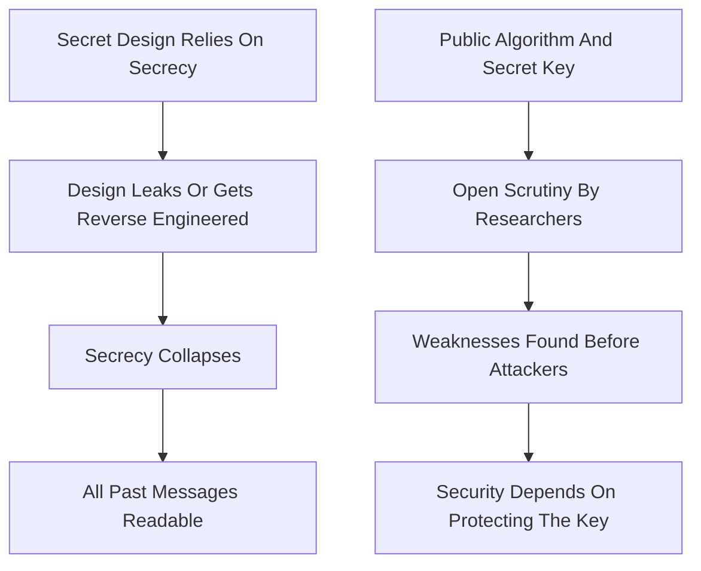

# Kerckhoffs's Principle: Security Should Depend on the Key, Not the Secret Design

## English

In the 1880s, Auguste Kerckhoffs laid out a set of rules for military ciphers, and one of them became the founding principle of modern cryptography: a cipher must remain secure even if everything about the system except the key is public knowledge. Shannon later restated it as 'the enemy knows the system.' The intuition is simple: designs leak. Source code gets decompiled, hardware gets reverse-engineered, employees leave, and a scheme that only works because nobody knows how it works is one leak away from total collapse.

History is full of cautionary tales. The 'secret' algorithms of the past often fell not because the math was weak but because the secrecy was. Once a design is exposed, there is no way to patch it retroactively — every message ever encrypted with it may now be readable. By contrast, a public algorithm like AES or ChaCha20 has been attacked by thousands of researchers for years, and the fact that it still stands is evidence, not a liability. Public scrutiny is how weaknesses get found before attackers find them.

Kerckhoffs's principle is why modern systems publish their specifications, submit to standardization processes, and run open cryptanalysis competitions. The AES competition in the late 1990s invited the world to break candidate ciphers; the winner, Rijndael, survived because it was examined, not because it was hidden. The principle also explains why 'security through obscurity' is considered a smell: hiding the design can be a useful extra layer (defense in depth), but it must never be the only thing standing between an attacker and your data.

In practice, this means your security budget should go into protecting the key, not the algorithm. Keys should be generated with a cryptographically secure random number generator, stored in hardware security modules or secure enclaves where possible, rotated on a schedule, and destroyed when no longer needed. The algorithm can be printed in a textbook; the key cannot. If someone steals your laptop, the attacker already knows you used AES-GCM — what they don't know is the key, and that is exactly the point.

A useful corollary: when you are evaluating a library or protocol, prefer well-known, widely reviewed primitives over clever homegrown ones. The unusual choice is not more secure just because it is unusual. Kerckhoffs's principle says the opposite — assume the attacker knows everything you know, and design so that the key is the only thing left to guess.

## 中文

1880 年代，Auguste Kerckhoffs 為軍事密碼訂下一套規則，其中一條成為現代密碼學的奠基原則：一個密碼即使除了金鑰之外的一切都公開，仍然必須保持安全。Shannon 後來把它重述為「敵人知曉整個系統」。直覺很簡單：設計會洩漏。原始碼會被反編譯、硬體會被逆向工程、員工會離職，而一個只靠「無人知道它如何運作」才成立的方案，距離徹底崩潰只差一次洩漏。

歷史充滿警示故事。過去那些「秘密」演算法往往不是因為數學薄弱而倒下，而是因為保密失效。設計一旦曝光，就無法事後修補——過去用它加密的每一則訊息都可能變得可讀。相反，像 AES 或 ChaCha20 這類公開演算法，多年來被數以千計的研究者攻擊，它仍然屹立不倒，這是證據，不是負擔。公開審視正是弱點在攻擊者找到之前被發現的方式。

Kerckhoffs 原則正是現代系統公開規格、參與標準化流程、舉辦公開密碼分析競賽的原因。1990 年代末的 AES 競賽邀請全世界破解候選密碼；勝出的 Rijndael 之所以倖存，是因為它被檢驗過，而不是因為它被隱藏。這個原則也解釋了為何「靠隱蔽求安全」（security through obscurity）被視為一種警訊：隱藏設計可以是有用的額外層（縱深防禦），但它絕不能是攻擊者與你的資料之間唯一的屏障。

在實務上，這意味著你的安全預算應該花在保護金鑰，而不是演算法。金鑰應該用密碼學安全的隨機數產生器產生、盡可能存放在硬體安全模組或安全隔離區、按計劃輪換、不再需要時銷毀。演算法可以印在教科書裡；金鑰不可以。如果有人偷了你的筆記型電腦，攻擊者早就知道你用了 AES-GCM——他們不知道的是金鑰，而這正是重點。

一個有用的推論：當你評估某個函式庫或協定時，寧可選擇知名、經過廣泛審視的基本元件，而不是自作聰明的自製版本。不尋常的選擇不會因為不尋常就比較安全。Kerckhoffs 原則說的正好相反——假設攻擊者知道你所有知道的，然後設計成只剩下金鑰需要猜。

## Key Takeaway

Assume the attacker knows your algorithm completely, and put all your protection into the key.

## Related Concepts
- Why 'Unbreakable' Is a Moving Target: Computational Security and Attack Cost
- Key Management Lifecycle: Generation, Distribution, Rotation, and Destruction

## Diagram

