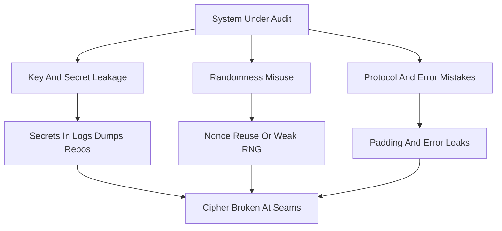

# Cryptographic Failure Modes: How Real Systems Actually Break

## English

Textbooks teach you how to break a cipher; real incidents teach you how systems break in practice. The uncomfortable truth is that almost no modern breach involves someone factoring a 2048-bit RSA modulus or brute-forcing AES-256. Instead, systems fail at the seams: a nonce gets reused, a key ends up in a log file, a developer uses a random number generator that isn't cryptographic, or an error message reveals too much. Understanding these failure modes is more useful than memorizing attack mathematics, because it tells you where to look when auditing real code.

One common failure is key and secret leakage through side channels that have nothing to do with the cipher. Secrets end up in debug logs, in crash dumps, in version control history, in environment variables visible to other processes, or in memory that gets swapped to disk unencrypted. A perfectly secure AES-GCM implementation is worthless if the key is printed in a stack trace. This is why key management is usually harder than the cryptography itself — the math is a solved problem, but the operational discipline of keeping keys out of everywhere they don't belong is not.

Another family of failures is misuse of randomness. If a nonce or an IV is generated with a non-cryptographic random number generator, or if a nonce is reused across two messages under the same key, the security guarantees collapse. With AES-GCM, nonce reuse can allow an attacker to recover the authentication key and forge messages; with stream ciphers, reusing a keystream lets an attacker XOR two ciphertexts together and cancel out the key entirely. The fix is not a better cipher but a better source of randomness and a discipline that makes nonce reuse structurally impossible.

A third family is protocol and error-handling mistakes. Padding oracle attacks, for example, do not break the block cipher — they exploit the fact that a server returns slightly different errors for 'bad padding' versus 'bad MAC', leaking one bit of information per query until the plaintext is recovered. Timing differences, different response lengths, and different HTTP status codes can all become oracles. The lesson is that an encryption scheme is only as strong as its observable behavior, not just its mathematical definition.

Finally, there is the human failure mode: choosing the wrong tool. Using ECB mode because it is the default, using a hash function as a password store, using Base64 and calling it encryption, or rolling a custom protocol because the standard one felt complicated. Most of these are caught by using well-reviewed libraries with safe defaults and by having someone who understands the failure modes review the design. The takeaway is that cryptography is rarely broken by clever mathematicians; it is broken by ordinary engineers making ordinary mistakes in a domain where mistakes are silent and expensive.

## 中文

教科書教你如何破解密碼；真實事故則教你係統在實務中如何崩壞。令人不安的真相是，幾乎沒有現代外洩事件涉及有人分解 2048 位元 RSA 模數，或暴力破解 AES-256。相反，系統在接縫處失效：nonce 被重複使用、金鑰跑進了記錄檔、開發者用了非密碼學的隨機數產生器，或者錯誤訊息透露太多。理解這些失效模式，比背誦攻擊數學更有用，因為它告訴你在審核真實程式碼時該往哪裡看。

一種常見失效是透過與密碼本身無關的旁路洩漏金鑰與秘密。秘密會出現在除錯記錄、當機傾印、版本控制歷史、其他程式可見的環境變數，或未加密就被置換到磁碟的記憶體中。一個完全安全的 AES-GCM 實作，如果金鑰被印在堆疊追蹤裡，就毫無價值。這就是為何金鑰管理通常比密碼學本身更難——數學是已解決的問題，但把金鑰擋在所有不該出現的地方之外的營運紀律則不是。

另一類失效是隨機性的誤用。如果 nonce 或 IV 用非密碼學的隨機數產生器產生，或者 nonce 在同一把金鑰下被兩則訊息重複使用，安全保證就會崩潰。以 AES-GCM 而言，nonce 重用可能讓攻擊者還原驗證金鑰並偽造訊息；以串流密碼而言，重用金鑰流會讓攻擊者把兩段密文 XOR 在一起，完全抵銷金鑰。解法不是更好的密碼，而是更好的隨機性來源，以及讓 nonce 重用結構上不可能發生的紀律。

第三類是協定與錯誤處理的錯誤。例如填充預言攻擊（padding oracle attack）並不破解區塊密碼——它利用伺服器對「填充錯誤」與「MAC 錯誤」回傳略有不同的錯誤，每次查詢洩漏一個位元的資訊，直到還原明文。時間差、回應長度差、HTTP 狀態碼差，全都可以變成預言。教訓是：加密方案的安全性取決於它可被觀察到的行為，而不只是它的數學定義。

最後是人的失效模式：選錯工具。因為它是預設值就用 ECB 模式、用雜湊函式當密碼儲存、用 Base64 然後稱之為加密，或者因為標準協定感覺複雜就自訂一套。這些大多可以靠使用經過審視、預設安全的函式庫，以及讓理解失效模式的人審核設計來避免。結論是：密碼學很少被聰明的數學家攻破，而是被普通工程師在一個錯誤既沉默又昂貴的領域裡犯下的普通錯誤攻破。

## Key Takeaway

Real cryptographic breaches come from leaked keys, bad randomness, and error-message oracles far more often than from broken math.

## Related Concepts
- Padding Oracle Attacks: When Error Messages Leak the Plaintext
- Nonce Reuse: The Small Mistake That Breaks a Cipher Completely

## Diagram

