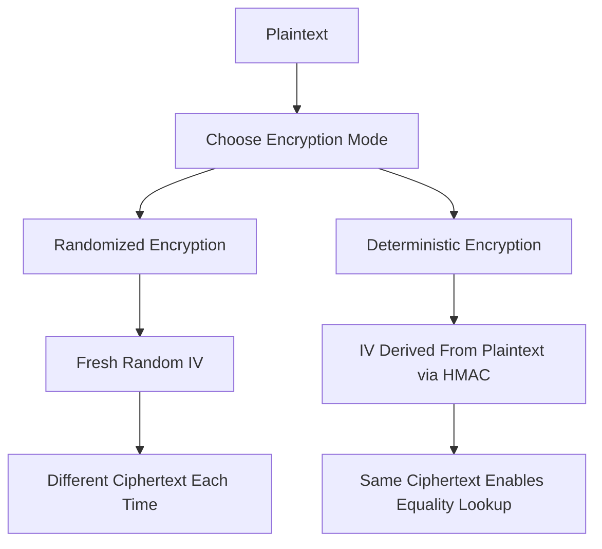

# Deterministic versus Randomized Encryption: When the Same Input Must (or Must Not) Produce the Same Output

## English

Randomized encryption is the default we teach: feed in a plaintext and a fresh random nonce or IV, and every ciphertext looks completely different. But some real systems deliberately want the opposite. Deterministic encryption produces the same ciphertext every time for the same plaintext under the same key, which sounds like a fatal flaw but is exactly what you need when you must look up a record by its encrypted value.

Picture a database of customer emails. If you encrypt each email with a random IV, you can never write a query like SELECT * WHERE encrypted_email = ? because the stored ciphertext for alice@example.com will differ on every row and every insert. Deterministic encryption solves this by deriving the IV from the plaintext itself, often via a keyed hash such as HMAC-SHA256 used as a synthetic IV. The same email always yields the same ciphertext, so equality lookups work. The trade-off is severe: an attacker who sees two identical ciphertexts learns the two plaintexts are identical, which is called a frequency leak. If the set of possible plaintexts is small (say, a yes/no flag or a country code), the attacker can simply encrypt every candidate and match.

This is why deterministic schemes are reserved for values with high entropy or for columns where equality search is genuinely required. For everything else you use randomized encryption and accept that you cannot search on the ciphertext directly. The general lesson is that the nonce or IV policy is a design decision with real consequences: reuse a nonce by accident and you break confidentiality; eliminate randomness on purpose and you gain searchability at the cost of leaking patterns.

A related middle ground is order-preserving or order-revealing encryption, which lets you run range queries like WHERE salary > 50000 on encrypted data. These schemes leak even more than deterministic encryption, because the ciphertext ordering mirrors the plaintext ordering, and research has shown that with enough leaked order information an attacker can approximately reconstruct the underlying values. They exist and are used, but only with eyes open about the leakage.

The practical takeaway for a developer is to ask, before choosing a scheme, what operations the application must perform on the encrypted data. Encryption is not a single switch; it is a spectrum from fully randomized (maximum privacy, no queryability) through deterministic (equality search, frequency leaks) to order-preserving (range search, order leaks). Choosing a point on that spectrum is a threat-model decision, not a purely technical one.

## 中文

隨機化加密（randomized encryption）是我們通常教的預設做法：把明文連同一個全新的隨機 nonce 或 IV 一起餵進演算法，每次產生的密文都截然不同。但有些真實系統偏偏想要相反的效果。確定性加密（deterministic encryption）在同一把金鑰下，對同一段明文永遠產生同一段密文，聽起來像致命缺陷，但當你需要用加密後的值來查詢紀錄時，這正是你需要的東西。

想像一個儲存客戶電郵的資料庫。如果你用隨機 IV 加密每個電郵，你就永遠寫不出 SELECT * WHERE encrypted_email = ? 這種查詢，因為 alice@example.com 在每一行、每一次插入所儲存的密文都不一樣。確定性加密的解法，是從明文本身推導出 IV，通常用帶金鑰的雜湊（例如以 HMAC-SHA256 當作合成 IV）。同一個電郵永遠得出同一段密文，所以等值查詢行得通。代價卻很沉重：攻擊者只要看到兩段相同的密文，就知道兩段明文相同，這叫頻率洩漏（frequency leak）。如果可能的明文集合很小（例如是/否旗標，或國碼），攻擊者只要把每個候選值加密一次再比對就行。

這就是為何確定性方案只保留給高熵（entropy，即難以猜測）的值，或者確實需要等值搜尋的欄位。其他情況一律用隨機化加密，並接受無法直接在密文上搜尋這件事。整體的教訓是：nonce 或 IV 的策略是一個有實際後果的設計決定——不小心重用了 nonce 就破壞機密性；刻意消除隨機性就換來可搜尋性，代價是洩漏模式。

另一個折衷方案是保序加密（order-preserving encryption）或揭示順序加密（order-revealing encryption），讓你能在加密資料上執行 WHERE salary > 50000 這類範圍查詢。這些方案洩漏得比確定性加密更多，因為密文的次序直接反映明文的次序；研究顯示，只要洩漏足夠的次序資訊，攻擊者就能大致重建底層數值。它們確實存在、也確實有人用，但用的人必須清楚知道會洩漏什麼。

對開發者來說，實用的結論是：在挑選方案之前，先問清楚應用程式必須對加密資料執行哪些操作。加密不是一個開關，而是一條光譜：由完全隨機化（最大私隱、完全無法查詢），經確定性（可做等值搜尋、有頻率洩漏），到保序（可做範圍搜尋、有次序洩漏）。在這條光譜上選哪一點，是威脅模型（threat model）的決定，而不是純技術的決定。

## Key Takeaway

Randomized encryption maximizes privacy but blocks searching; deterministic and order-preserving schemes trade leakage for queryability, so the right choice depends on what operations your application must perform on the ciphertext.

## Related Concepts
- Deterministic encryption and frequency analysis
- Searchable encryption trade-offs

## Diagram

