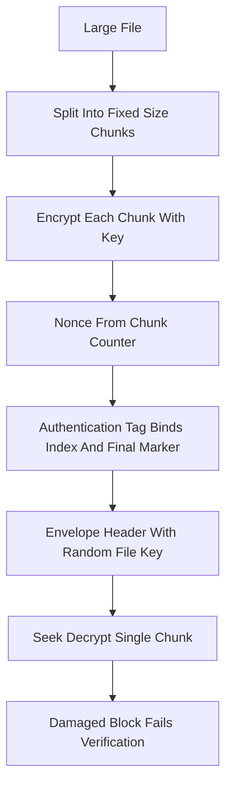

# Encrypting Files and Streams: Chunking, Seeking, and the Cost of Large Data

## English

Encrypting a short message in memory is easy: one call, one output buffer. Encrypting a 50 GB video file is a different engineering problem. You cannot hold the whole thing in RAM, you want to start playback before the download finishes, and you want a corrupted byte near the end not to destroy the whole file. Real file encryption therefore works in chunks, and the way those chunks are stitched together matters a great deal.

The straightforward approach is to split the file into fixed-size blocks, say 64 KiB, and encrypt each block independently with the same key but a nonce derived from the block's position (often a counter). This is essentially what the AES-GCM family of modes supports through a per-chunk counter, and it is how many full-disk and file-container formats behave. Because each block is self-contained, you can seek to any offset, decrypt just that block, and start reading immediately. A single damaged block loses only that block's data.

The catch is that independent chunks reintroduce the malleability and reordering problems that a single authenticated stream avoids. An attacker could not forge a block's contents (the authentication tag stops that), but they could potentially swap block 5 with block 7, or truncate the file after block 3, unless the scheme binds the blocks together. The standard fix is to authenticate the block index and a final-block marker along with the data, so a swapped or missing block fails verification. Some formats add a whole-file header containing a random file key and per-file nonce, then wrap that file key with a master key — the envelope pattern applied at the file level.

Streaming ciphers such as ChaCha20 handle large data naturally because they generate a keystream from a counter; you can encrypt byte by byte as data arrives without buffering. But authenticated modes like AES-GCM still need the full message to compute the final tag, which is why streaming formats either chunk the authentication or use a construction designed for streaming, such as encrypting each chunk with its own tag and chaining a running authentication state.

For anyone building or choosing a file encryption tool, the questions to ask are concrete: what is the chunk size, is each chunk independently authenticated, does the format bind chunk order, and can it detect truncation? A format that answers all four well is doing real engineering, not just calling an AES library. The naive approach — read the whole file, encrypt, write it out — works for a photo and falls apart for a disk image.

## 中文

在記憶體中加密一小段訊息很簡單：呼叫一次，得到一個輸出緩衝區。加密一個 50 GB 的影片檔卻是另一種工程問題。你不可能把整個檔案放進 RAM，你想在下載完成前就開始播放，你也不想檔案尾端一個位元組損壞就毀掉整個檔案。因此真實的檔案加密是以區塊（chunk）方式運作，而這些區塊如何拼接起來，影響極大。

最直接的做法，是把檔案切成固定大小的區塊，比如 64 KiB，然後用同一把金鑰、但以區塊位置推導出的 nonce（通常是一個計數器）獨立加密每個區塊。AES-GCM 這類模式透過每區塊計數器基本上就是這樣支援的，許多全碟加密與檔案容器格式也是這樣做。由於每個區塊自成一體，你可以跳到任何偏移位置，只解密那一個區塊，立即開始讀取。單一區塊損壞只會損失該區塊的資料。

問題在於，獨立區塊會重新引入單一驗證串流本來能避免的可延展性（malleability）與重排問題。攻擊者無法偽造某個區塊的內容（驗證標籤會擋住），但除非方案把區塊綁在一起，否則他們有可能把第 5 塊和第 7 塊對調，或者在第三塊之後截斷檔案。標準解法是把區塊索引和「最後一塊」標記連同資料一併驗證，這樣被調換或缺漏的區塊就無法通過驗證。有些格式會加一個全檔標頭，內含隨機的檔案金鑰和每檔 nonce，再用主金鑰包裝該檔案金鑰——這就是信封模式（envelope pattern）套用在檔案層級。

ChaCha20 這類串流加密（stream cipher）天生適合大資料，因為它從計數器產生金鑰串流（keystream）；資料一到就能逐位元組加密，不必緩衝。但 AES-GCM 這類驗證模式仍需完整訊息才能算出最終標籤，所以串流格式要麼把驗證分塊，要麼採用為串流設計的構造，例如每塊各自附標籤，並串接一個持續更新的驗證狀態。

對任何要打造或挑選檔案加密工具的人來說，該問的問題很具體：區塊大小是多少？每個區塊是否獨立驗證？格式有否綁定區塊次序？能否偵測截斷？四項都答得好的格式，才是真正的工程，而不是單純呼叫一個 AES 函式庫。天真的做法——讀入整個檔案、加密、寫出——處理一張相片還行，處理一個磁碟映像就崩潰了。

## Key Takeaway

Large-file encryption is a chunking design problem: independent blocks enable seeking and limit damage but require explicit binding of block index and final-block markers to prevent reordering and truncation attacks.

## Related Concepts
- Chunked authenticated encryption
- Envelope encryption at the file level

## Diagram

