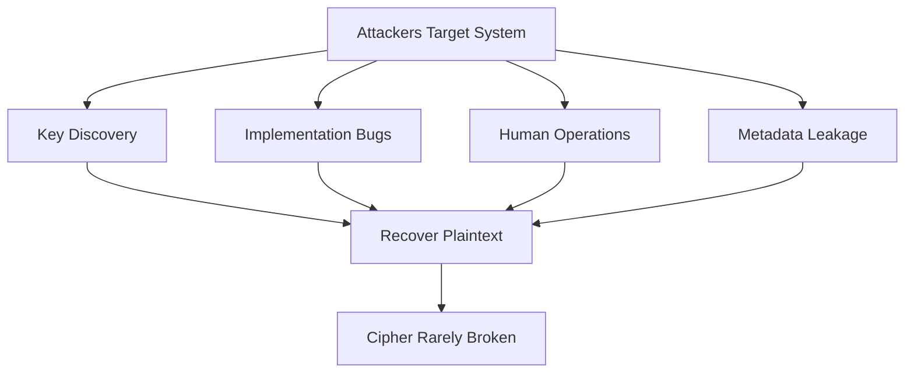

# The Adversary's Playbook: What Attackers Actually Try Before Touching the Math

## English

Textbook cryptography focuses on breaking the algorithm, but in real incidents the cipher is almost never the weak point. Attackers work through a practical checklist, and understanding that checklist tells you where to spend your defensive effort. The first item is almost always key discovery: a key committed to a Git repository, a hardcoded string in a mobile app binary, an environment variable leaked in a crash dump, a backup tape left unencrypted. No amount of AES-256 helps if the key is sitting in a config file next to the ciphertext.

The second item is the implementation layer. Does the system use a fresh nonce every time? Does it verify the authentication tag before acting on decrypted data, or does it decrypt first and check later? Does it return a distinct error for 'bad padding' versus 'bad MAC', handing an attacker a padding oracle? These are not exotic attacks; they are ordinary bugs, and they are far more common than a mathematical break. A famous historical example is the discovery that some TLS implementations leaked timing information during CBC decryption, letting an attacker recover plaintext byte by byte by measuring response times.

The third item is the human and operational layer. Who can read the key? Is it in a hardware security module or an environment variable? Are old keys revoked when an employee leaves? Are logs accidentally capturing plaintext or key material? Attackers phish for credentials, look for overly broad IAM roles, and exploit the fact that key rotation is often planned but never executed. Encryption at rest is worthless if the database administrator can simply SELECT the plaintext column because the application decrypts on read.

The fourth item is the metadata. Even perfect end-to-end encryption reveals who talks to whom, when, how often, and how large the messages are. Traffic analysis has broken real-world anonymity systems without ever decrypting a byte. If your threat model includes a global observer, the ciphertext is the least of your worries; the pattern is the message.

So the practical lesson is to think like the attacker in order: where are the keys, what does the implementation leak, who has access, and what does the traffic pattern reveal? Almost every real breach lives in one of those four questions. The mathematics of AES and ChaCha20 is not the thing that will fail you; the operational discipline around them is.

## 中文

教科書式的密碼學專注於破解演演算法，但在真實事件中，密碼本身幾乎從來不是弱點。攻擊者會依一份實用清單逐項嘗試，明白這份清單，就知道防禦精力該放在哪裡。第一項幾乎永遠是尋找金鑰：提交到 Git 儲存庫的金鑰、寫死在手機 App 二進位檔裡的字串、在當機轉儲（crash dump）中洩漏的環境變數、忘了加密的備份磁帶。如果金鑰就躺在密文旁邊的設定檔裡，AES-256 再強也救不了你。

第二項是實作層。系統是否每次都使用全新的 nonce？它是在對解密後的資料採取行動之前先驗證驗證標籤，還是先解密再檢查？它對「填充錯誤」和「MAC 錯誤」是否回傳不同的錯誤訊息，等於把填充預言機（padding oracle）送給攻擊者？這些不是什麼罕見攻擊，而是普通 bug，而且遠比數學上的破解常見。歷史上著名的例子，是某些 TLS 實作在 CBC 解密時洩漏時間資訊，攻擊者只要量度回應時間，就能逐位元組還原明文。

第三項是人員與營運層。誰能讀取金鑰？金鑰放在硬體安全模組（HSM）還是環境變數？員工離職時舊金鑰有否撤銷？日誌會不會不小心記錄了明文或金鑰材料？攻擊者會用釣魚騙取憑證、尋找許可權過大的 IAM 角色，並利用「金鑰輪換計劃了卻從未執行」這個事實。如果資料庫管理員可以直接 SELECT 明文欄位（因為應用程式讀取時會解密），靜態加密（encryption at rest）就形同虛設。

第四項是中繼資料（metadata）。即使端對端加密完美無缺，它仍然會揭示誰與誰通訊、何時、多頻繁、訊息多大。流量分析（traffic analysis）曾在完全沒有解密任何一個位元組的情況下，破解真實世界的匿名系統。如果你的威脅模型包含全球觀察者，密文反而是你最不用擔心的；模式本身就是訊息。

所以實用的教訓是：按次序像攻擊者那樣思考——金鑰在哪裡？實作洩漏了什麼？誰有存取權？流量模式揭示了什麼？幾乎每一宗真實入侵都落在這四條問題之中。AES 與 ChaCha20 的數學不會讓你失守；圍繞它們的營運紀律才會。

## Key Takeaway

Real attackers target key management, implementation bugs, access control, and metadata long before they attempt to break the cipher, so defensive effort should follow the same priority order.

## Related Concepts
- Threat modeling and attack surface
- Key management lifecycle

## Diagram

