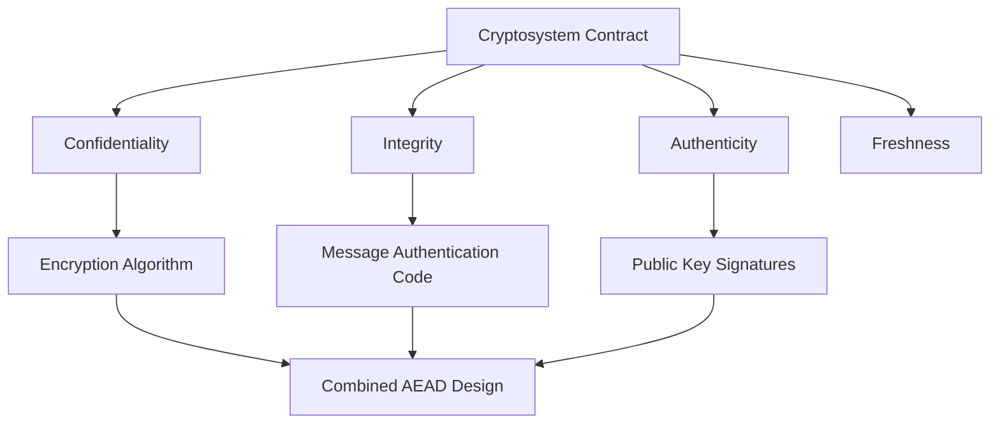

# The Cryptosystem as a Contract: What Encryption Actually Promises

## English

When people first meet encryption, they usually reduce it to one sentence: it keeps secrets secret. That is true, but it is only one clause of a longer contract. A cryptosystem is a package of algorithms and protocols that makes several separate promises, and a system can keep one promise while breaking another. Confidentiality says an eavesdropper learns nothing about the plaintext. Integrity says nobody can alter the ciphertext undetected. Authenticity says the message really came from the holder of a particular key. Freshness says an old message cannot be silently replayed today. Each promise needs its own machinery, and confusing them is where real systems fail.

A concrete example shows why the distinction matters. Suppose a messaging app encrypts messages with a strong cipher but never checks integrity. An attacker cannot read the message, yet they can flip bits in transit. Because many ciphers are malleable, a controlled bit flip in the ciphertext can produce a predictable change in the plaintext, even without the key. The victim sees a message that decrypts cleanly and is completely wrong. Confidentiality held; integrity did not. This is precisely why modern designs pair encryption with a message authentication code, usually in an encrypt-then-MAC arrangement, or use an AEAD mode that bundles both.

Authenticity is a third, separate clause. Encryption alone tells you nothing about who sent a message. If two parties share a symmetric key, either of them could have produced any given ciphertext, so a valid decryption proves only that someone with the key was involved. Public-key signatures are the usual tool for attributing a message to a specific identity, and they are layered on top of encryption rather than replacing it. A common beginner assumption, that decrypting successfully proves the sender is legitimate, is simply false in symmetric settings.

Freshness is the clause people forget entirely. Even a perfectly confidential, integral, and authentic message can be recorded and replayed later. A bank transfer instruction is valid forever unless the protocol attaches something that ties it to this moment, such as a sequence number, a timestamp checked within a narrow window, or a random challenge the receiver issued and expects to see echoed back. Replay protection lives in the protocol, not in the cipher.

The practical lesson is to ask, for any system you build or audit, which clauses of the contract it actually enforces and where. Reading a design document, you want to point at the exact component that delivers each promise. If a promise has no named owner, it is almost certainly not being kept, and the gap will only surface when someone attacks it.

## 中文

講到加密，大部分人第一時間只會想到一句話：佢可以保密。呢句係啱嘅，但佢只係一份更長合約入面其中一條條款。一個密碼系統（cryptosystem）其實係一組演演算法同協定嘅組合，同時作出幾個唔同嘅承諾，而一個系統可以守住一個承諾，同時破壞另一個。機密性（confidentiality）指竊聽者對明文（plaintext）一無所知。完整性（integrity）指冇人能夠改動密文（ciphertext）而唔被發現。真實性（authenticity）指訊息真係來自持有某條特定金鑰嘅人。新鮮度（freshness）指舊訊息唔可以喺今日被靜靜雞重播。每個承諾都需要自己嘅機制，而將佢哋撈亂，就係真實系統出事嘅地方。

一個具體例子可以說明點解呢個區分咁重要。假設一個通訊 app 用咗好強嘅密碼去加密訊息，但從來唔檢查完整性。攻擊者讀唔到訊息，但佢可以喺傳輸途中反轉某些位元。由於好多密碼都係可延展嘅（malleable），即使冇金鑰，密文入面一個受控嘅位元反轉，都可以令明文產生可預測嘅改變。收訊者見到嘅訊息解密得好乾淨，但內容完全錯曬。機密性守住了，完整性就冇。正因為咁，現代設計會將加密同訊息認證碼（MAC）配埋一齊，通常係「先加密後 MAC」嘅安排，或者直接用一個同時提供兩者嘅 AEAD 模式。

真實性係第三條、完全獨立嘅條款。單靠加密，你根本唔知訊息係邊個發嘅。如果兩個人都分享同一條對稱金鑰，咁任何一方都可以產生任何一個密文，所以成功解密只證明「有金鑰嘅人」參與過，唔證明係邊個。公開金鑰簽名（public-key signature）通常就係用嚟將訊息歸屬於某個特定身份嘅工具，佢係加喺加密之上，而唔係取代加密。初學者常見嘅誤解，就係以為「解密成功就證明傳送者係合法嘅」，喺對稱設定入面，呢個講法根本唔成立。

新鮮度就係大家完全唔記得嘅條款。即使一個訊息喺機密性、完整性、真實性三方面都完美，佢一樣可以被錄低，之後再重播。一項銀行轉帳指令，除非個協定附加咗啲嘢將佢綁死喺「呢一刻」，否則佢永遠有效。呢啲嘢可以係序號、喺窄窄時間視窗內檢查嘅時間戳，或者由收訊者發出、預期對方原封不動回傳嘅隨機挑戰值（challenge）。防重播嘅保護住喺協定度，唔係喺密碼本身。

實用嘅教訓係：對於你負責建立或者審核嘅任何系統，都要問清楚佢實際上守住咗邊幾條條款，同埋喺邊度守。睇設計檔案嘅時候，你要能夠指出邊個具體元件負責邊個承諾。如果某個承諾冇明確嘅負責人，咁佢幾乎肯定冇被守住，而個缺口只會喺有人攻擊佢嘅時候先浮面。

## Key Takeaway

Encryption is a multi-clause contract covering confidentiality, integrity, authenticity, and freshness, and each clause needs its own explicit mechanism.

## Related Concepts
- Threat modeling
- Authenticated encryption

## Diagram

