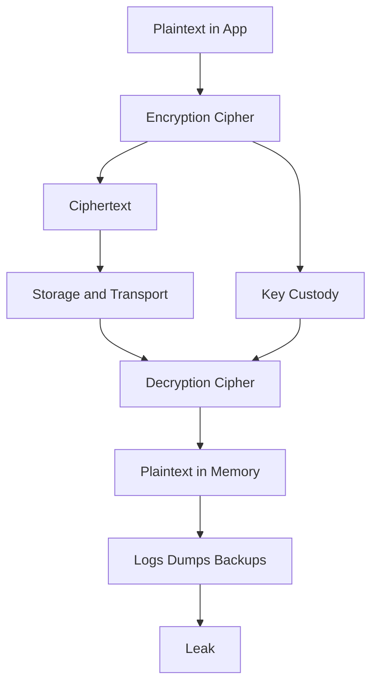

# Cryptographic Boundaries: Where Encryption Stops and the Rest of the System Begins

## English

A cipher is a small, well-understood machine that transforms bytes into other bytes. Real systems are large, messy machines full of databases, logs, caches, queues, and backups. Most cryptographic failures in the wild do not happen inside the cipher at all; they happen at the boundary where the cipher hands its output to the rest of the system. Learning to see those boundaries is arguably more useful than memorising algorithm names, because that is where you can actually prevent damage.

Start with the plaintext boundary. Encryption protects data while it is ciphertext, but the application must decrypt it to use it. The moment decryption happens, the plaintext exists in memory, and from there it can leak into a crash dump, a debug log, a heap snapshot, a swap file, or an error report sent to a third-party service. A team can run flawless AES-GCM and still leak every secret because someone added a verbose log line that prints the request body before decryption. The cryptographic primitive did its job perfectly; the surrounding software undid it.

Next is the key boundary. A key is only as safe as the place it is stored and the code that touches it. If the key sits in an environment variable, it appears in process listings and container inspection output. If it sits in a config file, it gets copied into backups and repositories. If it sits in application memory, it can be dumped. This is why serious systems move keys into dedicated custody, such as a hardware security module or a cloud key service, so that the application asks for a decrypt operation rather than ever holding the raw key. The boundary shifts from 'protect this byte string' to 'protect this API call'.

Then there is the metadata boundary. Even perfect end-to-end encryption leaves a great deal visible: who talked to whom, when, how often, how large the messages were, and from which network address. Traffic analysis can reconstruct social graphs and daily routines without ever breaking a cipher. If your threat model includes an observer who can watch the network, then metadata is part of the problem, and solutions like padding, cover traffic, or relaying through a mix network belong in the design. Encryption alone does not address it.

Finally, the trust boundary. Every system eventually trusts something: a certificate authority, a package registry, a build pipeline, an operating system, a random number generator. An attacker who can compromise any of those does not need to attack the cipher. The productive habit is to draw the boundary explicitly on a diagram, label what crosses it, and ask what an attacker on each side can do. Most real breaches live at these seams, not in the mathematics.

## 中文

一個密碼（cipher）係一部細細部、理解得好透徹嘅機器，將一堆位元組轉換成另一堆位元組。但真實系統係一部大型、混亂嘅機器，入面塞滿資料庫、日誌、快取、佇列同備份。現實世界入面，大部分密碼學上嘅失敗根本唔係喺密碼內部發生，而係喺密碼將輸出交俾系統其餘部分嘅嗰條界線上面發生。學識睇得出呢啲界線，老實講比死記演演算法名更加有用，因為嗰度先係你真正可以防止損害嘅地方。

先講明文界線。加密保護嘅係資料喺密文狀態嗰陣，但應用程式要用佢，就一定要解密。解密一發生，明文就存在喺記憶體入面，由嗰一刻開始，佢可以洩漏去當機傾印（crash dump）、除錯日誌、堆積快照（heap snapshot）、交換檔（swap file），或者送去第三方服務嘅錯誤報告。一個團隊可以完美咁用 AES-GCM，但依然洩漏曬所有秘密，原因只係有人加咗一行囉嗦嘅日誌，喺解密之前就印咗請求內容出嚟。密碼學原語完美咁做好咗佢份工；係周圍嘅軟體將佢抵銷咗。

跟住係金鑰界線。一條金鑰嘅安全程度，只等於佢存放嘅地方同埋接觸佢嘅程式碼。如果條金鑰放喺環境變數，佢就會出現喺行程列表同容器檢查輸出度。如果放喺設定檔，佢就會被複製入備份同版本庫。如果放喺應用程式記憶體，佢就可以被傾印出嚟。呢個就係點解認真嘅系統會將金鑰搬去專責保管嘅地方，例如硬體安全模組（HSM）或者雲端金鑰服務，令應用程式只係要求「做一次解密操作」，而唔係自己揸住條原始金鑰。條界線由「保護呢串位元組」轉移到「保護呢個 API 呼叫」。

然後係中繼資料（metadata）界線。即使做到完美嘅端對端加密，都仲有好多嘢係睇得到：邊個同邊個講過嘢、幾時講、幾密、訊息幾大、由邊個網路地址發出。流量分析（traffic analysis）唔使破解任何密碼，就可以重構社交圖譜同日常作息。如果你嘅威脅模型包括一個可以監察網路嘅觀察者，咁中繼資料就係問題嘅一部分，而填充（padding）、掩護流量（cover traffic），或者經混合網路（mix network）轉發呢啲方案，就應該納入設計。單靠加密處理唔到呢樣嘢。

最後係信任界線。每個系統最終都會信任某啲嘢：憑證頒發機構、套件登錄檔、建置流程、作業系統、隨機數產生器。攻擊者只要攻陷其中任何一個，就根本唔需要攻擊個密碼。有效率嘅習慣係：喺圖上面明確畫出條界線，標示乜嘢會跨越佢，再問嚇每一邊嘅攻擊者可以做啲乜。大部分真實嘅入侵事件，都係住喺呢啲接縫度，而唔係喺數學入面。

## Key Takeaway

Most real cryptographic failures happen at the boundaries where plaintext, keys, metadata, and trust cross between components, not inside the algorithm itself.

## Related Concepts
- Threat modeling
- Key management lifecycle

## Diagram

