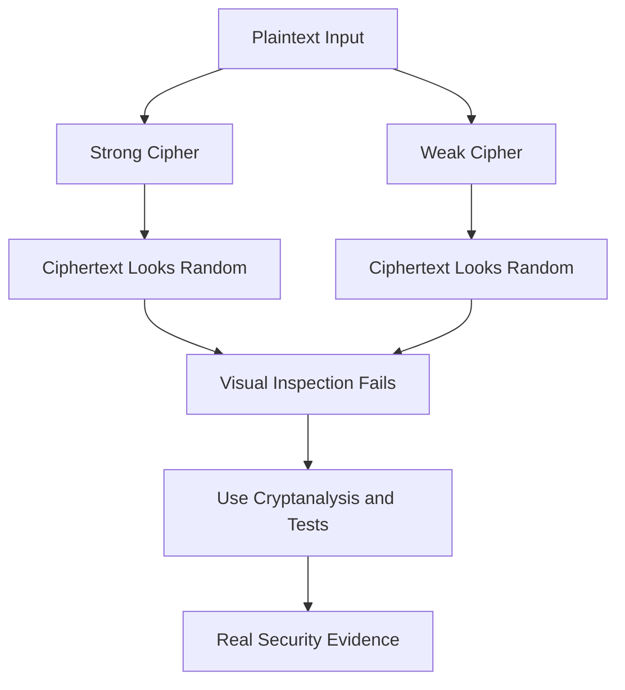

# Why You Cannot Tell Good Encryption from Bad by Looking

## English

Here is a fact that unsettles newcomers: the output of a strong cipher and the output of a completely broken one look identical. Both are streams of bytes with no visible structure, no English words, no patterns a human eye can catch. If you encrypt a file with a modern cipher and with a deliberately weak toy cipher, and you stare at the two results, you will not be able to rank them. This is not a curiosity; it is the reason cryptographic quality has to be established by analysis and testing rather than by inspection.

The underlying reason is that good ciphertext is designed to be indistinguishable from random data to anyone without the key. Random data has no structure by definition, so anything that looks structured is a red flag, but the absence of visible structure proves nothing. A weak cipher can also produce output that looks random, while leaking information through subtle statistical biases that only a purpose-built test can detect. Historically, several ciphers were believed secure for years and then fell to statistical analysis that revealed a slight bias in particular bits.

This creates a trap for developers. It is tempting to invent a custom scheme, look at the output, see gibberish, and conclude it works. The correct conclusion is the opposite: gibberish is the minimum bar, not evidence of security. Real evaluation means publishing the design, letting experts attempt cryptanalysis, running standard statistical test suites on large samples, and checking that the implementation matches the specification. Even then, confidence grows slowly and can collapse quickly.

A related trap is confusing obscurity with strength. A home-made cipher whose design is secret may feel safer, but history is unambiguous: secret designs tend to be weak designs, because they never received the scrutiny that exposes flaws. Public, standardised algorithms survive precisely because many people tried to break them and failed. The security should live in the key, not in the secrecy of the method, which is why standard algorithms are the right default.

Practically, this means your decision procedure should never be 'does the output look encrypted?' It should be 'is this a well-studied standard algorithm, used through a reputable library, with correct parameters and a properly generated key?' You are not evaluating the ciphertext; you are evaluating the provenance of the code that produced it. That shift, from looking at the artefact to auditing the process, is one of the most important habits in applied cryptography.

## 中文

有件事會令初學者好不安：一個強密碼嘅輸出，同一個完全破解得穿嘅密碼嘅輸出，睇落係一模一樣嘅。兩者都係一串串位元組，冇可見結構、冇英文字、冇人眼捉得到嘅模式。如果你用一個現代密碼同一個故意整弱嘅玩具密碼去加密同一個檔案，然後望住兩個結果，你根本排唔到邊個強啲。呢個唔係咩奇趣現象；而係點解密碼學質素一定要靠分析同測試去確立，而唔係靠肉眼檢查。

背後嘅原因係：好嘅密文，設計上就係要對任何冇金鑰嘅人嚟講，同隨機資料無法區分。隨機資料按定義就冇結構，所以任何睇落有結構嘅嘢都係警號，但「冇可見結構」證明唔到任何嘢。一個弱密碼都可以產生睇落隨機嘅輸出，同時透過微妙嘅統計偏差洩漏資訊，而呢啲偏差只有專門設計嘅測試先捉得到。歷史上，有幾個密碼被相信安全咗好多年，最後都敗喺統計分析手上，因為分析揭示咗某些位元有輕微偏差。

呢個為開發者設下一個陷阱。人好容易會自己發明一套方案，望住輸出，見到一堆亂碼，就結論話佢行得通。正確嘅結論啱啱相反：亂碼只係最低門檻，唔係安全嘅證據。真正嘅評估，係要公開設計、俾專家嘗試密碼分析、喺大量樣本上跑標準統計測試套件，同埋檢查實作係咪符合規格。即使做到咁，信心都係慢慢建立，但可以好快崩塌。

另一個相關陷阱，係將「隱蔽」同「強度」撈亂。一套設計保密嘅自製密碼，可能感覺安全啲，但歷史講得好清楚：保密嘅設計通常都係弱嘅設計，因為佢哋從來冇受過揭露缺陷嘅審視。公開、標準化嘅演算法之所以經得起考驗，正正因為好多人試過破解佢哋而失敗。安全應該住喺金鑰度，而唔係住喺方法嘅保密度，呢個就係點解標準演算法係正確嘅預設選擇。

實際嚟講，你嘅判斷程序永遠唔應該係「輸出睇落似唔似加密咗？」而應該係「呢個係咪一個受過充分研究嘅標準演算法，透過信譽良好嘅程式庫使用，參數正確，金鑰亦都係正確咁產生？」你評估嘅唔係密文，而係產生佢嗰段程式碼嘅來源。由「望住件成品」轉變為「審核個過程」，係應用密碼學入面最重要嘅習慣之一。

## Key Takeaway

Ciphertext that looks random proves nothing, so security must be judged by the provenance and analysis of the algorithm and implementation, never by appearance.

## Related Concepts
- Kerckhoffs's principle
- Cryptographic failure modes

## Diagram

