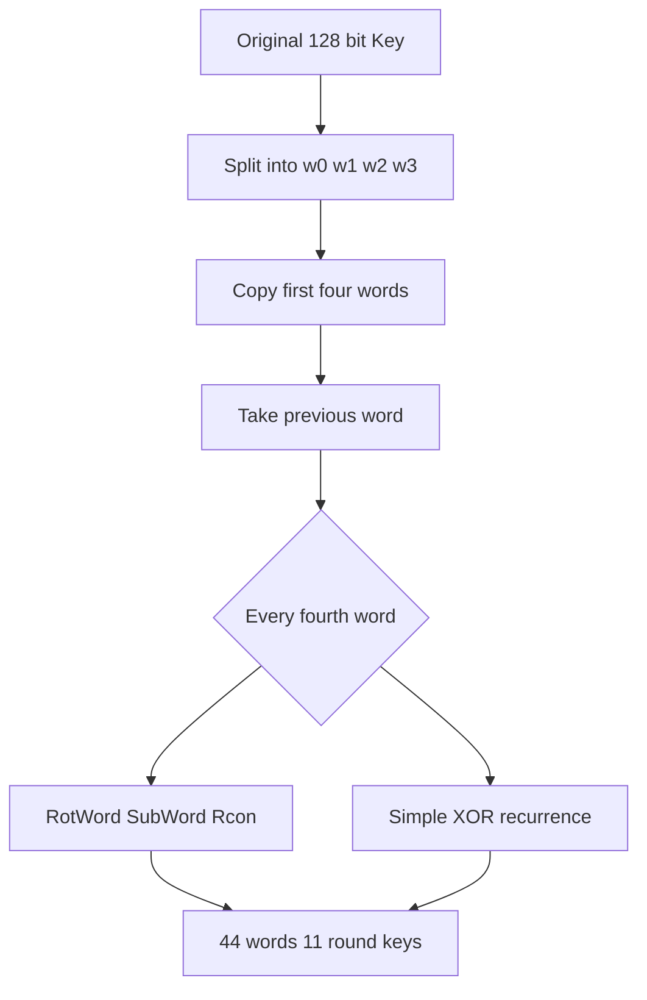

# The Key Schedule: How One Short Key Becomes Many Round Keys

## English

When you hand AES a 128-bit key, the cipher does not use that key directly on your data. Instead it runs the key through a key schedule (also called key expansion), a deterministic routine that stretches the 16-byte key into eleven separate 16-byte round keys — 176 bytes in total for AES-128. Each of those round keys is XORed into the state (the 4x4 grid of bytes the cipher operates on) at a different stage of encryption. The original key is never applied to the plaintext at all; it is only the seed from which all the round keys are derived.

The expansion works in 4-byte words. AES-128 has four words of input key material (w0 through w3) and needs 44 words in total. The first four words are simply the key itself. Each subsequent word is the XOR of the previous word and the word four positions back — except every fourth word, which first passes through a routine called RotWord (rotate the four bytes left by one), SubWord (apply the S-box to each byte), and then XOR with a round constant (Rcon), a small value that changes each round. Those three transformations are what stop the schedule from being a simple linear recurrence you could invert trivially.

Why bother? Diffusion. If the same key were XORed into every round, an attacker could cancel it out by XORing two ciphertexts together and eliminate the key entirely. By making every round use a different derived key, and by deriving each one through non-linear steps, the influence of a single key bit spreads across the entire state after a few rounds. This is the same confusion-and-diffusion philosophy the cipher body uses, applied to the key material itself.

A practical consequence: the key schedule is a known weak point in some ciphers. Related-key attacks exploit the fact that two keys with a simple mathematical relationship produce round keys with a predictable relationship. AES is not broken by this in practice, but the concept matters — if you derive two AES keys by flipping one bit of the master key, you may be creating a relationship the designer never intended. Good key management avoids this by deriving keys through a KDF rather than by tweaking bits.

One more subtlety: because the key schedule is deterministic, the same key always produces the same round keys. That is fine for a single key, but it means the round keys are as sensitive as the master key. If an attacker recovers a round key from a side-channel leak (say, a cache-timing observation during the final round), they can often work backwards through the schedule to recover the master key. This is why implementations that compute the schedule once and cache it in memory must protect that memory just as carefully as the key itself.

## 中文

當你將一條 128 位元的金鑰交給 AES，加密演算法並不會直接拿這條金鑰去處理你的資料。它會先讓金鑰經過「金鑰排程」（key schedule，又叫金鑰擴展），一個確定性的程序，把 16 位元組的金鑰拉長成十一條各自 16 位元組的輪金鑰——AES-128 總共 176 位元組。每一條輪金鑰會在不同階段與「狀態」（state，即密碼運算所操作的 4x4 位元組方格）進行 XOR。原本的金鑰從頭到尾都沒有直接作用於明文，它只是種子，所有輪金鑰都由它衍生出來。

擴展以 4 位元組為一個「字」運作。AES-128 有四個字的輸入金鑰材料（w0 至 w3），總共需要 44 個字。頭四個字就是金鑰本身。之後每一個字，都是前一個字與「往前數第四個字」的 XOR——但每第四個字例外，它要先經過 RotWord（將四個位元組向左旋轉一位）、SubWord（對每個位元組套用 S-box），再與輪常數（Rcon）XOR，這個小數值每輪都不同。這三道轉換正是防止排程退化成簡單線性遞推、讓人可以輕易反推的關鍵。

為何要這樣做？為了擴散。如果每一輪都 XOR 同一條金鑰，攻擊者只要把兩段密文互相 XOR，就能把金鑰完全消掉。讓每一輪使用不同的衍生金鑰，並且透過非線性步驟衍生，就能令單一金鑰位元的影響在幾輪之內散佈到整個狀態。這與密碼本體所用的混淆與擴散哲學如出一轍，只是套用在金鑰材料本身。

實際後果之一：金鑰排程在某些密碼中是已知的弱點。相關金鑰攻擊（related-key attack）正是利用兩條有簡單數學關係的金鑰，會產生有可預測關係的輪金鑰。AES 在實務上並未因此被攻破，但這個概念很重要——如果你用「把主金鑰其中一位元反轉」的方式衍生出兩條 AES 金鑰，你可能正在製造設計者從未預期的關係。良好的金鑰管理會用 KDF 衍生金鑰，而不是靠改動位元。

還有一個微妙之處：由於金鑰排程是確定性的，同一條金鑰永遠產生同一組輪金鑰。對單一金鑰而言這沒問題，但這代表輪金鑰與主金鑰同樣敏感。如果攻擊者透過側通道洩漏（例如在最後一輪觀察到快取時序）取得某一條輪金鑰，他們往往可以逆推排程還原主金鑰。這就是為何那些「只計算一次排程並快取在記憶體」的實作，必須像保護金鑰本身一樣保護那塊記憶體。

## Key Takeaway

AES never applies your key directly — it expands it into a schedule of round keys, and that schedule is as sensitive as the key itself.

## Related Concepts
- AES Substitution-Permutation Network
- Side-Channel Attacks

## Diagram

