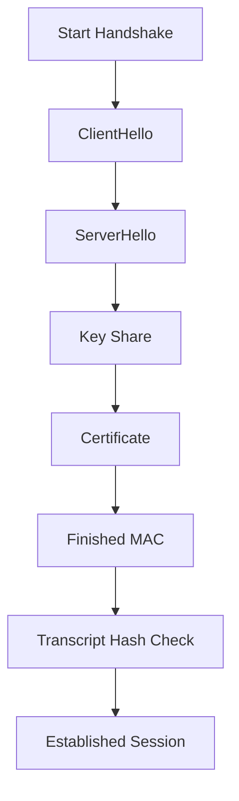

# Cryptographic Protocols Are State Machines, Not Just Algorithms

## English

A common beginner mental model is that encryption is a function: you call encrypt(key, plaintext) and get ciphertext. In real systems, encryption is almost always embedded in a protocol — a sequence of messages exchanged between parties, where each message depends on the ones before it. A protocol is best understood as a state machine: each party is in some state (no session, handshake in progress, established, closing), and each incoming message triggers a transition. Most real-world cryptographic failures are not broken math but broken state machines — a message accepted in the wrong state, a transition that skips a check, a state that can be replayed.

TLS is the canonical example. The handshake has a defined order: ClientHello, ServerHello, key share, certificate, Finished. The Finished message contains a MAC over a transcript hash of every handshake message seen so far. That transcript hash is what binds the whole conversation together — if an attacker tampers with any earlier message, the Finished MAC will not verify. This is a state-machine property, not a property of any single cipher. Remove the transcript binding and you get downgrade attacks, where an attacker strips strong cipher suites from the ClientHello and forces a weaker one.

Replay is the classic state-machine bug. Suppose a protocol accepts a signed command message. If the receiver does not track which messages it has already seen, an attacker can capture a legitimate 'transfer $100' signed message and resend it a hundred times. The signature verifies every time — the math is fine — but the protocol has no state recording that this exact message was already processed. The fix is a nonce or sequence number that the receiver remembers, which is fundamentally a state-machine concern, not a cryptographic one.

Another pattern: the confused deputy. A server holds a key and will sign anything a client asks. If the protocol does not distinguish 'this request came from Alice for Alice's data' from 'this request came from Alice for Bob's data', the server becomes a signing oracle for the attacker. The fix is not a stronger signature algorithm — it is a protocol rule that binds the request to the requester's identity, checked before the signature is produced.

When you design or review an encrypted system, ask: what states exist, what transitions are allowed, what happens if a message arrives twice or out of order, and what happens if a message from one state arrives in another. These questions catch more real bugs than asking whether AES-256 is stronger than AES-128. The math is usually the strongest part of the system; the protocol around it is usually the weakest.

## 中文

初學者常見的心智模型是：加密就是一個函數，你呼叫 encrypt(key, plaintext) 就得到密文。但在真實系統裡，加密幾乎總是嵌在一個「協定」之中——一連串雙方交換的訊息，每一則都依賴之前的訊息。協定最好理解成一個狀態機：每一方都處於某個狀態（尚未建立連線、握手進行中、已建立、關閉中），每一則收到的訊息觸發一次狀態轉換。現實世界大多數的密碼學失敗，不是數學被攻破，而是狀態機被攻破——在錯誤的狀態下接受了訊息、某個轉換跳過了檢查、某個狀態可以被重播。

TLS 是經典例子。握手有既定順序：ClientHello、ServerHello、金鑰分享、憑證、Finished。Finished 訊息包含一個 MAC，覆蓋迄今為止所有握手訊息的「逐字稿雜湊」（transcript hash）。這個逐字稿雜湊把整段對話綁在一起——如果攻擊者篡改任何較早的訊息，Finished 的 MAC 就無法驗證。這是狀態機的性質，不是任何單一密碼的性質。拿掉逐字稿綁定，你就會得到降級攻擊：攻擊者從 ClientHello 中刪去強加密套件，逼對方使用較弱的一套。

重播是最典型的狀態機漏洞。假設某協定接受一條已簽名的指令訊息。如果接收方不記錄自己已經見過哪些訊息，攻擊者就可以擷取一條合法的「轉帳 100 元」簽名訊息，然後重送一百次。每一次簽名都驗證通過——數學沒問題——但協定沒有狀態去記錄這條訊息已經處理過。解法是接收方記住的 nonce 或序號，這本質上是狀態機問題，不是密碼學問題。

另一種模式：混淆代理（confused deputy）。伺服器持有一條金鑰，會為任何客戶端簽署任何東西。如果協定不區分「這個請求來自 Alice、是為 Alice 的資料」與「這個請求來自 Alice、是為 Bob 的資料」，伺服器就變成攻擊者的簽名神諭。解法不是更強的簽名演算法，而是一條協定規則：在產生簽名之前，把請求綁定到請求者的身分並加以檢查。

當你設計或審查一個加密系統時，要問：有哪些狀態？允許哪些轉換？如果一則訊息來兩次或次序錯亂會怎樣？如果來自某個狀態的訊息在另一個狀態抵達會怎樣？這些問題抓到的真實漏洞，比問「AES-256 是否比 AES-128 強」多得多。數學通常是系統中最強的部分，圍繞它的協定通常最弱。

## Key Takeaway

Most real cryptographic failures are broken protocol state machines, not broken ciphers — ask what states exist and what happens when messages arrive twice or out of order.

## Related Concepts
- TLS Handshake
- Replay Attacks

## Diagram

