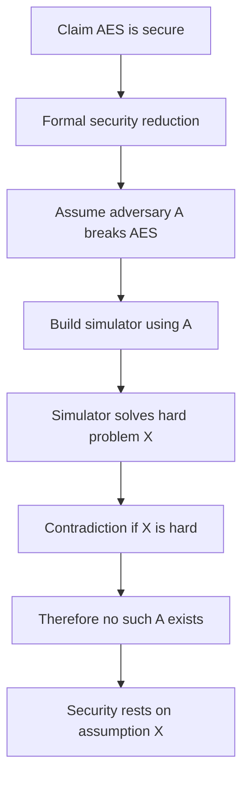

# Cryptographic Proofs and Reductions: Why 'No One Has Broken It' Is a Formal Claim

## English

When a cryptographer says AES is secure, they are not saying 'we tried and failed to break it.' They are making a precise, falsifiable claim: any algorithm that breaks AES with non-negligible advantage within a certain time bound would also solve some other problem believed to be hard. This is a security reduction — a proof that breaking the cipher implies solving a well-studied hard problem. The cipher is then said to be 'secure under the assumption that problem X is hard.'

A reduction works by contradiction. Suppose an adversary A can distinguish AES output from random with probability noticeably better than 1/2. You build a simulator that uses A as a subroutine to solve problem X. If X is believed hard, then no such A can exist. The strength of the claim depends entirely on how strong the underlying assumption is. RSA is secure under the assumption that factoring large integers is hard. Diffie-Hellman is secure under the assumption that the discrete logarithm problem is hard. Elliptic curve variants rest on the elliptic-curve discrete log problem. Each assumption is a separate, studied conjecture — not a theorem.

This is why 'no one has broken it' is a weaker statement than it sounds. A cipher can be unbroken in practice yet rest on a shaky assumption, or be broken tomorrow because someone finds a faster algorithm for the underlying problem. The reduction tells you: if the cipher breaks, here is exactly what else breaks. That is enormously more useful than 'we tried.' It tells you where to look and what a break would mean for the rest of the field.

There is also the tightness of the reduction. A reduction may show that an attacker with advantage ε against the cipher yields an attacker with advantage ε/2^64 against problem X. If ε/2^64 is negligible, the proof is technically valid but practically useless — it does not rule out a real attack. Cryptographers care a lot about tight reductions because a loose one can hide a real weakness behind a comfortable-looking theorem.

Finally, reductions only cover the model. They assume the adversary is a probabilistic polynomial-time algorithm with black-box access to the cipher. They say nothing about side-channel attacks, implementation bugs, or protocol misuse. A perfectly proven cipher can be broken by a power-analysis attack on the hardware, or by a developer who reuses a nonce. The proof is a guarantee about the mathematical object, not about the system you shipped.

## 中文

當密碼學家說 AES 安全，他們不是說「我們試過攻破但失敗了」。他們是在提出一個精確、可被否證的主張：任何能在某個時間界內以不可忽略的優勢攻破 AES 的演算法，也會同時解決另一個被認為困難的問題。這就是「安全性歸約」（security reduction）——證明攻破該密碼蘊含著解決一個被深入研究過的難題。於是我們說該密碼「在問題 X 困難的假設下是安全的」。

歸約用反證法運作。假設某個對手 A 能以明顯優於 1/2 的機率分辨 AES 輸出與隨機資料。你就建構一個模擬器，把 A 當作子程序來解決問題 X。如果 X 被認為困難，那麼這樣的 A 不可能存在。這個主張的強度完全取決於底層假設有多強。RSA 在「分解大整數是困難的」這個假設下安全。Diffie-Hellman 在「離散對數問題是困難的」假設下安全。橢圓曲線版本則建立在橢圓曲線離散對數問題上。每個假設都是獨立、被研究過的猜想——不是定理。

這就是為何「沒有人攻破它」聽起來比實際上弱。一個密碼可以在實務上未被攻破，卻建立在搖搖欲墜的假設上；也可能明天就被攻破，因為有人找到底層問題的更快速演算法。歸約告訴你的是：如果這個密碼被攻破，還有什麼會一起被攻破。這比「我們試過了」有用得多。它告訴你該往哪裡找，以及一次攻破對整個領域意味著什麼。

還有歸約的「緊緻度」（tightness）。一個歸約可能顯示：對密碼有優勢 ε 的攻擊者，會產生對問題 X 有優勢 ε/2^64 的攻擊者。如果 ε/2^64 是可忽略的，這個證明在技術上成立，但在實務上無用——它無法排除真實攻擊。密碼學家非常在意緊緻歸約，因為寬鬆的歸約可能把真實弱點藏在一個看起來很舒服的定理背後。

最後，歸約只涵蓋模型之內。它們假設對手是一個機率多項式時間演算法，只能以黑盒方式存取密碼。它們對側通道攻擊、實作錯誤或協定誤用隻字不提。一個證明完美的密碼，可能被硬體上的功率分析攻擊攻破，或被重用 nonce 的開發者毀掉。證明是關於那個數學物件的保證，不是關於你交付的系統。

## Key Takeaway

A security proof is a reduction showing that breaking the cipher implies solving a believed-hard problem — it is a precise claim about the math, not a guarantee about your implementation.

## Related Concepts
- Computational Security
- Cryptographic Failure Modes

## Diagram

