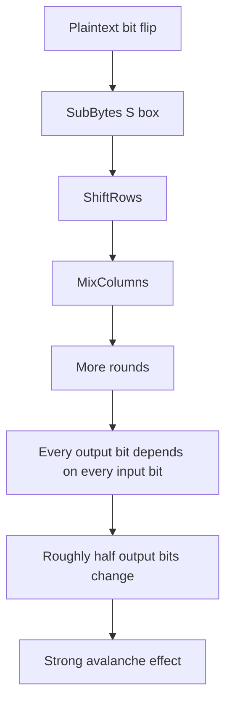

# Diffusion in Action: How the Avalanche Effect Reveals Cipher Quality

## English

The avalanche effect is the observable signature of good diffusion: flip a single bit of the plaintext or the key, and roughly half of the output bits should change. It sounds like a party trick, but it is one of the most practical diagnostics you can run on a cipher, because it exposes structural weaknesses that a formal proof might take years to characterise. If changing one input bit changes only a handful of output bits, the cipher has a local structure that an attacker can exploit by building up partial information about the key.

Concretely, imagine a toy block cipher that processes 8 bytes. You encrypt the plaintext 0x0000000000000000 and record the ciphertext. Then you flip the lowest bit of the first byte, giving 0x0100000000000000, and encrypt again. A well-designed cipher should produce a ciphertext that differs from the first in roughly 32 of the 64 bits. If instead only three bits differ, the cipher is probably just XORing the plaintext with a key stream — a one-time pad look-alike that fails catastrophically if the key is ever reused.

AES achieves strong avalanche behaviour through its round structure. The SubBytes step applies a non-linear S-box to every byte, so one changed byte becomes one changed byte per column. ShiftRows moves those bytes to different columns, and MixColumns mixes each column so that one changed byte spreads to all four bytes of that column. After a handful of rounds, every output bit depends on every input bit. This is why AES uses at least 10 rounds for 128-bit keys: fewer rounds would leave measurable non-randomness.

Avalanche testing is also a debugging tool. If you are implementing a cipher from a specification and your avalanche numbers look off — say, only 20 percent of bits change — you probably have a bug in one of the round transformations. Test vectors from the specification will catch outright errors, but avalanche tests catch subtler issues like a misordered ShiftRows or a MixColumns constant that is slightly wrong. Both kinds of bugs would be invisible to a naive round-trip test.

One caveat: avalanche is necessary but not sufficient. A cipher can pass avalanche tests and still be weak against differential or linear cryptanalysis, which look at statistical correlations over many chosen plaintexts. Avalanche is a sanity check, not a security proof. But it is cheap to run, easy to understand, and catches the kind of mistake that turns a cipher from 'probably fine' into 'obviously broken'.

## 中文

雪崩效應（avalanche effect）係良好擴散（diffusion）嘅可觀察特徵：改動明文或者密鑰嘅任何一個位元，輸出應該大約有一半位元跟住改變。聽落好似小把戲，但佢係你可以對密碼演算法做嘅最實用診斷之一，因為佢會揭露一啲正式證明可能要花幾年先刻畫到嘅結構性弱點。如果改一個輸入位元只係令少數輸出位元改變，噉個密碼就有局部結構，攻擊者可以靠累積部分密鑰資訊嚟利用佢。

具體嚟講，想像一個處理 8 個位元組嘅玩具分組密碼。你加密明文 0x0000000000000000 並記錄密文。然後你反轉第一個位元組嘅最低位元，變成 0x0100000000000000，再加密一次。設計良好嘅密碼應該產生一個同第一段密文大約有 32 個位元（64 位元中）唔同嘅密文。如果只得三個位元唔同，個密碼大概只係將明文同密鑰流做 XOR——一個似一次性密碼本嘅嘢，一旦密鑰重用就會災難性失敗。

AES 透過佢嘅輪結構達到強烈嘅雪崩行為。SubBytes 步驟對每個位元組施加非線性 S-box，所以一個改咗嘅位元組會變成每列一個改咗嘅位元組。ShiftRows 將嗰啲位元組移到唔同嘅列，而 MixColumns 就混合每一列，令一個改咗嘅位元組擴散到嗰列嘅全部四個位元組。經過幾輪之後，每個輸出位元都依賴每個輸入位元。呢個就係為何 AES 對 128 位元密鑰要用至少 10 輪：輪數少啲就會留下可量度嘅非隨機性。

雪崩測試亦係除錯工具。如果你正根據規格實作一個密碼，而你嘅雪崩數字睇落唔對——例如只得 20% 位元改變——你好可能喺其中一個輪變換有 bug。規格提供嘅測試向量會捉到明顯錯誤，但雪崩測試會捉到更細微嘅問題，例如 ShiftRows 次序錯咗，或者 MixColumns 常數有少少錯。兩種 bug 都會喺天真嘅來回測試（round-trip test）中隱形。

一個注意點：雪崩係必要但唔充分。一個密碼可以通過雪崩測試，但仍然對差分或者線性密碼分析（differential or linear cryptanalysis）脆弱，因為嗰啲分析會睇大量選擇明文之間嘅統計相關性。雪崩係一個基本檢查，唔係安全證明。但佢便宜、易明，而且會捉到嗰種令密碼由「大概冇問題」變成「明顯壞咗」嘅錯誤。

## Key Takeaway

The avalanche effect is a cheap, practical diagnostic for diffusion — if one input bit changes and only a few output bits follow, the cipher has exploitable local structure.

## Related Concepts
- Confusion and Diffusion
- Differential Cryptanalysis

## Diagram

