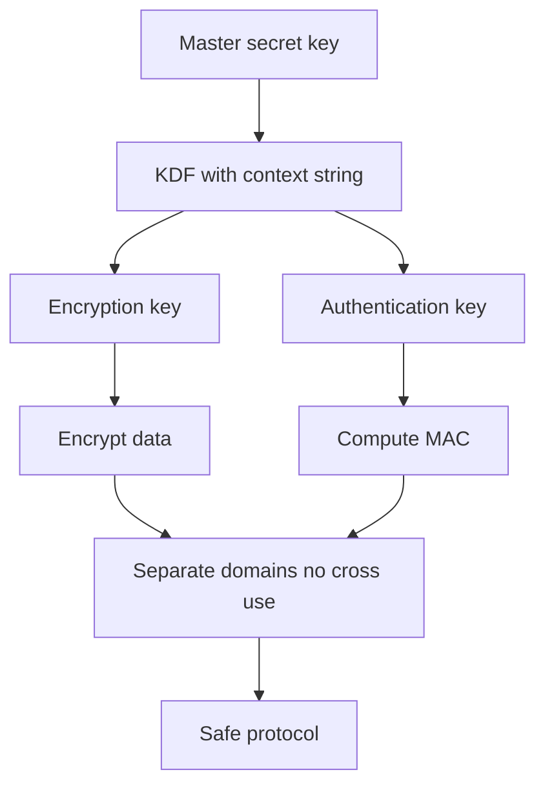

# Key Separation and Domain Separation: Why One Key Should Never Do Two Jobs

## English

Key separation is the principle that a single cryptographic key should be used for exactly one purpose. If you use the same key to encrypt data and to compute a MAC, or to encrypt data in two different protocols, you create cross-protocol attacks where the output of one use becomes a valid input to another. The attack is often not about breaking the cipher at all — it is about confusing the system into treating one kind of value as another.

A classic pattern: a system uses the same key K for both AES-CBC encryption and HMAC-SHA256 authentication. An attacker who can get the system to encrypt arbitrary data can also cause it to produce MACs over chosen messages, because the MAC key is the same. Worse, if the encryption and MAC outputs are ever compared or concatenated, an attacker can sometimes substitute an encrypted block for a MAC tag and have it accepted. This is one of the reasons modern designs use separate keys — one for encryption, one for MAC — even when they are derived from the same master secret.

Domain separation is the mechanism that makes key separation practical. Instead of generating many independent random keys, you derive them from one master key using a KDF (key derivation function) with distinct context strings. For example, HKDF (RFC 5869) takes an info parameter; you might call HKDF-Expand with info = 'encryption-key' for one key and info = 'authentication-key' for another. Because HKDF is a PRF (pseudorandom function), the two outputs are computationally independent even though they come from the same input keying material. The context strings are the 'domains' that keep the uses apart.

Domain separation also prevents subtle collisions. Suppose a protocol hashes a message and a nonce by concatenating them: hash(message || nonce). If an attacker can choose the message and nonce, they can craft two different (message, nonce) pairs that produce the same byte string — for example, message = 'ab', nonce = 'c' versus message = 'a', nonce = 'bc'. Length-prefixing or including a fixed domain tag (like hash('v1-context' || message || nonce)) closes this hole. The tag makes the input to the hash unambiguous about which field is which.

In practice, key separation is enforced at several layers. TLS 1.3 derives separate traffic keys for each direction of each connection, using labels like 'c ap traffic' and 's ap traffic'. Signal's Double Ratchet derives a new message key per message and a separate chain key per direction. Disk encryption tools derive a per-volume key from a master key, never reusing the master directly. If you are designing a system, the rule of thumb is simple: if two operations have different security properties or different threat models, give them different keys — and derive those keys with explicit, versioned domain labels.

## 中文

金鑰分離（key separation）係一個原則：一個金鑰應該只用於一個目的。如果你用同一個金鑰嚟加密資料同埋計算 MAC，或者喺兩個唔同協議中加密資料，你就會製造跨協議攻擊（cross-protocol attacks），其中一個用途嘅輸出會變成另一個用途嘅有效輸入。呢種攻擊通常完全唔係破解密碼本身——而係令系統混淆，將一種數值當成另一種。

一個經典模式：一個系統用同一個金鑰 K 做 AES-CBC 加密同 HMAC-SHA256 認證。如果攻擊者可以令系統加密任意資料，佢亦可以令系統對選擇嘅訊息產生 MAC，因為 MAC 金鑰係同一個。更差嘅係，如果加密同 MAC 輸出曾經被比較或者串接，攻擊者有時可以將一個加密區塊替換成 MAC 標籤並令佢被接受。呢個就係為何現代設計用分開嘅金鑰——一個加密、一個 MAC——即使佢哋係由同一個主秘密衍生出嚟。

域分離（domain separation）係令金鑰分離可行嘅機制。與其產生好多獨立隨機金鑰，你由一個主金鑰用 KDF（金鑰衍生函式）配合唔同嘅上下文串嚟衍生佢哋。例如 HKDF（RFC 5869）有一個 info 引數；你可以用 info = 'encryption-key' 叫 HKDF-Expand 攞一個金鑰，用 info = 'authentication-key' 攞另一個。因為 HKDF 係 PRF（偽隨機函式），兩個輸出喺計算上係獨立嘅，即使佢哋來自同一輸入金鑰材料。啲上下文串就係將用途分開嘅「域」。

域分離亦防止細微嘅碰撞。假設一個協議將訊息同 nonce 串接後雜湊：hash(message || nonce)。如果攻擊者可以選擇訊息同 nonce，佢可以砌出兩對唔同嘅 (message, nonce) 產生同一個位元組串——例如 message = 'ab'、nonce = 'c' 對比 message = 'a'、nonce = 'bc'。加長度字首或者包含固定域標籤（例如 hash('v1-context' || message || nonce)）就可以堵塞呢個窿。個標籤令雜湊輸入清楚知道邊個欄位係邊個。

喺實踐中，金鑰分離喺幾個層面執行。TLS 1.3 為每條連線每個方向衍生唔同嘅流量金鑰，用類似 'c ap traffic' 同 's ap traffic' 嘅標籤。Signal 嘅 Double Ratchet 為每條訊息衍生新訊息金鑰，並為每個方向衍生獨立嘅鏈金鑰。磁碟加密工具由主金鑰衍生每個磁碟區嘅金鑰，永遠唔會直接重用主金鑰。如果你設計系統，經驗法則好簡單：如果兩個操作有唔同安全屬性或者唔同威脅模型，就畀佢哋唔同金鑰——並且用明確、有版本嘅域標籤嚟衍生嗰啲金鑰。

## Key Takeaway

Never let one key serve two purposes — derive purpose-specific keys from a master secret using explicit domain labels, so a compromise or confusion in one use cannot leak into another.

## Related Concepts
- Key Derivation Functions
- HKDF and Domain Separation

## Diagram

