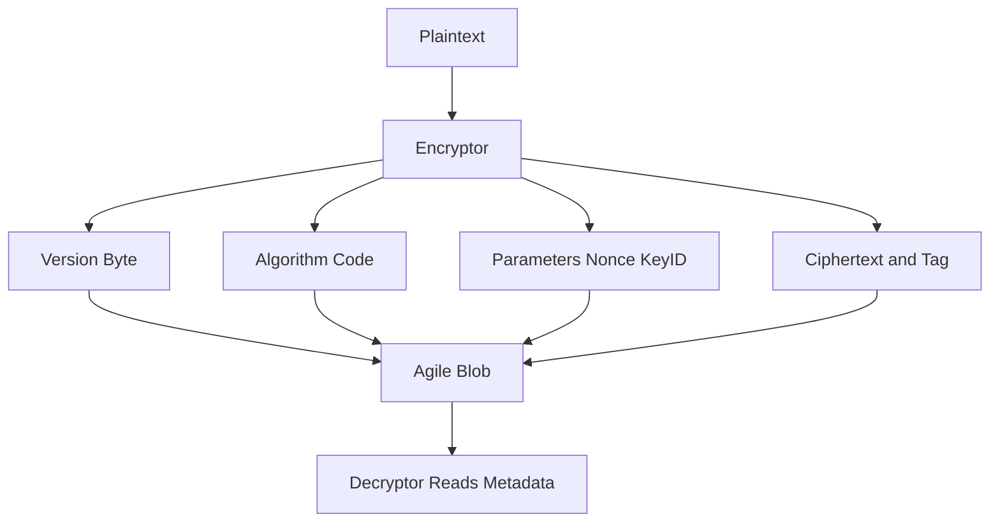

# Cryptographic Agility at the Algorithm Level: Versioning Ciphertexts So You Can Migrate

## English

Every ciphertext you produce today may need to be decrypted years from now, possibly after the algorithm that produced it has been deprecated. If your storage format does not record which algorithm and parameters were used, you cannot migrate — you can only re-encrypt everything at once, which is often impossible for data at rest. Cryptographic agility is the discipline of designing formats that carry enough metadata to survive algorithm changes.

A minimal agile ciphertext format has three parts: a version identifier, an algorithm identifier, and the parameters (nonce, IV, tag, key ID). For example, a blob might start with a one-byte format version (0x01), then a one-byte algorithm code (0x01 = AES-256-GCM, 0x02 = ChaCha20-Poly1305), then a key identifier, then the nonce, then the ciphertext and tag. The exact layout matters less than the principle: the decryptor must be able to look at the blob and know exactly how to process it without out-of-band information.

This is not just about swapping algorithms. It is also about parameters. If you later decide to increase the GCM tag length, change the KDF iteration count, or move from a 12-byte to a 16-byte nonce, the format needs to express that. A common mistake is to hard-code parameters in the decryptor: 'GCM always uses a 12-byte nonce'. That works until you need to change it, and then every old blob becomes unreadable. Encoding the nonce length in the format, or using a version byte that implies a fixed set of parameters, keeps the door open.

The migration story is where agility pays off. Suppose you discover that your KDF parameters are too weak, or that an algorithm has a practical break. With an agile format, you can write new blobs with the new algorithm while still decrypting old blobs with the old one. You can then run a background job that re-encrypts old blobs at your own pace. Without agility, you face a flag day: every blob must be re-encrypted before you can switch, and any blob you miss becomes unreadable. Real systems — TLS, JOSE, age, and most disk encryption formats — all embed algorithm identifiers for exactly this reason.

Agility has costs. Every extra byte of metadata is a byte an attacker can tamper with, and every supported algorithm is a code path that must be tested. The right balance is usually to support a small, well-understood set of algorithms and to version the format rather than the algorithm list. A single format version byte that implies 'AES-256-GCM with a 12-byte nonce and a 16-byte tag' is often enough, as long as you commit to incrementing it when anything changes. The goal is not infinite flexibility — it is the ability to make one controlled change when you need to.

## 中文

你今日產生嘅每一段密文，將來都可能需要解密，而嗰時產生佢嘅演算法可能已經被棄用。如果你嘅儲存格式冇記錄用咗邊個演算法同參數，你就唔可以遷移——你只能一次過重新加密所有嘢，而對於靜態數據嚟講呢個通常係唔可能嘅。密碼學敏捷性（cryptographic agility）就係設計格式嘅紀律，令格式攜帶足夠元數據去捱過演算法變更。

一個最低限度嘅敏捷密文格式有三部分：版本標識、演算法標識，同埋參數（nonce、IV、tag、密鑰 ID）。例如，一個 blob 可能以一個位元組嘅格式版本（0x01）開始，然後一個位元組嘅演算法代碼（0x01 = AES-256-GCM，0x02 = ChaCha20-Poly1305），然後密鑰標識、nonce、密文同 tag。確切佈局唔及原則重要：解密器必須能夠望住個 blob 就知道點樣處理佢，唔需要額外資訊。

呢個唔單止係換演算法嘅問題，亦係參數嘅問題。如果你後來決定增加 GCM tag 長度、改變 KDF 迭代次數，或者由 12 位元組 nonce 轉去 16 位元組，格式需要表達呢啲嘢。一個常見錯誤係喺解密器硬編碼參數：「GCM 永遠用 12 位元組 nonce」。噉樣行得通，直到你需要改變，然後每個舊 blob 都變成讀唔到。將 nonce 長度編碼入格式，或者用一個版本位元組暗示一組固定參數，就可以保持呢道門打開。

遷移故事就係敏捷性回本嘅地方。假設你發現 KDF 參數太弱，或者某個演算法有實際破解。有敏捷格式，你可以用新演算法寫新 blob，同時仍然用舊演算法解密舊 blob。然後你可以跑一個背景任務，按自己節奏重新加密舊 blob。冇敏捷性，你就面對一個「flag day」：每個 blob 都必須喺切換之前重新加密，而你漏咗嘅任何一個 blob 都會變成讀唔到。真實系統——TLS、JOSE、age，以及大部分磁碟加密格式——都嵌入演算法標識，正正就係為咗呢個原因。

敏捷性有代價。每個額外位元組嘅元數據都係攻擊者可以篡改嘅位元組，而每個支援嘅演算法都係一條必須測試嘅代碼路徑。正確嘅平衡通常係支援一小組、透徹理解嘅演算法，並且為格式而唔係為演算法清單做版本控制。一個格式版本位元組暗示「AES-256-GCM 配 12 位元組 nonce 同 16 位元組 tag」通常已經夠，只要你承諾任何嘢改變時就遞增佢。目標唔係無限靈活性——而係當你需要時，有能力做一次受控嘅改變。

## Key Takeaway

Design ciphertext formats with version and algorithm identifiers baked in, so you can migrate to new algorithms incrementally instead of facing an all-or-nothing re-encryption.

## Related Concepts
- Cryptographic Agility
- Ciphertext Format Design

## Diagram

