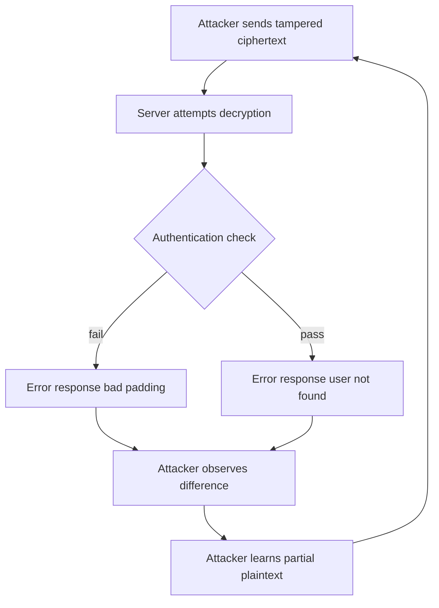

# The Decryption Oracle Problem: When Partial Knowledge Becomes a Weapon

## English

A decryption oracle is any interface that tells an attacker something about what a decryption attempt produced — even something as small as whether decryption succeeded or failed. In textbook cryptography you only worry about someone reading the ciphertext, but real systems constantly leak side information: an error page that says 「bad padding」 versus 「bad MAC」, a server that takes 3 ms longer on malformed input, a database that returns a row or returns nothing. Each of these is a tiny oracle, and a patient attacker can call it millions of times and use the answers to reconstruct plaintext one byte at a time. This is not a theoretical curiosity — padding oracle attacks against CBC-mode systems have broken real TLS deployments, and Bleichenbacher-style attacks against RSA PKCS#1 v1.5 padding have been rediscovered repeatedly across two decades of real products.

The key mental model is that decryption is not just a mathematical function but a *service* that a program exposes, and any observable difference in how that service behaves on different inputs is a leak. Suppose a server decrypts a token and replies 「invalid signature」 when the crypto check fails but 「user not found」 when it passes. That two-millisecond difference in response text tells an attacker whether their tampering produced a valid-looking plaintext. They can now iterate: flip a byte, observe, flip another, observe, and slowly converge on a plaintext they can forge. The math of AES is untouched; the *system around it* is the problem.

The standard defense is to make decryption constant-time and indistinguishable. Authenticate before you decrypt (encrypt-then-MAC, or use an AEAD like AES-GCM or ChaCha20-Poly1305), and on any authentication failure return exactly the same error, in the same amount of time, with the same response length, whether the failure was padding, tag, or content. This is sometimes called 「uniform error handling」 or 「cryptographic hygiene at the boundary」. The trick is that you cannot just write `if (bad) return error;` — you have to make sure the compiler, the runtime, and the network stack all behave identically in both paths.

A useful analogy is a bank teller who, when asked about an account, answers 「I cannot help you with that」 in the same tone and timing whether the account exists or not. If she says 「no such account」 for missing ones and 「wrong PIN」 for existing ones, she has just become an account-existence oracle. Cryptographic systems need the same discipline: on failure, be a black box. Many real-world breaches are not about breaking AES but about a developer who added a helpful error message to a decryption endpoint.

In practice, you rarely build this by hand. Modern libraries and frameworks push you toward AEAD modes precisely because they fold authentication into decryption and eliminate padding as a separate failure path. If you must use a non-AEAD mode, the rule is: verify the MAC first, in constant time, then decrypt only if the MAC is valid. Never decrypt first and check later — the decryption itself can leak through timing or through downstream parsing errors.

## 中文

「解密預言機」(decryption oracle) 是指任何會向攻擊者洩露「解密嘗試結果」的介面，即使洩露的只是「成功」或「失敗」這種極微小的訊號。在教科書式密碼學裡，你只擔心有人讀走密文；但真實系統不斷洩露側面資訊：一個錯誤頁面寫「padding 錯誤」還是「MAC 錯誤」、伺服器在畸形輸入上多花 3 毫秒、資料庫回傳一列或回傳空。每一個都是微型預言機，有耐性的攻擊者可以呼叫它幾百萬次，用答案一個位元組一個位元組地重建明文。這不是理論好奇——針對 CBC 模式的 padding oracle 攻擊曾攻破真實的 TLS 部署，而針對 RSA PKCS#1 v1.5 padding 的 Bleichenbacher 式攻擊，在二十年間於真實產品上被反覆重新發現。

關鍵心智模型是：解密不只是數學函式，而是一個程式對外暴露的「服務」，而這個服務在不同輸入下任何可觀察的行為差異，都是洩漏。假設伺服器解密一個 token，當密碼學檢查失敗時回覆「簽章無效」，透過時卻回覆「找不到使用者」。那幾毫秒的回應文字差異，就告訴攻擊者他們的竄改是否產生了看起來合法的明文。他們現在可以迭代：翻一個位元、觀察、再翻一個、再觀察，慢慢收斂到一個可以偽造的明文。AES 的數學完全沒被動到，問題在它周圍的「系統」。

標準防禦是讓解密具備常數時間且不可區分。先驗證再解密（encrypt-then-MAC，或使用 AES-GCM、ChaCha20-Poly1305 這類 AEAD），並在任何驗證失敗時，回傳完全相同的錯誤、相同的時間、相同的回應長度——不論失敗原因是 padding、tag 還是內容。這有時被稱為「統一錯誤處理」或「邊界上的密碼學衛生」。訣竅在於你不能只寫 `if (bad) return error;`——你必須確保編譯器、執行環境與網路堆疊在兩條路徑上行為一致。

一個好用的類比是銀行櫃員：被問到某個帳戶時，不論帳戶存不存在，都用同樣的語氣與時間回答「這個我沒辦法幫你」。如果她對不存在的帳戶說「查無此帳戶」、對存在的說「PIN 錯誤」，她就變成了「帳戶存在性預言機」。密碼系統需要同樣的紀律：失敗時就是一個黑盒。許多真實世界的入侵不是破了 AES，而是開發者在解密端點上加了一條「貼心」的錯誤訊息。

實務上你很少手工打造這些。現代函式庫與框架會把你推向 AEAD 模式，正因為它們把驗證折進解密、消除 padding 這條獨立的失敗路徑。如果你非得用非 AEAD 模式，規則就是：先以常數時間驗證 MAC，只有 MAC 透過才解密。永遠不要先解密再檢查——解密本身就可能透過時序或下游解析錯誤洩漏。

## Key Takeaway

Any observable difference in how a system responds to failed decryption is an oracle; authenticate first and fail uniformly.

## Related Concepts
- Padding Oracle Attacks
- Authenticated Encryption (AEAD)

## Diagram

