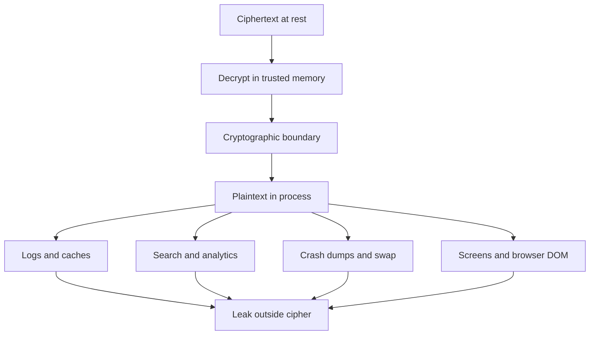

# The Cryptographic Boundary: What Encryption Cannot Protect Once Data Leaves the Cipher

## English

Encryption protects data only while it is inside the cryptographic boundary — the region of the system where the plaintext exists in memory, is processed by trusted code, and is not yet handed off to something that will log, cache, index, or display it. The moment plaintext crosses out of that boundary — into an application log, a search index, an analytics pipeline, a crash dump, a swap file, a screenshot, a browser's DOM — it is no longer protected by the cipher, no matter how strong the cipher was. This is why a database with 「encryption at rest」 can still leak every record through a SQL injection that reads the decrypted rows. The encryption was real; the boundary was wrong.

A useful way to think about it is: encryption is a *transport* mechanism for confidentiality, not a *storage* property of data. The ciphertext is safe on disk and on the wire, but as soon as your application needs to compute on the value — sort it, search it, join it, render it — it must decrypt it into plaintext, and at that point the confidentiality guarantee is provided by the surrounding system (access control, process isolation, memory hygiene), not by the cipher. This is why 「encrypt everything」 is not a security strategy on its own; you also need to know every place plaintext will land.

Concrete leaks at the boundary are everywhere. A debugging `printf` that logs the decrypted record. A metrics library that captures a request body for 「error context」. A heap dump written to disk when the process crashes. A swap partition that pages out decrypted secrets. A cloud provider's hypervisor snapshot. A browser extension that reads the DOM after your frontend decrypts. A support engineer who screenshots the admin panel. None of these are cryptographic failures — they are boundary failures — but from the user's perspective the effect is identical: their data is exposed.

The practical discipline is to *map* the boundary explicitly. For each piece of sensitive data, ask: where does it exist as plaintext? In which process? For how long? Who can read that memory, that log, that disk? Then decide whether those places are acceptable. Often the answer is 「no」 for logs and 「yes but only in this one service」 for memory. The boundary is not a place you find; it is a place you *declare*, and then enforce with code review, log scrubbing, memory zeroing, and process isolation.

A good analogy is a sealed diplomatic pouch. Inside the pouch, the document is protected. But the diplomat still has to open the pouch in a secure room, read the document, and act on it — and if that room has a window, an open door, or a listening device, the seal on the pouch is irrelevant. Encryption buys you a sealed pouch. Everything else — the room, the door, the people — is your job. Systems that mistake the pouch for the room end up with beautiful ciphertext and a plaintext leak in the logs.

## 中文

加密只在資料仍位於「密碼學邊界」之內時保護它——也就是明文存在於記憶體中、由受信任的程式碼處理、尚未交給任何會記錄、快取、索引或顯示它的東西的那塊區域。一旦明文越過那條邊界——進入應用程式日誌、搜尋索引、分析管線、當機傾印、置換檔、螢幕截圖、瀏覽器的 DOM——它就不再受密碼保護了，無論那個密碼本來有多強。這就是為什麼一個有「靜態加密」的資料庫，仍可能因為一條讀取解密列的 SQL injection 而洩露每一筆紀錄。加密是真的，邊界劃錯了。

一個好用的想法是：加密是機密性的「傳輸」機制，不是資料的「儲存」屬性。密文在磁碟上、在網路上是安全的，但一旦你的應用程式需要對這個值做運算——排序、搜尋、join、渲染——它就必須解密成明文，而在那一刻，機密性保證是由周遭系統（存取控制、行程隔離、記憶體衛生）提供的，不是由密碼提供的。這就是為什麼「全部加密」本身不是一套安全策略；你還必須知道明文會落在哪些地方。

邊界上的具體洩漏俯拾皆是。一個把解密後紀錄印出來的除錯 `printf`。一個在「錯誤情境」時捕捉請求主體的 metrics 函式庫。行程當機時寫到磁碟的 heap dump。把解密後機密分頁出去的置換分割區。雲端業者的 hypervisor 快照。在你前端解密後讀取 DOM 的瀏覽器擴充功能。把管理後臺截圖下來的客服工程師。這些都不是密碼學失敗——是邊界失敗——但從使用者的角度看，效果完全相同：他們的資料外洩了。

實務上的紀律是明確「畫出」邊界。對每一筆敏感資料問：它在哪裡以明文存在？在哪個行程裡？存在多久？誰能讀那塊記憶體、那份日誌、那顆磁碟？然後判斷這些地方是否可接受。答案對日誌往往是「不行」，對記憶體則是「可以，但只在這個服務裡」。邊界不是你去「找到」的地方，而是你去「宣告」、然後用程式碼審查、日誌清洗、記憶體歸零、行程隔離去強制執行的東西。

一個好類比是密封的外交郵袋。袋子裡的檔案受保護。但外交官終究得在安全的房間裡開啟郵袋、閱讀檔案、據以行動——而如果那個房間有窗、有開著的門、有竊聽器，郵袋上的封蠟就毫無意義。加密幫你買到一個密封的郵袋。其他一切——房間、門、人——是你的事。把郵袋誤當成房間的系統，最後會得到漂亮的密文，以及日誌裡的一灘明文。

## Key Takeaway

Encryption protects plaintext only inside the cryptographic boundary; map where plaintext lives, because most leaks happen outside the cipher.

## Related Concepts
- Encryption at Rest Versus Encryption in Transit
- What Encryption Cannot Do

## Diagram

