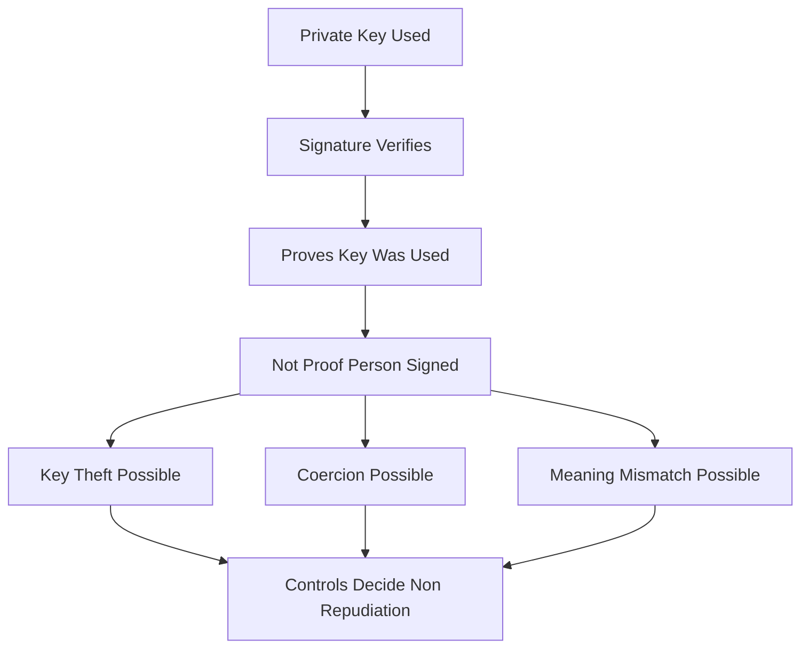

# Cryptographic Non-Repudiation Is Not What Most People Think It Is

## English

Non-repudiation is often described as 「the sender cannot later deny having sent a message」, and digital signatures are said to provide it. That is true only in a narrow, technical sense, and the gap between the technical sense and the legal or business sense is enormous. A valid signature proves that *somebody with access to a particular private key* signed a particular byte string. It does not prove who that somebody was, whether they were authorized, whether they were coerced, whether their key had been stolen, or whether the software that used the key was doing what they thought. Non-repudiation is a property of a *protocol and its surrounding controls*, not a property of a signature alone.

Consider the classic failure: a user's laptop is compromised, the attacker extracts the private key, and signs a fraudulent document. The signature verifies perfectly. The user genuinely did not sign it. In a court, the user's defense is 「my key was stolen」, and whether that defense succeeds depends on whether the system had strong controls — hardware-backed keys, PIN-protected signing, tamper-evident audit logs, timestamping, and a documented key-custody policy. Without those, the signature proves *the key was used*, not *the person signed*. This is why serious e-signature systems (for contracts, code signing, certificate authorities) invest far more in key custody and audit than in the signing algorithm itself.

There is also a subtler problem: a signature covers bytes, not meaning. If you sign a PDF, you are signing the exact bytes of that PDF. If the viewer that displays the PDF to you renders it differently from how it will be rendered later — different fonts, different metadata, a different page order, an embedded script — you may have signed something you did not read. This is a real class of attack against document-signing systems, and it is why signed documents are usually required to be in a canonical, unambiguous format with a strict parser, and why the signer is expected to review the *rendered* form, not the bytes. The signature is only as meaningful as the mapping between bytes and human understanding.

A third issue is *forward-dated* or *backdated* claims. A signature with a timestamp proves the signature existed at or before that time, assuming you trust the timestamping authority. Without a trusted timestamp, a signature proves only that the key existed at some point — it does not tell you when the message was signed, so a key holder could sign a document today and claim it was signed years ago, or a compromised key could be used to backdate evidence. Real non-repudiation systems therefore chain signatures to trusted timestamps (often via a Time-Stamping Authority that signs a hash of the document plus the current time).

The honest summary is that cryptographic non-repudiation is a *building block*, not a guarantee. It gives you strong evidence that a specific key was used on specific bytes at a specific (provable) time. Turning that into 「this person agreed to this contract」 requires identity proofing at key issuance, hardware-backed key custody, tamper-evident logging, trusted timestamping, and a legal framework that says what the evidence means. Systems that promise non-repudiation without those controls are selling a feeling, not a property.

## 中文

「不可否認性」(non-repudiation) 常被描述成「寄件人日後不能否認曾寄出某訊息」，而數位簽章據說能提供它。這只在一個狹窄的技術意義上成立，而技術意義與法律或商業意義之間的落差極大。一個有效簽章證明的是：某個能存取某把私鑰的人，對某個位元組字串簽了名。它不證明那個人是誰、是否被授權、是否被脅迫、金鑰是否被偷、或使用那把金鑰的軟體是否在做他以為的事。不可否認性是「協定及其周邊控制」的屬性，不是簽章本身的屬性。

想想經典的失敗：使用者的筆電被入侵，攻擊者取出私鑰，簽了一份偽造文件。簽章驗證完美通過。使用者真的沒簽。在法庭上，使用者的抗辯是「我的金鑰被偷了」，而這個抗辯是否成立，取決於系統有沒有強控制——硬體保管的金鑰、PIN 保護的簽署、防竄改的稽核日誌、時間戳記、以及有文件的密鑰保管政策。沒有這些，簽章證明的是「金鑰被用過」，不是「本人簽了」。這就是為什麼認真的電子簽章系統（合約、程式碼簽章、憑證機構）在密鑰保管與稽核上的投入，遠超過簽章演算法本身。

還有一個更細微的問題：簽章涵蓋的是位元組，不是意義。你簽一份 PDF，你簽的是那份 PDF 確切的位元組。如果向你看圖的檢視器，與日後他人檢視時的渲染不同——不同字型、不同中介資料、不同頁序、內嵌腳本——你可能簽了你沒讀過的東西。這是針對文件簽章系統的一類真實攻擊，也是為什麼受簽文件通常被要求採用嚴格解析器能處理的、正規化且無歧義的格式，以及為什麼簽署者被期望審閱「渲染後」的樣子，而不是位元組。簽章的意義，只跟位元組與人類理解之間的對應一樣可靠。

第三個問題是「前移日期」或「回填日期」的主張。帶時間戳記的簽章，證明該簽章在該時刻或之前已存在——前提是你信任那個時間戳記機構。沒有受信任的時間戳記，簽章只證明金鑰在某個時點存在過，並不告訴你訊息何時被簽，於是金鑰持有人可以今天簽一份文件、宣稱是多年前簽的，或被盜的金鑰可以用來回填證據。真正的不可否認系統因此會把簽章串接到受信任的時間戳記（通常透過一個「時間戳記機構」，它會對文件雜湊加當前時間簽名）。

誠實的總結是：密碼學的不可否認性是一塊「積木」，不是保證。它給你強證據：某把特定金鑰、在某個可證明的時間、對某些特定位元組被使用過。要把這轉化成「這個人同意了這份合約」，需要金鑰簽發時的身分核驗、硬體保管金鑰、防竄改日誌、受信任時間戳記，以及一個說明這些證據代表什麼的法律框架。沒有這些控制卻承諾不可否認性的系統，賣的是感覺，不是屬性。

## Key Takeaway

A signature proves a key was used on bytes, not that a person agreed; non-repudiation is a system property built from custody, audit, timestamps, and law.

## Related Concepts
- Digital Signatures
- Key Custody in Practice

## Diagram

