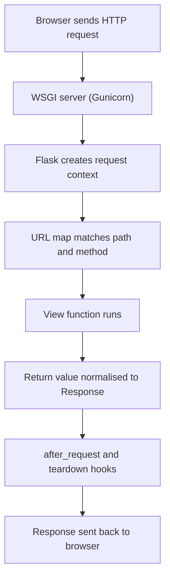

# How Flask Handles a Request: Routing and the WSGI Cycle

### English

A Flask app does not talk to the network directly. Between your code and the browser sits a **WSGI server** (such as Gunicorn or Werkzeug's development server). WSGI is a simple calling convention — the server hands your application a plain Python call: "here is an environ dictionary describing the request, give me an iterable of byte strings back." Flask is a **WSGI application**, so it can be dropped into any conforming server.

When a request arrives, Flask builds a **request context** and a **request object** (`flask.request`) that wraps the raw environ into friendly properties: `request.method`, `request.path`, `request.args`, `request.form`, `request.headers`. **Routing** is the mapping from URL plus HTTP method to a Python function. A route decorator such as `@app.route("/articles/<int:year>")` registers a *view function*; the `<int:year>` part is a **converter** that captures and type-checks the segment, so `2024` becomes an `int` argument before your code ever runs.

After your view returns, Flask needs to turn the return value into an HTTP response. A string becomes a 200 response with `text/html`; a tuple `(body, 404)` sets the status code; a `dict` is auto-converted to JSON; a `Response` object gives you full control over headers and cookies. **Teardown** and **after-request** hooks then run, which is where you release database connections or add security headers.

Think of the whole cycle as a relay race: the WSGI server passes the baton to Flask, Flask's URL map decides which view function receives it, the view produces a response object, and the hooks clean up before the baton is passed back.

### 中文

Flask 應用程式並不直接與網絡溝通。在你的程式碼與瀏覽器之間有一個 **WSGI 伺服器**（例如 Gunicorn 或 Werkzeug 的開發伺服器）。WSGI 是一套簡單的呼叫約定——伺服器把一個描述請求的 environ 字典交給你的應用程式，並取回一串位元組作為回應。Flask 是一個 **WSGI 應用程式**，所以可以安裝在任何符合規格的伺服器上。

當請求抵達，Flask 會建立一個**請求情境**和一個**請求物件**（`flask.request`），把原始 environ 包裝成易讀的屬性：`request.method`、`request.path`、`request.args`、`request.form`、`request.headers`。**路由**就是把「URL 加上 HTTP 方法」對應到一個 Python 函式。`@app.route("/articles/<int:year>")` 這類裝飾器會註冊一個*視圖函式*；`<int:year>` 是**轉換器**，會擷取並檢查該段文字，`2024` 會先變成 `int` 引數才交到你的程式碼。

視圖函式回傳後，Flask 要把回傳值轉成 HTTP 回應。字串會變成 200 回應及 `text/html`；元組 `(body, 404)` 可設定狀態碼；字典會自動轉成 JSON；`Response` 物件則讓你完全控制標頭與 cookie。之後 **teardown** 與 **after-request** 掛鉤會執行，用來釋放資料庫連線或加上安全標頭。

可以把整個過程想像成接力賽：WSGI 伺服器把接力棒交給 Flask，Flask 的 URL 對照表決定哪個視圖函式接手，視圖函式產生回應物件，最後掛鉤清理善後，再把接力棒交回。

## Key Takeaway
Flask is a WSGI application whose URL map routes each request to a view function, and the return value is normalised into a proper HTTP response.

## Related Concepts
- WSGI
- Routing and URL converters
- Request context and `flask.request`
- Response objects

## Diagram

