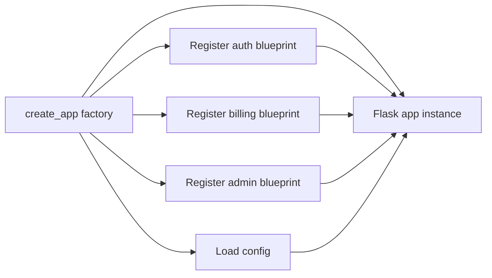

# Application Factories and Blueprints for Modular Code

### English

As a Flask project grows, putting every route in one file becomes unmanageable. Two features solve this. The **application factory** is a function that builds and returns an app instead of creating a module-level global:

```python
def create_app(config_name=None):
    app = Flask(__name__)
    app.config.from_object(config[config_name])
    app.register_blueprint(api_bp, url_prefix="/api")
    return app
```

The big advantage is that nothing is created at import time. Configuration, extensions and routes are all wired up inside the function, so the same factory can produce a development app, a test app, or a production app with different settings. It also makes testing far easier: you can spin up a throwaway instance per test instead of mutating a global. The rule of thumb is: never call `app.config` or connect a database at module level; do it inside the factory.

A **blueprint** is a reusable group of routes and related code that is not yet bound to an app. You define one with `Blueprint("api", __name__, url_prefix="/api")`, attach routes with `@api_bp.route("/items")`, and later register it with `app.register_blueprint(api_bp)`. Blueprints give you a prefix, allow several instances of the same blueprint with different prefixes, can carry their own templates and static folders, and — crucially — let you organise by feature rather than by file type. A typical layout is one blueprint per domain area: `auth`, `billing`, `admin`.

Because blueprints are deferred, a common beginner error is registering a blueprint after the first request has been handled; Flask 2.x raises an error in that case. Register everything during startup, inside the factory.

### 中文

當 Flask 專案愈來愈大，把所有路由塞在同一個檔案會變得難以維護。這時有兩項功能可以解決問題。**應用程式工廠**是一個用來建立並回傳 app 的函式，而不是在模組層級建立全域物件：

```python
def create_app(config_name=None):
    app = Flask(__name__)
    app.config.from_object(config[config_name])
    app.register_blueprint(api_bp, url_prefix="/api")
    return app
```

它的最大好處是：匯入模組時不會產生任何物件。設定、擴充套件與路由都在函式內接好，因此同一個工廠可以產生開發、測試或生產三種不同設定的 app。測試也容易得多：每個測試可以建立一個用完即棄的實例，而不用改動全域變數。經驗法則是：絕不要在模組層級呼叫 `app.config` 或連接資料庫，必須放在工廠內。

**Blueprint（藍圖）**是一組尚未綁定到 app 的可重用路由與相關程式碼。用 `Blueprint("api", __name__, url_prefix="/api")` 定義，以 `@api_bp.route("/items")` 加掛路由，稍後用 `app.register_blueprint(api_bp)` 註冊。藍圖提供前綴、允許同一個藍圖以不同前綴註冊多次、可自帶模板與靜態檔案，最重要是讓你按「功能」而非按「檔案類型」來組織程式。常見結構是每個業務範疇一個藍圖：`auth`、`billing`、`admin`。

因為藍圖是延後處理，常見新手錯誤是在第一個請求處理完之後才註冊藍圖；Flask 2.x 在這種情況會直接報錯。請在啟動階段、即工廠之內完成所有註冊。

## Key Takeaway
Use an application factory to create configurable app instances and blueprints to split routes into reusable, feature-scoped modules.

## Related Concepts
- Application factory pattern
- Blueprints
- Application configuration
- Flask extension initialisation

## Diagram

