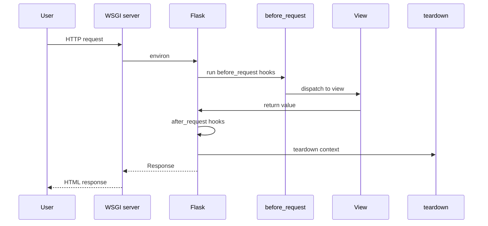

# Jinja2 Templates, the Request Lifecycle, and Error Handling

### English

Flask separates the data your code works with from the markup shown to the user. **Jinja2** is the template engine that does the merging. A template is HTML with placeholders like `{{ article.title }}` for values and `` for logic. Flask's `render_template("index.html", articles=articles)` renders the file and returns a string that becomes the response body. Jinja2 also auto-escapes HTML by default, so a value containing `<script>` is escaped rather than executed — a major protection against cross-site scripting.

Templates live in a `templates/` folder next to your package, and use `` plus `` for **template inheritance**, which lets one base layout hold the navigation and footer while child templates fill in the body.

The **request lifecycle** is the fixed order Flask follows for every request: the WSGI server receives it, a request context is pushed, `before_request` hooks run, the URL map dispatches to the view, the view returns, `after_request` hooks run in reverse order, and the context is popped. Anything you open before the view — a database connection, a temporary file — should be closed in a `teardown_request` or `teardown_appcontext` handler.

Error handling works through the same machinery. The `@app.errorhandler(404)` decorator registers a function for an HTTP status code, and Flask uses it to render a custom page instead of the default one. The exception hierarchy matters: an `HTTPException` (like `abort(403)`) is handled by the code-based handler, while any other unhandled exception becomes a 500 and is logged. In production you should not leak stack traces to users, and in testing you may want to re-raise them instead.

### 中文

Flask 把程式處理的資料與給用戶看的標記分開處理。**Jinja2** 就是負責把兩者合併的模板引擎。模板基本上是加了佔位符的 HTML：`{{ article.title }}` 放入數值，`` 放入邏輯。Flask 的 `render_template("index.html", articles=articles)` 會算繪檔案並回傳字串，成為回應的內容。Jinja2 預設會自動轉義 HTML，因此含有 `<script>` 的數值會被轉義而不是執行——這是防止跨站腳本攻擊的重要保護。

模板放在套件旁邊的 `templates/` 資料夾，並以 `` 配合 `` 實作**模板繼承**：共用一份母版負責導覽列與頁尾，子模板只需填入內容。

**請求生命週期**是每個請求都會依循的固定次序：WSGI 伺服器收到請求、推入請求情境、執行 `before_request` 掛鉤、URL 對照表分派到視圖函式、視圖回傳、依相反次序執行 `after_request` 掛鉤、然後彈出情境。凡是在視圖之前開啟的資源（資料庫連線、暫存檔），都應該在 `teardown_request` 或 `teardown_appcontext` 收尾。

錯誤處理沿用同一套機制。`@app.errorhandler(404)` 裝飾器為某個 HTTP 狀態碼註冊函式，Flask 會用它算繪自訂頁面取代預設頁面。例外層級也很重要：`HTTPException`（例如 `abort(403)`）交由狀態碼處理器，而其他未捕捉的例外會變成 500 並寫入日誌。正式環境不應把堆疊追蹤暴露給用戶，測試環境則可選擇重新拋出。

## Key Takeaway
Jinja2 safely merges data into HTML, and Flask's fixed request lifecycle plus error handlers give you predictable hooks for cleanup and failure pages.

## Related Concepts
- Jinja2 templating and auto-escaping
- Template inheritance
- Request lifecycle hooks
- Error handlers and `abort()`

## Diagram

