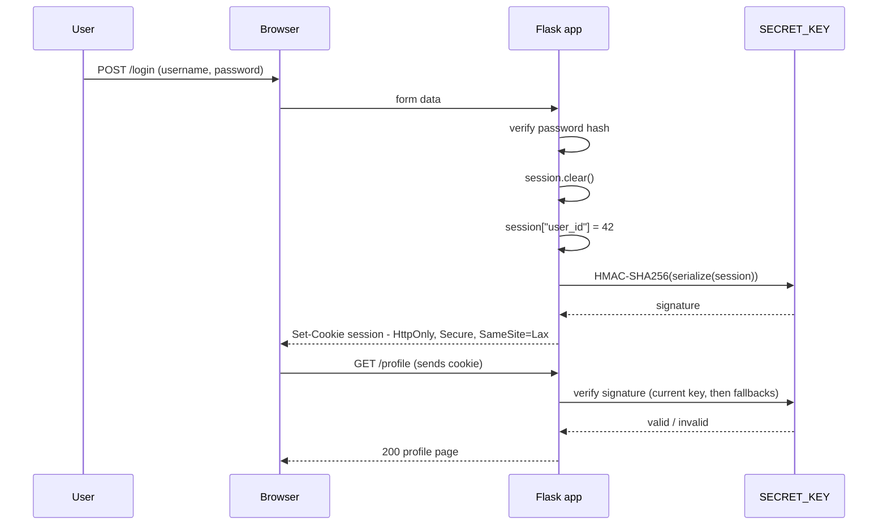

# Sessions, Signed Cookies, and Cookie Security in Flask

### English

Flask's session is unusual among web frameworks: there is no session store on the server by default. When you write `session["user_id"] = 42`, Flask serializes the whole dictionary, signs it with **HMAC-SHA256** using your `SECRET_KEY`, and sends it back to the browser as a cookie called `session`. On the next request the browser returns that cookie, Flask verifies the signature, and only then does `session["user_id"]` exist again. The signature is what makes the cookie *tamper-evident*: the end user can read the contents (they are Base64-encoded, not encrypted) but cannot alter them without the secret key. Think of a sealed envelope you can read through the window — you can see what is inside, but you cannot reseal it convincingly.

That design has two consequences that beginners usually get wrong. First, the client can read everything you put in the session, so never store a password, an access token, or a credit card number in it. Store an identifier such as `user_id` and reload the authoritative data from your database on each request. Second, because the state lives entirely on the client, the server cannot revoke it. A stolen cookie stays valid until it expires. Flask 3.1 defaults `PERMANENT_SESSION_LIFETIME` to 31 days, so the practical exposure window of a stolen cookie can be a month unless you deliberately shorten it.

The `SECRET_KEY` is the whole security of this scheme. In Flask 3.1 it defaults to `None`, and a tutorial that sets `app.secret_key = "dev"` means every session cookie in the world is signed with a string that is published on the internet. Generate a real one and keep it out of version control:

```python
import os, secrets
app.config["SECRET_KEY"] = os.environ.get("FLASK_SECRET_KEY") or secrets.token_hex(32)
```

Cookie flags matter as much as the signature. Flask's stock defaults are `SESSION_COOKIE_HTTPONLY=True` (JavaScript cannot read the cookie — this blocks token theft via XSS), `SESSION_COOKIE_SECURE=False` (the cookie will happily travel over plain HTTP), and `SESSION_COOKIE_SAMESITE=None`, which means *no `SameSite` attribute is emitted at all* rather than the permissive value `SameSite=None`. Relying on the browser's implicit default is fragile; declare it yourself:

```python
from datetime import timedelta
app.config.update(
    SESSION_COOKIE_SECURE=True,      # requires HTTPS
    SESSION_COOKIE_HTTPONLY=True,    # already the default, but be explicit
    SESSION_COOKIE_SAMESITE="Lax",   # blocks cross-site POSTs riding the cookie
    PERMANENT_SESSION_LIFETIME=timedelta(days=1),
)
```

`Lax` is usually the right choice because `Strict` would also strip the cookie when a user follows a link from an email and would log them out. `Lax` still blocks the classic cross-site form POST that CSRF attacks rely on, but it is a defence in depth, not a replacement for token-based CSRF protection.

Rotating the secret key normally invalidates every active session. Flask 3.1 added `SECRET_KEY_FALLBACKS` so old keys can still verify signatures while new cookies are signed with the current one:

```python
app.config["SECRET_KEY"] = new_key
app.config["SECRET_KEY_FALLBACKS"] = [previous_key]  # try current first, then fallbacks
```

Keep the fallback list short, remove old keys after a reasonable period, and remember that each extra key costs a verification attempt per request.

Finally, clear the session on privilege change. After a successful login call `session.clear()` and then set the new values, otherwise a pre-authentication identifier (a "session fixation" anchor) survives the login and an attacker who planted it keeps a foothold. When you genuinely need server-side revocation — logout-that-actually-logs-out, "log out all devices", very large session payloads — use **Flask-Session** with a Redis or database backend, which stores the payload server-side and leaves only an opaque ID in the cookie.

### 中文

Flask 的 session 與其他網頁框架比較之下頗不尋常：預設情況下伺服器其實沒有 session 存放區。當你寫 `session["user_id"] = 42`，Flask 會把整個字典序列化，用你的 `SECRET_KEY` 做 **HMAC-SHA256** 簽名，然後以名為 `session` 的 cookie 傳回瀏覽器。下一個請求時瀏覽器把 cookie 送回，Flask 驗證簽名通過後，`session["user_id"]` 才再次存在。這個簽名令 cookie 具備**防篡改**能力：使用者可以讀取內容（那是 Base64 編碼，不是加密），但沒有密鑰就改不了。可以想像成一個能透視的封蠟信封——你可以看到裡面寫了甚麼，但無法重新封好。

這個設計帶來兩個初學者經常搞錯的推論。第一，內容對客戶端是公開的，所以千萬不要把密碼、access token 或信用卡號碼放進 session；只放 `user_id` 這類識別碼，每個請求再從資料庫重新載入權威資料。第二，由於狀態完全存放在客戶端，伺服器無法主動撤銷它。被偷走的 cookie 會一直有效到過期為止。Flask 3.1 的 `PERMANENT_SESSION_LIFETIME` 預設是 31 日，即被偷 cookie 的實際危害期可能長達一個月，除非你刻意調短。

`SECRET_KEY` 是整個安全機制的核心。Flask 3.1 預設是 `None`，而很多教學會寫 `app.secret_key = "dev"`，等於用一個全網都知道的字串去簽發全世界 session cookie。正確做法是產生真正的隨機值，並且不要提交到版本庫：

```python
import os, secrets
app.config["SECRET_KEY"] = os.environ.get("FLASK_SECRET_KEY") or secrets.token_hex(32)
```

Cookie 的屬性標旗同樣重要。Flask 預設是 `SESSION_COOKIE_HTTPONLY=True`（JavaScript 讀不到 cookie，阻擋 XSS 偷 token）、`SESSION_COOKIE_SECURE=False`（cookie 會在明文 HTTP 上明目張膽地傳輸），以及 `SESSION_COOKIE_SAMESITE=None`——這裡的 `None` 意思是**完全不發出 `SameSite` 屬性**，而不是送出寬鬆的 `SameSite=None`。靠瀏覽器的隱含預設值並不穩陣，最好自己明確宣告：

```python
from datetime import timedelta
app.config.update(
    SESSION_COOKIE_SECURE=True,      # 必須配 HTTPS
    SESSION_COOKIE_HTTPONLY=True,    # 預設已是 True，寫出來更清楚
    SESSION_COOKIE_SAMESITE="Lax",   # 阻擋跨站 POST 夾帶 cookie
    PERMANENT_SESSION_LIFETIME=timedelta(days=1),
)
```

一般選 `Lax` 就夠，因為 `Strict` 會令使用者由電郵點連結進入時被清掉 cookie、變成未登入狀態。`Lax` 已能擋下 CSRF 最依賴的跨站表單 POST，但它屬於縱深防禦，不能取代以 token 為本的 CSRF 保護。

換密鑰通常會令所有進行中的 session 失效。Flask 3.1 新增了 `SECRET_KEY_FALLBACKS`，讓舊密鑰仍可用來驗證簽名，而新 cookie 則用現行密鑰簽發：

```python
app.config["SECRET_KEY"] = new_key
app.config["SECRET_KEY_FALLBACKS"] = [previous_key]  # 先試現行，再依次試舊值
```

備用密鑰清單不要放太多，隔一段時間就移除舊密鑰，並記住每多一把密鑰，每個請求就多一次驗證開銷。

最後，在權限狀態變化時要清空 session。登入成功後呼叫 `session.clear()` 再重新寫入新資料，否則登入前的識別碼（session fixation 的锚點）會存活下來，攻擊者預先種下的值就等於留了一個後門。若你真的需要伺服器端撤銷——真正有效的登出、「登出所有裝置」、超大的 session 內容——可以用 **Flask-Session** 配合 Redis 或資料庫後端，把 payload 放在伺服器端，cookie 內只留一個不透明的 ID。

## Key Takeaway
Flask's default session is a signed, client-readable cookie, so its security rests entirely on `SECRET_KEY`, explicit cookie flags, and a short lifetime — use Flask-Session when you need real server-side revocation.

## Related Concepts
- `SECRET_KEY` and HMAC signing with itsdangerous
- Cookie flags: `Secure`, `HttpOnly`, `SameSite`
- `SECRET_KEY_FALLBACKS` for zero-downtime key rotation
- Session fixation and `session.clear()` on login
- Flask-Session with Redis for server-side state

## Diagram

