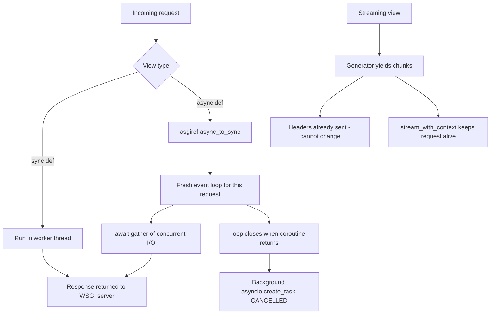

# Async Views, Background Tasks, and Streaming Responses in Flask

### English

Flask is fundamentally a **WSGI** framework: WSGI is the Python standard interface between a web server and a Python application, and it is a strictly synchronous contract — the server calls the app, the app returns a complete response, the server writes it out. Flask 2.0 added support for `async def` views (install the extra with `pip install flask[async]`), but the underlying model has not changed. When a request arrives, the WSGI server calls Flask synchronously; Flask runs your coroutine to completion on a **new event loop created for that request** via `asgiref`, and returns the result. Each request still occupies exactly one worker, exactly as a sync view does.

This is the single most misunderstood feature in Flask. Async is not "Flask is now async." It buys you **concurrency inside a view**, not more concurrent requests. If your endpoint needs to fan out to three slow third-party HTTP APIs, an async view with `asyncio.gather` can cut the latency from the sum of the three calls to the maximum of them, while the worker stays busy the whole time. If your endpoint is CPU-bound — image resizing, PDF generation, a tight numeric loop — async makes it *worse*, because the event loop is single-threaded and blocking work stalls everything else in that loop.

A second, subtler trap is resource lifetime. Because each request gets a fresh event loop that is closed when the coroutine finishes, anything bound to a loop cannot be shared across requests. A module-level `httpx.AsyncClient()` looks fine, returns 200 on the first request, and then raises `RuntimeError: Event loop is closed` on the second, because the connection pool it created belongs to the first loop. The fix is to create the client per request and close it:

```python
import httpx
from flask import Flask, jsonify

app = Flask(__name__)

@app.get("/prices")
async def prices():
    async with httpx.AsyncClient(timeout=5.0) as client:
        responses = await asyncio.gather(
            client.get("https://api.example.com/a"),
            client.get("https://api.example.com/b"),
        )
    return jsonify([r.json() for r in responses])
```

If you need a shared, pooled async client, run a persistent event loop in a background thread of the process and submit work to it from sync views — and create it *after* the worker forks, because Gunicorn's pre-fork model copies a not-yet-running thread's state rather than the thread itself. If most of your views really want to be async, the honest answer is to move to an ASGI framework such as Quart, Starlette, or FastAPI, which keep one long-lived event loop per worker. Flask can be served over ASGI through the `asgiref.wsgi.WsgiToAsgi` adapter (`hypercorn module:asgi_app`), which is exactly what the docs recommend when background tasks are needed.

Related trap: **you cannot spawn background tasks from an async view**. `asyncio.create_task(...)` inside the view is cancelled when the request's event loop stops, because the loop is torn down as soon as the coroutine returns. Work that must survive the response — sending an email, calling a webhook, generating a thumbnail — belongs in a real task queue (Celery, RQ, arq) or, for lighter needs, in Flask's own `after_request`/teardown-style extension point.

For slow *responses* rather than slow work, **streaming** is the right tool. If you are exporting a million rows to CSV, building the whole file in memory wastes RAM and delays the first byte. A generator lets you send each row as it is produced:

```python
@app.get("/export.csv")
def export():
    def generate():
        yield "id,name\n"
        for row in iter_rows():
            yield f"{row.id},{row.name}\n"
    return generate(), {"Content-Type": "text/csv"}
```

Two rules catch everyone out. Headers must be set *before* the body starts streaming — you cannot add a header after the first chunk is on the wire. And the request context is no longer active inside the generator, so touching `request` or `session` there raises `RuntimeError` unless you wrap the generator with `stream_with_context()`. Jinja2 templates can also be streamed with `stream_template()`, which yields the template piece by piece as it renders.

### 中文

Flask 本質上是 **WSGI** 框架。WSGI 是 Python 標準中「網頁伺服器」與「Python 應用程式」之間的介面，而且是一份嚴格同步的契約：伺服器呼叫應用程式，應用程式交回一份完整回應，伺服器再寫出。Flask 2.0 加入了對 `async def` 視圖的支援（用 `pip install flask[async]` 安裝額外套件），但底層模型並沒有改變。請求到達時，WSGI 伺服器同步呼叫 Flask；Flask 透過 `asgiref` 在**每次請求專屬的一個新 event loop** 上把你的 coroutine 跑完，然後交回結果。每個請求依然只佔用一個 worker，與同步視圖完全一樣。

這是 Flask 最常被誤解的一點。async 的價值在於「單一視圖內部的並行」，而不是「同時處理更多請求」。如果某個端點要同時查三個慢的第三方 API，async 視圖配合 `asyncio.gather` 可以把延遲由三者的總和降到最大者，而 worker 在期間仍然是忙碌的。反過來，若工作屬於 CPU 密集型——圖片縮放、產生 PDF、密集數值運算——async 反而更糟，因為 event loop 是單執行緒的，阻塞的工作會拖慢同一個 loop 上的所有東西。

第二個更隱蔽的陷阱是資源生命週期。由於每個請求都有一個專屬的 event loop，並在 coroutine 結束時被關閉，凡是与 loop 綁定的資源都不能跨請求共用。模組層級的 `httpx.AsyncClient()` 看似正常，第一個請求回 200，第二個卻拋出 `RuntimeError: Event loop is closed`——因為它的連線池屬於第一個 loop。修正方法是在每個請求內建立並關閉 client：

```python
import httpx
from flask import Flask, jsonify

app = Flask(__name__)

@app.get("/prices")
async def prices():
    async with httpx.AsyncClient(timeout=5.0) as client:
        responses = await asyncio.gather(
            client.get("https://api.example.com/a"),
            client.get("https://api.example.com/b"),
        )
    return jsonify([r.json() for r in responses])
```

若你需要共用、有連線池的 async client，可以在行程背景執行緒內跑一個長駐的 event loop，由同步視圖把工作交給它——而且要在 worker fork **之後**才建立，否則 Gunicorn 的 pre-fork 模式只會複製未啟動執行緒的狀態，而不是執行緒本身。如果大部分視圖真的都要 async，誠實的答案其實是轉用 ASGI 框架，例如 Quart、Starlette 或 FastAPI，它們每個 worker 維持一條長駐的 event loop。Flask 亦可以透過 `asgiref.wsgi.WsgiToAsgi` 轉接器在 ASGI 之下運行（`hypercorn module:asgi_app`），官方文件建議需要背景任務時採用這種做法。

關聯陷阱：**你無法從 async 視圖派生背景任務**。視圖內的 `asyncio.create_task(...))` 會在請求的 event loop 停止時被取消，因為 loop 在 coroutine 回傳後隨即被拆掉。必須在回應之後仍然存在的工作——寄信、呼叫 webhook、產生縮圖——應該放進真正的任務佇列（Celery、RQ、arq），或者用 Flask 自己的擴充點處理。

至於「回應很慢」而非「工作很慢」，**串流**才是正確工具。要匯出一百萬行 CSV 的話，整份先砌在記憶體既浪費 RAM，也延遲了第一個位元組。用 generator 就可以逐行送出：

```python
@app.get("/export.csv")
def export():
    def generate():
        yield "id,name\n"
        for row in iter_rows():
            yield f"{row.id},{row.name}\n"
    return generate(), {"Content-Type": "text/csv"}
```

有兩條規則最容易令人中招。所有標頭必須在**串流內容開始之前**設定好——第一個 chunk 上線之後就無法再加標頭。而且 generator 執行期間請求情境已經不再有效，在裡面碰 `request` 或 `session` 會拋出 `RuntimeError`，除非用 `stream_with_context()` 包住 generator。Jinja2 模板同樣可以串流，用 `stream_template()` 便會在算繪過程中逐段產出。

## Key Takeaway
Flask's async support adds intra-view concurrency, not extra request capacity, and per-request event loops break shared async clients — use `stream_with_context` for streaming and a real task queue for background work.

## Related Concepts
- WSGI vs ASGI and the `WsgiToAsgi` adapter
- `asyncio.gather` for concurrent I/O in a view
- Per-request event loop lifetime and shared-client bugs
- Generator-based streaming responses and HTTP header ordering
- Task queues (Celery, RQ) for durable background jobs

## Diagram

