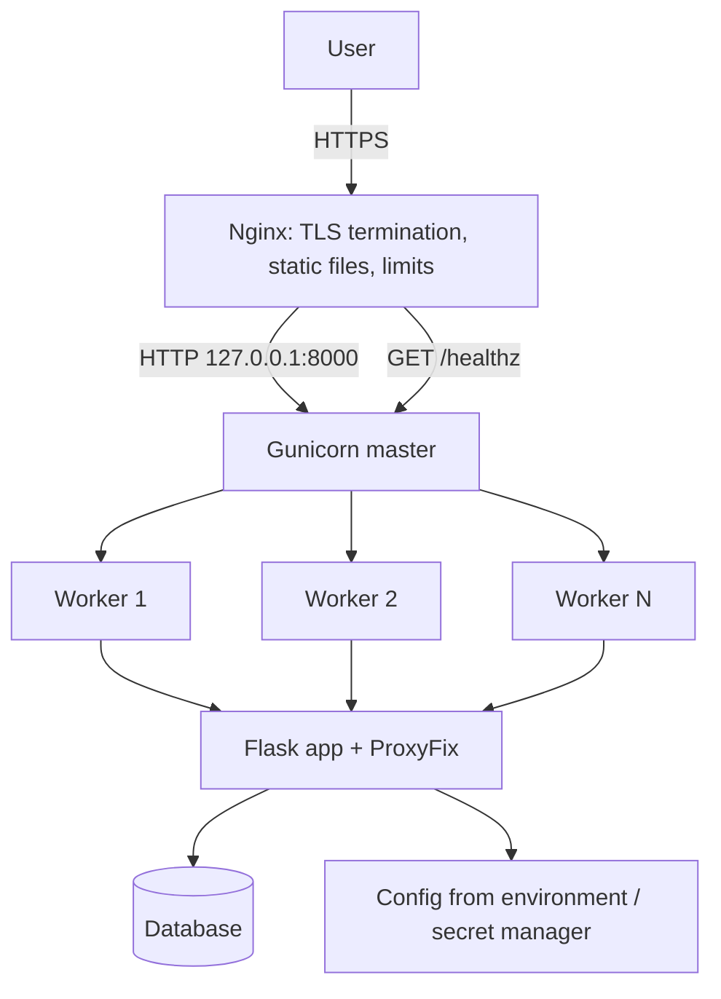

# Configuration, Secrets, and Production Deployment with Gunicorn and Nginx

### English

A Flask app that runs on `python app.py` is a development server. The Flask docs are blunt about it: the development server is not designed to be efficient, stable, or secure, and it is not meant to be used in production. Production means running the app behind a real WSGI server, usually Gunicorn, usually behind Nginx. Understanding the split matters, because each layer solves a different problem and each one introduces a failure mode.

**Gunicorn** ("Green Unicorn") is a pre-forking WSGI server. Its "prefork" model forks a master process and then N worker processes from it; each worker handles requests independently in its own process. Because workers are separate processes, a crash or a memory leak in one worker does not take down the others, and a CPU-bound request cannot block every other request. The knob that matters most is the worker count:

```bash
# Rule of thumb: 2 * CPU cores + 1 workers
gunicorn --workers 5 --bind 127.0.0.1:8000 "app:create_app()"
```

Each worker is a separate interpreter with its own memory, so if your app holds connections or caches, that count multiplies. Threaded workers (`--threads N`) or gevent workers are alternatives for I/O-bound workloads; the `gthread` mix is a common compromise. Use `--preload` sparingly: it imports the app in the master before forking, which speeds startup and shares memory, but any resource opened before the fork (a database pool, a socket) is then copied into every worker and can end up shared in a broken state. If you preload, open connections *after* the fork, in a `post_fork` hook.

**Nginx** sits in front as a reverse proxy. It terminates TLS, serves static files directly from disk without waking Python, enforces connection limits and timeouts, and can load-balance across several Gunicorn instances. A minimal proxy block:

```nginx
server {
    listen 443 ssl http2;
    server_name app.example.com;

    location /static/ {
        alias /srv/app/static/;
        expires 30d;
    }

    location / {
        proxy_pass http://127.0.0.1:8000;
        proxy_set_header Host $host;
        proxy_set_header X-Real-IP $remote_addr;
        proxy_set_header X-Forwarded-For $proxy_add_x_forwarded_for;
        proxy_set_header X-Forwarded-Proto $scheme;
    }
}
```

The `X-Forwarded-Proto` header deserves special attention in Flask. Flask's `request.is_secure` checks the URL scheme, and behind a TLS-terminating proxy the scheme it sees is `http` unless the proxy tells it otherwise. Use the `ProxyFix` middleware to apply the forwarded headers correctly:

```python
from werkzeug.middleware.proxy_fix import ProxyFix
app.wsgi_app = ProxyFix(app.wsgi_app, x_for=1, x_proto=1, x_host=1)
```

Only do this when you know the proxy count — `ProxyFix` trusts the header you name, so a client that can reach Flask directly could spoof `X-Forwarded-For` and fake an IP address.

Configuration is the third pillar, and Flask makes it easy to get wrong. Flask's configuration is a plain dictionary (`app.config`) of uppercase keys, and settings are loaded from objects, files, environment variables, or dictionaries. The important discipline is that **different environments must never share a secret**:

```python
class Config:
    SECRET_KEY = os.environ["FLASK_SECRET_KEY"]   # fail loudly if missing
    SQLALCHEMY_DATABASE_URI = os.environ["DATABASE_URL"]

class ProductionConfig(Config):
    DEBUG = False
    SESSION_COOKIE_SECURE = True

def create_app(config_object=Config):
    app = Flask(__name__)
    app.config.from_object(config_object)
    return app
```

Using `os.environ[...]` rather than `os.environ.get(...)` is a deliberate choice: a missing secret should crash the process at startup, not silently fall back to a default at 3 a.m. Never commit `.env` files — keep them in `.gitignore`, inject them in production from your platform's secret manager (AWS Secrets Manager, Vault, Kubernetes Secrets), and rotate them with a documented procedure.

Two operational habits separate a demo from a service. First, add a `/healthz` endpoint that returns 200 without touching the database, and point your load balancer at it — but put the real dependency check on a separate `/readyz` so a brief database outage does not remove the instance from the pool. Second, run `gunicorn` under a process supervisor (systemd, `supervisord`, or Docker's restart policy) with `--access-logfile -` and `--error-logfile -` so logs reach your aggregator, and never run Flask with `debug=True` in production: the debugger gives anyone who can reach it a Python shell on your server.

### 中文

用 `python app.py` 跑起來的 Flask 應用是**開發用伺服器**。Flask 官方文件講得很直接：開發伺服器並非為效率、穩定性或安全性而設計，不應該用於生產環境。所謂生產環境，就是把應用放在真正的 WSGI 伺服器之後，通常是 Gunicorn，通常再由 Nginx 在前面。理解這個分工很重要，因為每一層解決的問題不同，也各自帶來不同的失效模式。

**Gunicorn**（Green Unicorn）是一個 pre-fork 模式的 WSGI 伺服器：master 行程先 fork 出 N 個 worker 行程，每個 worker 各自獨立處理請求。由於 worker 是不同行程，某一個崩潰或記憶體洩漏不會拖垮其他行程，CPU 密集的請求亦不會阻塞其餘請求。最關鍵的參數是 worker 數量：

```bash
# 常見經驗法則：CPU 核心數 * 2 + 1
gunicorn --workers 5 --bind 127.0.0.1:8000 "app:create_app()"
```

每個 worker 都是獨立的直譯器、擁有獨立記憶體，所以應用持有的連線或快取數量會隨 worker 數倍增。執行緒式 worker（`--threads N`）或 gevent worker 則適合 I/O 密集的場景，`gthread` 混合模式是常見折衷。`--preload` 要慎用：它會在 fork 之前於 master 內匯入應用程式，加快啟動並共用記憶體，但任何在 fork 前開啟的資源（資料庫連線池、socket）都會被複製到每個 worker，狀態可能因而損壞。若要用 preload，就應該在 fork **之後**才開啟連線，例如放在 `post_fork` hook 內。

**Nginx** 在前面做反向代理：終止 TLS、直接從磁碟提供靜態檔案（完全不用喚醒 Python）、限制連線數與逾時，並可以把流量分配到多個 Gunicorn 實例。一段最小的設定：

```nginx
server {
    listen 443 ssl http2;
    server_name app.example.com;

    location /static/ {
        alias /srv/app/static/;
        expires 30d;
    }

    location / {
        proxy_pass http://127.0.0.1:8000;
        proxy_set_header Host $host;
        proxy_set_header X-Real-IP $remote_addr;
        proxy_set_header X-Forwarded-For $proxy_add_x_forwarded_for;
        proxy_set_header X-Forwarded-Proto $scheme;
    }
}
```

`X-Forwarded-Proto` 這行在 Flask 特別值得留意。Flask 的 `request.is_secure` 檢查的是 URL 的 scheme，但在前面由 TLS 終止的代理，除非代理明說，Flask 看到的仍是 `http`。要用 `ProxyFix` 中介層正確套用轉發標頭：

```python
from werkzeug.middleware.proxy_fix import ProxyFix
app.wsgi_app = ProxyFix(app.wsgi_app, x_for=1, x_proto=1, x_host=1)
```

但前提是你清楚代理的層數——`ProxyFix` 會信任你點名的標頭，若使用者能繞過代理直接連到 Flask，就可以偽造 `X-Forwarded-For` 假裝 IP。

第三根支柱是設定管理，而 Flask 很容易在這裡出錯。Flask 的設定就是一個普通字典（`app.config`），鍵名全大寫，可以從物件、檔案、環境變數或字典載入。關鍵的紀律是：**不同環境絕不共用同一組密鑰**：

```python
class Config:
    SECRET_KEY = os.environ["FLASK_SECRET_KEY"]   # 缺少就直接報錯
    SQLALCHEMY_DATABASE_URI = os.environ["DATABASE_URL"]

class ProductionConfig(Config):
    DEBUG = False
    SESSION_COOKIE_SECURE = True

def create_app(config_object=Config):
    app = Flask(__name__)
    app.config.from_object(config_object)
    return app
```

用 `os.environ[...]` 而非 `os.environ.get(...)` 是刻意的：缺少密鑰應該讓行程在啟動時就崩潰，而不是在凌晨三點悄悄退化成預設值。`.env` 檔案絕不提交版本庫——加入 `.gitignore`，在生產環境改由平台的密鑰管理服務注入（AWS Secrets Manager、Vault、Kubernetes Secrets），並備有書面換密流程。

兩個操作習慣可以區分「示範」與「服務」。其一，加入 `/healthz` 端點回傳 200 且不碰資料庫，讓負載平衡器指向它，但把真正的相依檢查放在另一個 `/readyz`，避免資料庫短暫故障就讓實例離開集結點。其二，用行程監管工具（systemd、`supervisord`，或 Docker 的 restart policy）管理 gunicorn，加上 `--access-logfile -` 與 `--error-logfile -` 讓日誌進入集中收集系統；千萬不要在生產環境開 `debug=True`——除錯器等於送給任何能連到它的人一個 Python shell。

## Key Takeaway
Production Flask means Gunicorn workers behind Nginx, with secrets injected per environment and `ProxyFix` applied so TLS and client IPs are read correctly behind the proxy.

## Related Concepts
- WSGI server vs reverse proxy responsibilities
- Gunicorn prefork workers, threads, and `--preload` pitfalls
- `ProxyFix` and `X-Forwarded-Proto`
- Environment-driven configuration and `os.environ[...]` fail-fast
- Health checks, log shipping, and never enabling the debugger in production

## Diagram

