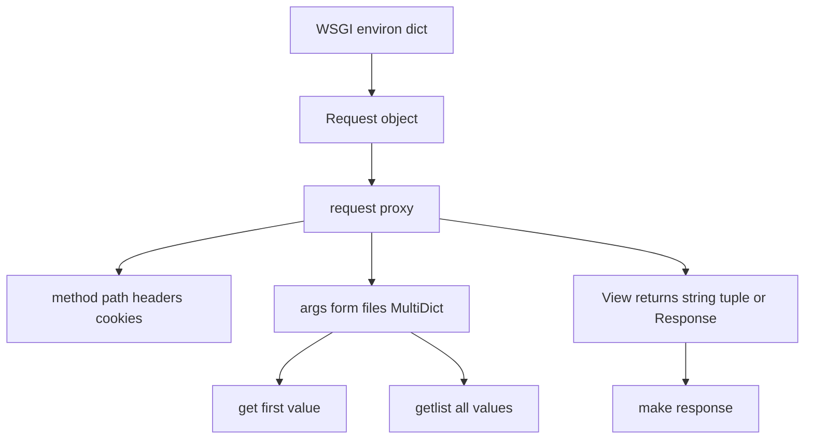

# Request and Response Objects: The Werkzeug Data Model Behind Flask

## English

Flask itself is a thin layer, and most of the objects you touch in a view function come from Werkzeug, the WSGI utility library underneath. The most important of these is the request object. In a view you usually access it through the `request` proxy imported from `flask`, which always resolves to the request currently being handled. That object is a `Request` instance wrapping the raw WSGI `environ` dictionary — the flat map of CGI-style keys (REQUEST_METHOD, PATH_INFO, QUERY_STRING, HTTP_* headers, wsgi.input) that the server hands to your application. Flask parses that dictionary into convenient attributes: `request.method`, `request.path`, `request.args` (the parsed query string), `request.form` (URL-encoded or multipart body fields), `request.files` (uploaded files), `request.json` (parsed JSON body when the content type matches), `request.headers`, and `request.cookies`.

A subtle but vital detail is that `request.args`, `request.form`, and `request.files` are `MultiDict` objects, not plain dictionaries. A MultiDict preserves repeated keys, which matters because HTML forms routinely send the same name twice (think of a list of checkboxes). `request.args.get('tag')` returns only the first value, while `request.args.getlist('tag')` returns every value as a list. If you forget this and iterate a plain dict, you silently lose data. The same MultiDict type is used for building query strings on the way out.

On the response side, Flask lets you return several things from a view: a plain string (wrapped into a 200 response with text/html), a `(body, status)` tuple, a `(body, status, headers)` tuple, or an explicit `Response` object created with `flask.make_response` or the `Response` class. Returning tuples is idiomatic Flask and is one of the reasons views stay short. If you need to set a cookie or a custom header, you either return a tuple with a headers dict or call `response.set_cookie(...)` on a real Response object. Werkzeug's `Response` handles content type, charset, and the actual serialization to bytes.

Because both request and response are Werkzeug objects, you can use Werkzeug's lower-level tools directly when Flask's conveniences are not enough. For example, `werkzeug.datastructures.Headers` gives case-insensitive header access, and `werkzeug.http.parse_options_header` helps parse the Content-Type header's parameters. Understanding this layering explains a common confusion: Flask does not magically know about JSON or form data — it inspects the Content-Type header and delegates parsing to Werkzeug, and it only parses the body lazily the first time you access `request.form` or `request.json`. That laziness is why reading the raw stream with `request.stream` before touching `request.form` can leave you with an empty form.

A practical takeaway: treat `request` as a read-only view over data the server already collected, and treat the response as something you construct explicitly when you need control. When debugging, print `request.environ` to see exactly what the WSGI server sent — method, path, headers, and the input stream. Once you see the environ dictionary, Flask's request attributes stop feeling magic and start feeling like a thin, well-designed convenience layer over a plain Python dict.

## 中文

Flask 本身只是一層薄薄的封裝，你在 view function 裡接觸到的大部分物件，其實都來自它底下的 WSGI 工具庫 Werkzeug。其中最重要的是 request 物件。在 view 裡你通常透過從 `flask` 匯入的 `request` proxy 來存取它，這個 proxy 永遠會解析成目前正在處理的那個請求。那個物件是一個 `Request` 實例，包住原始的 WSGI `environ` 字典——也就是伺服器交給應用程式的那個扁平對照表，裡面有 REQUEST_METHOD、PATH_INFO、QUERY_STRING、HTTP_* 標頭、wsgi.input 等 CGI 風格的鍵。Flask 把這個字典解析成方便的屬性：`request.method`、`request.path`、`request.args`（解析後的 query string）、`request.form`（URL-encoded 或 multipart 的 body 欄位）、`request.files`（上傳的檔案）、`request.json`（content type 符合時解析出的 JSON body）、`request.headers` 以及 `request.cookies`。

一個細微但關鍵的細節是：`request.args`、`request.form` 和 `request.files` 都是 `MultiDict` 物件，不是普通字典。MultiDict 會保留重複的鍵，這一點很重要，因為 HTML 表單經常同一個名稱送出兩次（想想一整排 checkbox）。`request.args.get('tag')` 只會回傳第一個值，而 `request.args.getlist('tag')` 會把所有值以 list 回傳。如果你忘了這件事而把它當普通 dict 迭代，就會悄悄漏掉資料。同一個 MultiDict 型別也用來在輸出時組建 query string。

在回應這一側，Flask 允許 view 回傳幾種東西：純字串（包成 200 回應、content type 為 text/html）、`(body, status)` tuple、`(body, status, headers)` tuple，或用 `flask.make_response` 或 `Response` 類別建立的明確 `Response` 物件。回傳 tuple 是 Flask 的慣用寫法，也是 view 能保持簡短的原因之一。如果你需要設定 cookie 或自訂標頭，要嘛回傳帶 headers 字典的 tuple，要嘛在真正的 Response 物件上呼叫 `response.set_cookie(...)`。Werkzeug 的 `Response` 負責 content type、charset 以及實際序列化成 bytes。

因為 request 和 response 都是 Werkzeug 物件，當 Flask 的便利功能不夠用時，你可以直接使用 Werkzeug 較低階的工具。例如 `werkzeug.datastructures.Headers` 提供大小寫不敏感的標頭存取，`werkzeug.http.parse_options_header` 則幫忙解析 Content-Type 標頭的參數。理解這層分層，就能解釋一個常見的困惑：Flask 並不是天生就懂 JSON 或表單資料——它會檢查 Content-Type 標頭並把解析交給 Werkzeug，而且只在你第一次存取 `request.form` 或 `request.json` 時才惰性解析 body。正因為這種惰性，如果你在碰 `request.form` 之前先用 `request.stream` 讀了原始串流，表單就會是空的。

一個實用的重點：把 `request` 當成伺服器已收集資料的唯讀檢視，並在需要控制時明確建構 response。除錯時，印出 `request.environ` 就能看到 WSGI 伺服器到底送了什麼——method、path、headers 以及 input stream。一旦你看到 environ 字典，Flask 的 request 屬性就不再像魔法，而會像一層設計良好、包在普通 Python dict 外的薄薄便利層。

## Key Takeaway

Flask's request and response objects are Werkzeug objects wrapping the raw WSGI environ, and knowing that MultiDicts preserve repeated keys plus that body parsing is lazy explains most of the surprising behaviours.

## Related Concepts
- WSGI environ dictionary
- Werkzeug MultiDict

## Diagram

