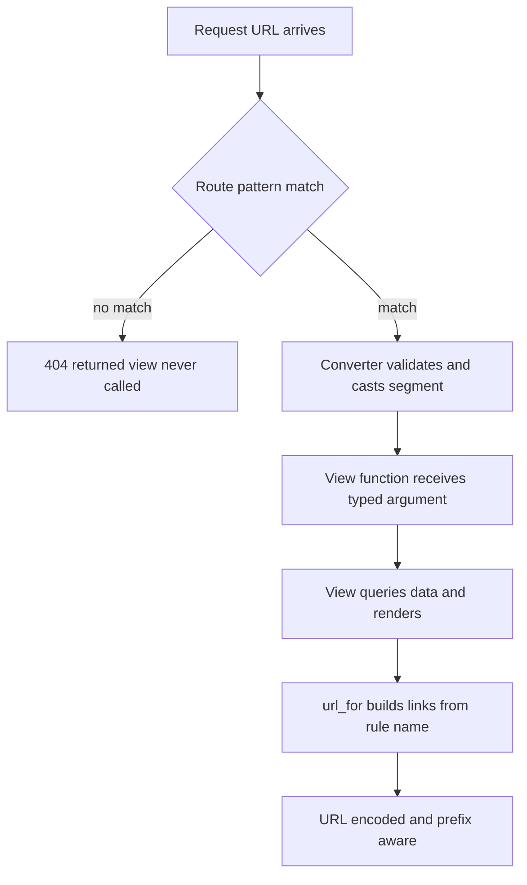

# URL Building with url_for and Dynamic Route Converters

## English

Most Flask tutorials show routes with hard-coded paths like `/about`, but real applications need addresses that depend on data: a user's id, a slug, a page number. Flask handles this with variable rules. A route like `@app.route('/user/<username>')` declares a URL pattern where the `<username>` segment becomes a keyword argument passed to the view function. By default the converter is `string`, which matches any text without a slash. Flask also ships several other converters: `int` matches non-negative integers, `float` matches positive floating-point numbers, `path` matches text including slashes, `uuid` matches canonical UUID strings, and `any` lets you list acceptable literal values. You can even register custom converters by subclassing `werkzeug.routing.BaseConverter`.

The converters do more than validate: they type-cast. With `/post/<int:post_id>`, the view receives `post_id` as a Python `int`, not a string, so you can pass it straight to a database query. If the incoming URL does not match — say `/post/abc` against an int rule — Flask never calls your view; routing fails and you get a 404 automatically. This is one of the quiet wins of Flask's design: input validation for path segments happens before your code runs, and invalid values never reach your handlers.

The other half of the story is `url_for`. Instead of writing `<a href="/user/alice">`, you write `url_for('view_name', username='alice')` and Flask generates the URL from the registered rule. This has several benefits. First, if you later change the route pattern, every link updates automatically. Second, `url_for` handles URL encoding of special characters for you. Third, it works correctly when the application is mounted under a prefix (for example, behind a reverse proxy at `/app`), because Flask knows the mount point and includes it. Fourth, in templates, `url_for` is available as a global function, so `{{ url_for('static', filename='css/site.css') }}` is the canonical way to link static files — it even appends a cache-busting query string when relevant.

A common source of confusion is the difference between `url_for` and `redirect`. `url_for` returns a URL string; `redirect` returns a Response that tells the client to go to a URL. They compose naturally: `return redirect(url_for('login'))` is the standard idiom after a successful action. Similarly, `url_for` can generate external URLs when called with `_external=True`, which is useful for emails and webhooks where the client is not the browser that made the request. You can also append query parameters by passing extra keyword arguments that are not part of the route rule — Flask tucks them into the query string.

Putting converters and `url_for` together gives you a clean separation of concerns. Routes declare the shape of your URLs and the types of their parameters; views receive typed, pre-validated arguments; templates and redirects never hard-code paths. When you refactor a route from `/user/<username>` to `/profile/<username>`, the only thing that changes is the decorator — every `url_for` call keeps working. This is why experienced Flask developers treat hard-coded paths in templates as a smell: they are a silent source of broken links and a sign that `url_for` has been bypassed.

## 中文

大部分 Flask 教學示範的路由都是寫死的路徑，例如 `/about`，但真實應用需要依資料而定的位址：某個使用者的 id、某個 slug、某個頁碼。Flask 用變數規則（variable rules）來處理這件事。像 `@app.route('/user/<username>')` 這樣的路由，宣告了一個 URL 樣式，其中 `<username>` 這一段會變成傳給 view function 的關鍵字參數。預設的轉換器是 `string`，會匹配任何不含斜線的文字。Flask 還內建幾種轉換器：`int` 匹配非負整數，`float` 匹配正浮點數，`path` 匹配含斜線的文字，`uuid` 匹配標準 UUID 字串，`any` 則讓你列出可接受的固定字面值。你甚至可以繼承 `werkzeug.routing.BaseConverter` 來註冊自訂轉換器。

轉換器不只做驗證，還會做型別轉換。用 `/post/<int:post_id>` 時，view 收到的 `post_id` 是 Python 的 `int`，不是字串，所以可以直接丟進資料庫查詢。如果進來的 URL 不符合——比如 `/post/abc` 對上 int 規則——Flask 根本不會呼叫你的 view；路由失敗，你會自動得到 404。這是 Flask 設計中一個低調的優點：路徑區段的輸入驗證在你的程式碼執行前就完成了，不合法的值永遠到不了你的處理函式。

故事的另一半是 `url_for`。與其寫 `<a href="/user/alice">`，你寫 `url_for('view_name', username='alice')`，Flask 會根據註冊的規則產生 URL。這有幾個好處。第一，如果你之後改了路由樣式，所有連結會自動更新。第二，`url_for` 會幫你處理特殊字元的 URL 編碼。第三，當應用掛載在某個前綴下時（例如放在反向代理的 `/app` 後面），它也能正確運作，因為 Flask 知道掛載點並會把它包含進去。第四，在模板裡 `url_for` 是全域函式，所以 `{{ url_for('static', filename='css/site.css') }}` 是連結靜態檔案的標準寫法——相關時它甚至會附加一個破除快取的 query string。

一個常見的混淆點是 `url_for` 和 `redirect` 的差別。`url_for` 回傳的是 URL 字串；`redirect` 回傳的是一個告訴客戶端前往某個 URL 的 Response。兩者自然組合：`return redirect(url_for('login'))` 就是動作成功後的標準慣用寫法。同樣地，`url_for` 搭配 `_external=True` 呼叫時可以產生外部 URL，這在寄送電郵和 webhook 時很有用，因為那裡的客戶端並不是發出請求的瀏覽器。你也可以傳入不屬於路由規則的額外關鍵字參數，Flask 會把它們塞進 query string。

把轉換器和 `url_for` 放在一起，就能做到乾淨的關注點分離。路由宣告 URL 的形狀和參數的型別；view 收到已轉型、已預先驗證的參數；模板和重導向永遠不寫死路徑。當你把路由從 `/user/<username>` 改成 `/profile/<username>` 時，唯一改變的是那個裝飾器——每個 `url_for` 呼叫都照常運作。這就是為什麼有經驗的 Flask 開發者會把模板裡寫死的路徑視為一種壞味道：它們是斷鏈的沉默來源，也是 `url_for` 被繞過的徵兆。

## Key Takeaway

Dynamic route converters type-cast and pre-validate path segments before your view runs, and url_for is the single source of truth for generating URLs so links survive refactors and mount-point changes.

## Related Concepts
- Werkzeug BaseConverter
- redirect vs url_for

## Diagram

