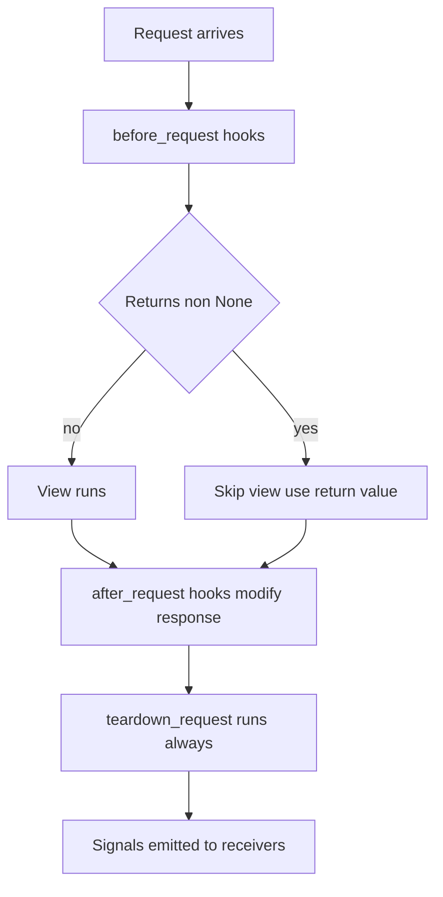

# Hooks and Signals: request lifecycle callbacks and the observer pattern

## English

Flask gives you several ways to run code around a request without stuffing it into every view. The most familiar are the request hooks: `before_request`, `after_request`, and `teardown_request`. A function registered with `before_request` runs before the matched view, and if it returns a non-None value, Flask treats that value as the response and skips the view entirely. This is the classic place to enforce authentication: check the session, and if the user is not logged in, return `redirect(url_for('login'))` or a 401. `after_request` functions run after the view and receive the response object, which they can modify — adding security headers like Content-Security-Policy or a cache-control directive is a typical use. `teardown_request` runs even when the view raised an exception, which makes it the right place to close resources such as database connections or file handles.

Hooks are registered on the application or on a blueprint. Blueprint-level hooks are scoped: a `before_request` on a blueprint runs only for requests that route to that blueprint. This lets you keep authentication logic next to the code it protects instead of piling it into a single global function. Order matters too: app-level `before_request` functions run before blueprint-level ones, and `after_request` functions run in reverse registration order. If you have several hooks, the order in which they execute can be surprising, and it is worth testing explicitly rather than assuming.

Beyond hooks, Flask supports signals through the Blinker library. Signals are a publish-subscribe mechanism: Flask emits a named signal at a particular moment, and any number of receivers can subscribe to it without the emitter knowing who they are. Common signals include `request_started`, `request_finished`, `got_request_exception`, `template_rendered`, and `appcontext_tearing_down`. You connect a receiver with `signal.connect(my_function)`. This is a different pattern from hooks: hooks are imperative and ordered, while signals are decoupled and fire-and-forget. Signals are excellent for cross-cutting concerns like logging, metrics, or audit trails, where you want to add behaviour without changing the code that emits the event.

A useful comparison is to think of hooks as middleware-lite and signals as an event bus. Hooks are the right tool when you need to intercept, modify, or short-circuit a request — authentication, response headers, resource cleanup. Signals are the right tool when you merely want to observe something that happened — count requests, record a template render, log an exception. Mixing them up leads to awkward code: trying to short-circuit a request with a signal does not work, because signals cannot return a response, and putting pure logging into a `before_request` hook couples logging to the request path unnecessarily.

One caution: because signals are synchronous by default, a slow receiver slows down the request. If a signal handler does heavy work, it should hand off to a background queue rather than block. Also, signals are not a substitute for error handling — an exception in a receiver propagates unless you handle it. Used well, hooks and signals together give you a clean separation between the core logic of a view and the surrounding concerns of authentication, observability, and cleanup, which is exactly the kind of separation that keeps a growing Flask application maintainable.

## 中文

Flask 提供幾種方式讓你在請求前後執行程式碼，而不必把它塞進每個 view。最熟悉的是請求掛鉤（request hooks）：`before_request`、`after_request` 和 `teardown_request`。用 `before_request` 註冊的函式會在匹配的 view 之前執行，如果它回傳非 None 的值，Flask 會把那個值當成回應，並完全跳過 view。這是執行身分驗證的經典位置：檢查 session，如果使用者未登入，就回傳 `redirect(url_for('login'))` 或 401。`after_request` 函式在 view 之後執行，並收到 response 物件，可以加以修改——加上 Content-Security-Policy 這類安全標頭或 cache-control 指令就是典型用途。`teardown_request` 即使在 view 拋出例外時也會執行，這使它成為關閉資料庫連線或檔案控制代碼等資源的正確位置。

掛鉤可以註冊在應用程式上，也可以註冊在 blueprint 上。blueprint 層級的掛鉤是有範圍的：blueprint 上的 `before_request` 只會對路由到該 blueprint 的請求執行。這讓你把身分驗證邏輯放在它所保護的程式碼旁邊，而不是全部堆進一個全域函式。順序也很重要：應用層級的 `before_request` 會先於 blueprint 層級的執行，而 `after_request` 則以相反的註冊順序執行。如果你有好幾個掛鉤，它們執行的順序可能會出乎意料，值得明確測試而不是憑假設。

除了掛鉤，Flask 透過 Blinker 函式庫支援訊號（signals）。訊號是一種發布—訂閱機制：Flask 在某個特定時刻發出一個具名訊號，任意數量的接收者都可以訂閱它，而發出者並不知道它們是誰。常見的訊號包括 `request_started`、`request_finished`、`got_request_exception`、`template_rendered` 和 `appcontext_tearing_down`。你用 `signal.connect(my_function)` 連接一個接收者。這和掛鉤是不同的模式：掛鉤是命令式且有順序的，訊號則是解耦的、射後不理。訊號非常適合橫切關注點，例如日誌、指標或稽核軌跡，因為你想在不改動發出事件的程式碼的情況下加上行為。

一個有用的比較是把掛鉤想成輕量版中介軟體，把訊號想成事件匯流排。當你需要攔截、修改或短路一個請求時——身分驗證、回應標頭、資源清理——掛鉤是正確的工具。當你只是想觀察某件已發生的事——計算請求數、記錄模板渲染、記錄例外——訊號才是正確的工具。把兩者搞混會導致彆扭的程式碼：想用訊號短路請求行不通，因為訊號無法回傳回應；而把純日誌放進 `before_request` 掛鉤，則會不必要地把日誌和請求路徑綁在一起。

一個提醒：因為訊號預設是同步的，慢的接收者會拖慢請求。如果某個訊號處理函式做很重的工作，它應該交給背景佇列，而不是阻塞。另外，訊號不能取代錯誤處理——接收者裡的例外會往外傳，除非你處理它。用得好的話，掛鉤和訊號一起能讓 view 的核心邏輯與身分驗證、可觀測性、清理這些周邊關注點乾淨分離，而這正是讓一個不斷成長的 Flask 應用保持可維護的那種分離。

## Key Takeaway

Use request hooks to intercept, modify, or clean up around a request and signals to observe events without coupling, because hooks can short-circuit and are ordered while signals are decoupled and fire-and-forget.

## Related Concepts
- Blinker signals
- before_request and after_request

## Diagram

