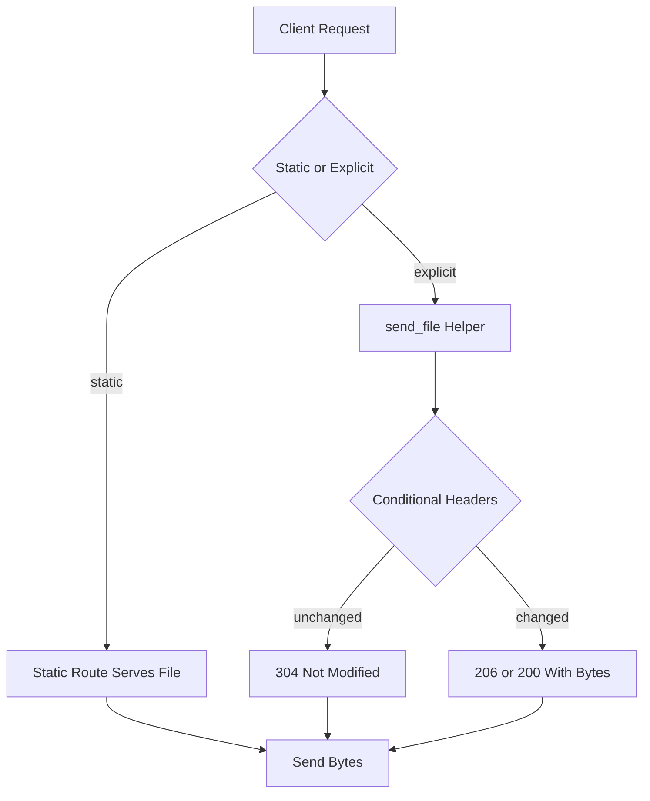

# Static Files, send_file, and Conditional GET Semantics

## English

Every web app eventually has to hand raw bytes to the browser: CSS, images, PDFs, generated CSVs. Flask gives you two doors for this. The first is the automatic static route: when you construct a Flask app with a static folder (default 'static'), Flask registers a rule that serves files from that directory and builds URLs for them via url_for('static', filename='...'). This is convenient but deliberately simple — it is meant for development and for apps where a reverse proxy like Nginx will handle static assets in production anyway. The second door is explicit: the send_file and send_from_directory helpers from flask, which stream a file you choose at runtime, set a mimetype, and optionally attach a download name via the download_name argument so the browser saves rather than renders it.

The interesting part is what send_file does beyond opening a file. It inspects the request headers. If the incoming request carries an If-Modified-Since header and the file's modification time is not newer, Flask responds with 304 Not Modified and an empty body, saving bandwidth. Similarly, it can compute an ETag — a short fingerprint of the file's identity — and honour If-None-Match. This is the machinery of conditional GET: the client asks 'has this changed since I last saw it?', and the server either sends fresh bytes or says 'no'. Browsers and CDNs use it constantly, which is why a page reload often transfers far less than the full payload.

There is a subtlety with ranges. Media players and download managers send a Range header asking for bytes 1000–2000 of a large file so they can resume or seek. send_file supports this when conditional=True is passed, returning 206 Partial Content. Without it, a video element may fail to seek properly. If you are serving user-uploaded media, this flag matters more than you would guess from its name.

Security is the trap here. Never build a path by concatenating user input onto a base directory — '../../etc/passwd' is the classic attack, called path traversal. send_from_directory exists precisely to defuse this: it resolves the requested filename inside the given directory and raises a 404 if the result escapes it. If you must handle paths yourself, Werkzeug's safe_join performs the same containment check. Also remember that send_file takes a path, not an open file object, unless you pass a file-like object explicitly; mixing the two up is a common source of confusing errors.

Finally, caching headers are your lever for performance. Setting max_age (in seconds) on send_file tells browsers and proxies how long they may reuse the response without revalidating. For fingerprinted asset filenames — names that change when content changes — a long max_age is safe and fast. For files whose URL stays constant but content changes, prefer a short max_age plus ETag revalidation so clients pick up updates promptly. Getting this balance right is often the difference between a snappy app and one that re-downloads megabytes on every navigation.

## 中文

每個網頁應用程式最終都要把原始位元組交給瀏覽器：CSS、圖片、PDF、即時產生的 CSV。Flask 為此提供了兩道門。第一道是自動的靜態路由：當你建立 Flask 應用程式並指定靜態資料夾（預設為 'static'）時，Flask 會註冊一條規則，從該目錄提供檔案，並可透過 url_for('static', filename='...') 產生網址。這很方便，但刻意保持簡單——它主要供開發使用，而在正式環境中，通常會由 Nginx 這類反向代理負責處理靜態資源。第二道門則是明確的：flask 的 send_file 與 send_from_directory 輔助函式，讓你在執行時選擇要串流的檔案、設定 mimetype，並可選擇透過 download_name 參數指定下載檔名，使瀏覽器儲存而非直接顯示。

有趣之處在於 send_file 除了開啟檔案之外還做了什麼。它會檢查請求標頭。若進來的請求帶有 If-Modified-Since 標頭，而檔案的修改時間並不較新，Flask 便回應 304 Not Modified 與空的內容主體，節省頻寬。同樣地，它可以計算 ETag——檔案身分的短指紋——並遵循 If-None-Match。這就是條件式 GET 的機制：用戶端問「自從我上次看到之後，這東西有變嗎？」，伺服器則要麼送出新的位元組，要麼回答「沒有變」。瀏覽器與 CDN 無時無刻不在使用它，這也是為什麼重新載入頁面時，傳輸量往往遠少於完整內容。

範圍請求（range）有個微妙之處。媒體播放器與下載管理器會送出 Range 標頭，要求大檔案的第 1000 至 2000 位元組，以便續傳或跳轉。當傳入 conditional=True 時，send_file 支援此功能，回傳 206 Partial Content。若沒有這個旗標，video 元素可能無法正確跳轉。如果你要提供使用者上傳的媒體，這個旗標的重要性遠超過它名字給人的印象。

安全性正是這裡的陷阱。絕不要用字串串接把使用者輸入接到基礎目錄後面——'../../etc/passwd' 是經典攻擊，稱為路徑遍歷（path traversal）。send_from_directory 的存在正是為了化解此問題：它在給定目錄內解析所請求的檔名，若結果逃出該目錄便拋出 404。如果你非得自己處理路徑，Werkzeug 的 safe_join 會執行同樣的範圍檢查。另外要記得，send_file 接受的是路徑，而非已開啟的檔案物件，除非你明確傳入類檔案物件；把兩者搞混是常見且令人困惑的錯誤來源。

最後，快取標頭是你效能的槓桿。在 send_file 上設定 max_age（以秒為單位），告訴瀏覽器與代理它們可以重複使用該回應多久而不必重新驗證。對於帶指紋的資源檔名——內容改變時檔名也跟著改變——較長的 max_age 既安全又快速。對於網址固定但內容會變的檔案，則偏好較短的 max_age 加上 ETag 重新驗證，讓用戶端能及時取得更新。把這個平衡拿捏好，往往就是應用程式反應靈敏與每次導覽都重新下載數 MB 之間的差別。

## Key Takeaway

Use send_from_directory to avoid path traversal, and lean on ETag and max_age so clients revalidate cheaply instead of re-downloading.

## Related Concepts
- HTTP conditional GET
- Path traversal prevention

## Diagram

