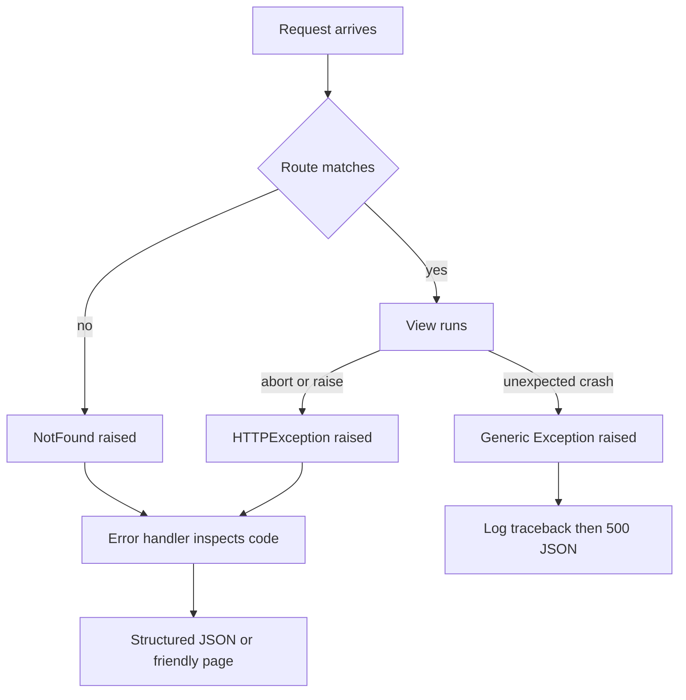

# Error Handling: HTTPException, Custom Handlers, and Failure Modes

## English

Things go wrong, and Flask's error story is more structured than a try/except around every view. The foundation is Werkzeug's HTTPException: when a route does not match, Flask raises a NotFound; when you call abort(403), it raises a Forbidden. These are exceptions that also carry a response — a status code, headers, and usually an HTML or JSON body. Because they are exceptions, they propagate up the stack until something handles them, which is exactly what error handlers are for.

The workhorse is @app.errorhandler(code_or_exception). Registering a handler for 404 lets you render a friendly page instead of the default plain one; registering for 500 lets you log the failure and show a generic apology. You can also register handlers for exception classes, such as a custom ValidationError, so that raising it anywhere in a view produces a consistent 400 response. Handlers receive the exception instance, so you can inspect it — but be careful not to leak internals like stack traces or database messages to clients, since those are a reconnaissance gift to attackers.

One of the most useful patterns is a JSON error handler for APIs. A single handler registered for HTTPException can inspect e.code and return structured JSON with an error key and message, so every failure — bad route, forbidden, unprocessable — looks the same to the client. Pair this with a handler for generic Exception to convert unexpected crashes into a 500 JSON body while still logging the traceback server-side. Keep the client-facing message vague and the server-side log detailed.

Debug mode changes everything. With app.debug on, Flask propagates exceptions to the interactive debugger and shows tracebacks in the browser; error handlers for 500 are effectively bypassed because the exception is re-raised. This is wonderful locally and catastrophic in production, because the debugger can execute arbitrary code. Production deployments must run with debug off, and the werkzeug debugger PIN should never be exposed. This is why configuration discipline — environment variables, separate config classes — matters so much.

Finally, distinguish client errors from server errors in your design. A 4xx means the request was wrong: missing field, expired token, unknown ID. A 5xx means your code failed. Logging 4xx as alarms creates noise; logging 5xx as debug hides real outages. Flask lets you route both through handlers, but the semantics are yours to keep straight. A common mistake is returning 200 with an error field in the body — technically it works, but it breaks caching, monitoring, and every client that checks status codes. Let the status code carry the meaning.

## 中文

事情總會出錯，而 Flask 的錯誤處理機制比在每個檢視函式中包 try/except 更有結構。基礎是 Werkzeug 的 HTTPException：當路由不匹配時，Flask 拋出 NotFound；當你呼叫 abort(403) 時，它拋出 Forbidden。這些是同時攜帶回應的例外——狀態碼、標頭，通常還有 HTML 或 JSON 內容主體。因為它們是例外，所以會沿著堆疊往上傳播，直到有東西處理它們為止，而這正是錯誤處理器的用途。

主力是 @app.errorhandler(code_or_exception)。為 404 註冊處理器，讓你呈現友善的頁面而非預設的純文字頁；為 500 註冊，讓你記錄失敗並顯示通用的道歉訊息。你也可以為例外類別註冊處理器，例如自訂的 ValidationError，這樣在任何檢視函式中拋出它，都會產生一致的 400 回應。處理器會收到例外實例，所以你可以檢查它——但要小心別把堆疊追蹤或資料庫訊息等內部細節洩漏給用戶端，因為那等於送給攻擊者一份偵察大禮。

最有用的模式之一，是為 API 設計 JSON 錯誤處理器。為 HTTPException 註冊單一處理器，便能檢查 e.code 並回傳帶有 error 鍵與 message 的結構化 JSON，如此一來每個失敗——錯誤路由、禁止存取、無法處理——對用戶端而言看起來都一樣。再搭配一個處理一般 Exception 的處理器，把非預期的崩潰轉成 500 的 JSON 內容主體，同時仍在伺服器端記錄堆疊追蹤。讓面向用戶端的訊息保持模糊，伺服器端的記錄則保持詳盡。

除錯模式會改變一切。當 app.debug 開啟時，Flask 會把例外傳播給互動式除錯器，並在瀏覽器中顯示堆疊追蹤；500 的錯誤處理器實際上會被繞過，因為例外被重新拋出。這在本機很棒，在正式環境卻是災難，因為除錯器可以執行任意程式碼。正式部署必須關閉除錯，而 werkzeug 除錯器的 PIN 絕不該暴露。這就是為什麼配置紀律——環境變數、分開的配置類別——如此重要。

最後，在設計上區分用戶端錯誤與伺服器錯誤。4xx 表示請求有問題：缺少欄位、權杖過期、未知 ID。5xx 表示你的程式碼失敗了。把 4xx 當成警報來記錄只會製造噪音；把 5xx 當成除錯訊息來記錄則會掩蓋真正的故障。Flask 讓你用處理器把兩者都導向，但語意得由你自己保持清楚。常見的錯誤是回傳 200 並在內容主體裡放一個 error 欄位——技術上可行，但會破壞快取、監控，以及每一個會檢查狀態碼的用戶端。讓狀態碼承載意義吧。

## Key Takeaway

Register handlers for HTTPException and generic Exception, keep client messages vague while logging details server-side, and never run with debug on in production.

## Related Concepts
- Werkzeug HTTPException
- HTTP status code semantics

## Diagram

